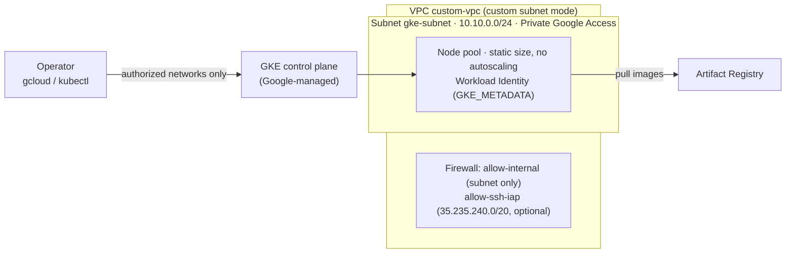

# ☁️ GCP Custom VPC + GKE Deployment (gcloud CLI)

A single-subnet custom VPC and a **public, zonal, small** GKE Standard cluster, created with one idempotent script ([`gcp-infra.sh`](gcp-infra.sh)) or the equivalent `gcloud` commands below. The same script builds the cluster for the guarded Hermes deployment in [`../sandbox/k8s/`](../sandbox/k8s/README.md).

> 🧪 **Status:** `gcp-infra.sh` created the `hermes-gke` cluster (GKE 1.36.4-gke.2046003, 2 × `e2-standard-2` Ubuntu, Dataplane V2, zonal `us-central1-b`) in a fresh project on **2026-11-07**; `--dry-run` re-checked the same day. The default profile (3 × `e2-medium`, COS) is unchanged and was not rebuilt that day.

## 🏗️ Architecture



| Component | Name | What it does | Where defined |
|---|---|---|---|
| VPC | `custom-vpc` | Custom-mode network, regional routing | `gcp-infra.sh` step 2 |
| Subnet | `gke-subnet` | `10.10.0.0/24` for nodes (pod/service ranges auto, VPC-native), Private Google Access | step 3 |
| Firewall | `custom-vpc-allow-internal` | tcp/udp/icmp from the subnet only | step 4 |
| Firewall | `custom-vpc-allow-ssh-iap` | SSH from Google IAP's range only (skip with `--no-ssh-iap`) | step 4 |
| Cluster | `gke-cluster` (default) / `hermes-gke` | Zonal GKE Standard, static node pool, Workload Identity, authorized networks | step 5 |

### GKE cluster settings

| Property | Default | Hermes profile | Why |
|---|---|---|---|
| Location | zonal `us-central1-a` | zonal `us-central1-b` (`-c` on a stockout) | A regional cluster puts the node count in every zone (3×) |
| Machine type × nodes | `e2-medium` × 3 (6 vCPU) | `e2-standard-2` × 2 (4 vCPU / 16 GB) | Small and predictable |
| Node image | GKE default (COS) | `UBUNTU_CONTAINERD` | OpenShell needs Landlock, which COS lacks |
| Network policy | none | Dataplane V2 (creation time only) | NetworkPolicies enforced |
| Boot disk | 100 GB `pd-standard` | 30 GB `pd-balanced` | |
| Autoscaling / Spot | off / off | off / off | Exact node count, no preemption |
| Release channel | `regular` | `regular` | Managed upgrades |
| Workload Identity | on (`GKE_METADATA`) | on | Google API access without node keys |
| Control plane access | `0.0.0.0/0` | your IP `/32` | Lock it down for anything real |

## ✅ Prerequisites

| Need | Version / note |
|---|---|
| Google Cloud CLI | current release, with `gke-gcloud-auth-plugin` |
| `kubectl` | within one minor version of the cluster (1.36) |
| Permissions | create networks, firewall rules and GKE clusters in the project |
| Quota | default profile 6 vCPU, Hermes profile 4 vCPU (6 during a surge upgrade) in one region; check `gcloud compute regions describe us-central1` first |

```bash
gcloud auth login
gcloud projects list                       # find the project ID
gcloud config set project <PROJECT_ID>
```

## 🚀 Deploy

### ⚡ One command (recommended)

```bash
./gcp-infra.sh --dry-run --project <PROJECT_ID>   # print every gcloud command, change nothing
./gcp-infra.sh --project <PROJECT_ID>             # create (5-10 min); idempotent, re-run after a partial failure
./gcp-infra.sh --help                             # all flags
```

It enables the APIs, creates the VPC, subnet, firewall rules and cluster, runs `get-credentials`, then prints the cluster, the Workload Identity pool and `kubectl get nodes`. Every value can be overridden (`--zone`, `--machine-type`, `--num-nodes`, `--master-networks`, …).

> 🔒 Pass your own CIDR for the control plane: `--master-networks "$(curl -s https://checkip.amazonaws.com)/32"`.

### 🛡️ Hermes + NVIDIA OpenShell profile

For the guarded Hermes deployment ([`../sandbox/k8s/README.md` → Part 1](../sandbox/k8s/README.md#️-part-1-hermes-in-nvidia-openshell-on-gke-live-deployment)):

| Option / variable | Why |
|---|---|
| `--image-type UBUNTU_CONTAINERD` | **Landlock**: COS kernels are built without it (tested on COS 125: `landlock_create_ruleset` → `ENOSYS`; see [Landlock and Ubuntu vs COS](../sandbox/k8s/README.md#-landlock-and-why-the-nodes-are-ubuntu-not-cos)) |
| `--dataplane-v2` | NetworkPolicies enforced (Cilium); creation time only |
| `--system-config-from-file ../sandbox/k8s/gke/node-system-config.yaml` | kubelet `podPidsLimit: 2048` |
| `--no-ssh-iap` | Skip the SSH-from-IAP rule (no SSH needed) |
| `RELEASE_CHANNEL=… CLUSTER_VERSION=…` | Pin a GKE version valid in that channel (`gcloud container get-server-config --zone <zone>`) |
| `GCP_APIS="…"` | Enable only the listed APIs (default: container, artifactregistry, compute, iamcredentials) |

```bash
cd gcp
CLUSTER_NAME=hermes-gke ZONE=us-central1-b MACHINE_TYPE=e2-standard-2 NUM_NODES=2 DISK_TYPE=pd-balanced DISK_SIZE=30 \
MASTER_AUTHORIZED_NETWORKS="$(curl -s https://checkip.amazonaws.com)/32" \
GCP_APIS="container.googleapis.com artifactregistry.googleapis.com compute.googleapis.com" \
./gcp-infra.sh --project <PROJECT_ID> --image-type UBUNTU_CONTAINERD --dataplane-v2 --no-ssh-iap \
  --system-config-from-file ../sandbox/k8s/gke/node-system-config.yaml
```

If a zone reports *"does not have enough resources"*, delete the failed cluster and use the next zone (`-b`, `-c`, `-f`).

### 🔧 What the script runs (manual equivalent)

```bash
export PROJECT_ID=<PROJECT_ID> REGION=us-central1 ZONE=us-central1-a
export VPC_NAME=custom-vpc SUBNET_NAME=gke-subnet SUBNET_RANGE=10.10.0.0/24 CLUSTER_NAME=gke-cluster

# 1. APIs
gcloud services enable container.googleapis.com compute.googleapis.com iamcredentials.googleapis.com --project=$PROJECT_ID

# 2-3. VPC and subnet (Private Google Access: nodes reach Google APIs privately)
gcloud compute networks create $VPC_NAME --project=$PROJECT_ID --subnet-mode=custom --bgp-routing-mode=regional
gcloud compute networks subnets create $SUBNET_NAME --project=$PROJECT_ID --region=$REGION --network=$VPC_NAME \
  --range=$SUBNET_RANGE --enable-private-ip-google-access

# 4. Firewall: internal traffic, and SSH only from Google IAP (never 0.0.0.0/0 on :22)
gcloud compute firewall-rules create ${VPC_NAME}-allow-internal --project=$PROJECT_ID --network=$VPC_NAME \
  --allow=tcp,udp,icmp --source-ranges=$SUBNET_RANGE --priority=1000
gcloud compute firewall-rules create ${VPC_NAME}-allow-ssh-iap --project=$PROJECT_ID --network=$VPC_NAME \
  --allow=tcp:22 --source-ranges=35.235.240.0/20 --priority=1000

# 5. Cluster: static on-demand pool, Workload Identity, authorized networks
gcloud container clusters create $CLUSTER_NAME --project=$PROJECT_ID --zone=$ZONE \
  --network=$VPC_NAME --subnetwork=$SUBNET_NAME --release-channel=regular \
  --machine-type=e2-medium --num-nodes=3 --disk-type=pd-standard --disk-size=100 \
  --enable-ip-alias --workload-pool=${PROJECT_ID}.svc.id.goog --workload-metadata=GKE_METADATA \
  --enable-master-authorized-networks --master-authorized-networks=<YOUR_IP>/32

# 6. kubectl credentials
gcloud container clusters get-credentials $CLUSTER_NAME --project=$PROJECT_ID --zone=$ZONE
```

GKE creates the firewall rules for LoadBalancer Services and health checks itself; nothing else is opened.

## 🛡️ Security model

| Threat | Control | How it's enforced | Check |
|---|---|---|---|
| Anyone on the internet uses the Kubernetes API | Authorized networks on the control plane | `--enable-master-authorized-networks --master-authorized-networks=<CIDR>` | `gcloud container clusters describe … --format='value(masterAuthorizedNetworksConfig)'` |
| SSH to nodes from the internet | Only Google IAP's range on :22, or no SSH rule at all | `allow-ssh-iap` / `--no-ssh-iap` | `gcloud compute firewall-rules list` |
| Workloads use the node's service account key | Workload Identity, GKE metadata server on every node | `--workload-pool`, `--workload-metadata=GKE_METADATA` | `describe … --format='yaml(workloadIdentityConfig)'` |
| Lateral traffic between pods | NetworkPolicies (Hermes profile) | Dataplane V2 | See [`../sandbox/k8s/README.md` → Verify](../sandbox/k8s/README.md#-verify) |
| Surprise cost or quota exhaustion | Zonal, static node count, no autoscaling | Script defaults | `gcloud container clusters list` |

**Not protected here:** the nodes have public IPs (no Cloud NAT, no private cluster); the default `0.0.0.0/0` for the control plane is for throwaway projects only; application security is the workload's job (see the Hermes README).

## 🩺 Operations

| Task | How |
|---|---|
| Health | `gcloud container clusters list`; `kubectl get nodes` (all `Ready`) |
| Logs | Cloud Logging (GKE system and container logs); `kubectl logs` per pod |
| Resize (static pool) | `gcloud container clusters resize <cluster> --node-pool default-pool --num-nodes <n> --zone <zone>` |
| Upgrades | Managed by the release channel; a surge upgrade briefly adds one node |
| Capacity | `kubectl describe nodes` → "Allocated resources" (requests vs allocatable) |

| Symptom | Cause | Fix |
|---|---|---|
| `does not have enough resources` on create | Zone stockout | Delete the failed cluster, use the next zone |
| `No project` | No project set | `gcloud config set project <PROJECT_ID>` |
| `kubectl` cannot reach the cluster | Your IP is not in the authorized networks | `gcloud container clusters update <cluster> --zone <zone> --enable-master-authorized-networks --master-authorized-networks <IP>/32` |
| `docker push` to Artifact Registry fails with a credential helper error | Docker config names a helper this machine lacks | Use a separate `DOCKER_CONFIG` with `{"credHelpers":{"us-central1-docker.pkg.dev":"gcloud"}}` |

## 🧪 Tests

| Date | Check | Result |
|---|---|---|
| 2026-11-07 | `./gcp-infra.sh --dry-run --project example-project` | 7 `gcloud` commands printed (APIs, VPC, subnet, 2 firewall rules, cluster, credentials), nothing created |
| 2026-11-07 | Hermes profile in a fresh project | Cluster `hermes-gke` created in `us-central1-b`, GKE 1.36.4-gke.2046003, 2 nodes `Ready`, Ubuntu 24.04.5, Dataplane V2 (`ADVANCED_DATAPATH`), Workload Identity pool set, autoscaling off |

## 🧹 Teardown

```bash
gcloud container clusters delete <cluster> --zone <zone>
gcloud compute firewall-rules delete custom-vpc-allow-internal custom-vpc-allow-ssh-iap
gcloud compute networks subnets delete gke-subnet --region us-central1
gcloud compute networks delete custom-vpc
```

For the Hermes stack, also see [`../sandbox/k8s/README.md` → Teardown](../sandbox/k8s/README.md#-teardown).

## 🔐 Hermes dashboard credentials (GKE)

Hermes on GKE uses Hermes's own login (Traefik allows only Cloudflare and rate-limits sign-in) with GKE-only credentials kept in `~/.config/hermes-sandbox/gke/` (folder `700`, files `600`), never in Kubernetes output or git:

- **How to log in, where each password lives, and how to rotate them:** [`../sandbox/k8s/README.md` → How to log in](../sandbox/k8s/README.md#-how-to-log-in).
- **Creating the credentials from scratch:** [Build it, step 3](../sandbox/k8s/README.md#-build-it-step-by-step).
- **Every Kubernetes Secret, what uses it and how to rotate it:** [Kubernetes Secrets](../sandbox/k8s/README.md#-kubernetes-secrets).

> Never print a Secret's value or put a password on a command line (`--from-literal`, `echo`); create Secrets from files or stdin.

## 📌 Pinned versions and references

| Item | Value |
|---|---|
| GKE | release channel `regular` (1.36 at the last build); pin with `CLUSTER_VERSION` |
| Node image | default COS; `UBUNTU_CONTAINERD` for the Hermes profile |
| Region / zone | `us-central1` / `us-central1-a` (Hermes: `-b`) |

**References:** [GKE cluster architecture](https://cloud.google.com/kubernetes-engine/docs/concepts/cluster-architecture) · [Authorized networks](https://cloud.google.com/kubernetes-engine/docs/how-to/authorized-networks) · [Workload Identity Federation for GKE](https://cloud.google.com/kubernetes-engine/docs/concepts/workload-identity) · [Dataplane V2](https://cloud.google.com/kubernetes-engine/docs/concepts/dataplane-v2) · [GKE node images](https://cloud.google.com/kubernetes-engine/docs/concepts/node-images) · [IAP TCP forwarding](https://cloud.google.com/iap/docs/using-tcp-forwarding)
