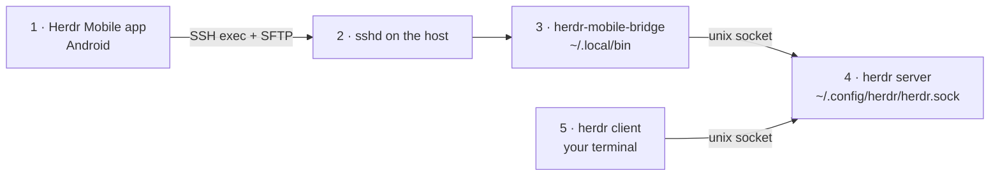

# 🐑 herdr: Terminal Workspace Manager for AI Coding Agents

[herdr](https://herdr.dev) runs your AI coding agents side by side in persistent workspaces, tabs and panes, and you
can attach to them from anywhere, including your phone. 🚀✨

This folder covers how to **install herdr** and how to get the **Herdr Mobile** Android app connected over SSH,
including a fix for a zsh issue that stops the app finding your sessions. 📱

**Status:** tested with herdr 0.9.5 on Linux x86_64 (zsh login shell) and the Herdr Mobile Android app, which
installed herdr-mobile-bridge 0.4.1 on the host (checked 2026-11-07). Not tested: macOS, Windows, Linux aarch64.

## 📁 Files

```text
herdr/
├── README.md                       # 👈 You are here
└── hermes-herdr/                   # 🤖 POC: herdr driving Hermes Agent in hardened containers
```

🤖 **herdr + Hermes Agent POC:** [hermes-herdr/README.md](hermes-herdr/README.md) shows herdr running Hermes Agent
as a recognized agent (`hermes`) in hardened containers, with Hermes's own guardrails locked, an OS-enforced herdr
allowlist for its one skill, and end-to-end tests.

## 🏗️ Architecture



| # | Component | One line |
|---|---|---|
| 1 | Herdr Mobile app | Logs in over SSH, uploads the bridge, lists sessions and opens one; no relay, no cloud account. |
| 2 | sshd | The only way in from the phone: SSH exec for commands, the `sftp` subsystem for the bridge upload. |
| 3 | herdr-mobile-bridge | Small binary the app installs and runs (`sessions --json`, `stdio --session <name>`). |
| 4 | herdr server | Holds the workspaces, tabs and panes; reached only through its socket, owned by your user. |
| 5 | herdr client | `herdr` in a local terminal attaches to the same server and sessions. |

## 🧩 Components

| Name | What it does | Where defined | Security role |
|---|---|---|---|
| herdr | Client and server binary | `~/.local/bin/herdr` (direct install) | runs as your user |
| herdr server socket | Local API the clients and the bridge use | `~/.config/herdr/herdr.sock` | unix socket in your home, owned by your user |
| herdr-mobile-bridge | Connects the app's SSH session to the herdr socket | `~/.local/bin/herdr-mobile-bridge` | uploaded by the app, checked against a SHA-256 checksum |
| sshd + sftp | Remote access for the app | `/etc/ssh/sshd_config` | the only exposed service; key auth, LAN/VPN only |
| zsh fix | Puts herdr on `PATH` for non-interactive SSH and fixes the discovery glob | `~/.zshenv` | appends to `PATH`; glob change scoped to the bridge's commands |

## 💻 Supported Platforms

- 🐧 Linux: `x86_64` and `aarch64`
- 🍎 macOS: Intel (`x86_64`) and Apple silicon (`aarch64`)
- 🪟 Windows: `x86_64`. Windows ARM64 runs the x86_64 build under emulation.

Sizing: herdr is a single binary (about 30 MB) and runs as your user next to your agents; no extra services.

## ⚡ Quick Install

### 🐧 Linux / 🍎 macOS

```bash
curl -fsSL https://herdr.dev/install.sh | sh
herdr
```

### 🪟 Windows (PowerShell)

```powershell
powershell -ExecutionPolicy Bypass -c "irm https://herdr.dev/install.ps1 | iex"
herdr
```

If endpoint security blocks the PowerShell command, use **Command Prompt** instead:

```cmd
curl.exe -fsSLo install.cmd https://herdr.dev/install.cmd && install.cmd && del install.cmd
herdr
```

## 📦 Package Managers

```bash
# 🍺 Homebrew
brew install herdr

# 🧰 mise (if mise says herdr isn't in its registry, update mise first)
mise use -g herdr
mise use -g github:herdrdev/herdr      # temporary fallback

# ❄️ Nix (pinned release tag)
nix run github:herdrdev/herdr/v0.9.5
nix profile install github:herdrdev/herdr/v0.9.5
```

> 💡 Package-manager installs update through their own package manager, **not** through `herdr update`.

## 🛠️ Manual Install (Linux / macOS)

Download the binary for your platform from the [GitHub releases](https://github.com/herdrdev/herdr/releases):

| Platform | Asset |
|---|---|
| 🐧 Linux x86_64 | `herdr-linux-x86_64` |
| 🐧 Linux aarch64 | `herdr-linux-aarch64` |
| 🍎 macOS Intel | `herdr-macos-x86_64` |
| 🍎 macOS Apple silicon | `herdr-macos-aarch64` |
| 🪟 Windows x86_64 | `herdr-windows-x86_64.zip` |

Then make it executable and put it on your `PATH`:

```bash
chmod +x herdr-linux-x86_64
mkdir -p ~/.local/bin
mv herdr-linux-x86_64 ~/.local/bin/herdr
```

> 🪟 On Windows, extract the **whole** zip and keep `herdr.exe` next to its ConPTY runtime files. Don't copy only
> the `.exe`.

## ✅ Verify

```bash
herdr --version   # → herdr 0.9.5
herdr status      # → client and server blocks; the server shows "status: running" once herdr has started
```

## 🚀 First Launch

Run herdr from a project directory. It creates a workspace automatically and shows onboarding on the first run:

```bash
cd ~/my-project
herdr
```

🐚 Optional shell completion (zsh):

```bash
mkdir -p ~/.zfunc
herdr completion zsh > ~/.zfunc/_herdr
```

Then make sure `~/.zshrc` adds the folder to `fpath` **before** `compinit` runs:

```zsh
fpath=(~/.zfunc $fpath)
autoload -Uz compinit && compinit
```

## 🔁 Update

```bash
herdr update                      # direct installs only
herdr update --handoff            # experimental: keep running servers via live handoff
herdr channel set preview         # opt into preview builds
herdr channel set stable          # back to stable (default)
```

By default `herdr update` leaves running servers alive. Restart herdr to reconnect with the new client.

## 📱 Herdr Mobile (Android) Over SSH

The [Herdr Mobile](https://play.google.com/store/apps/details?id=dev.herdr.mobile) app connects **directly over
SSH**, with no relay and no cloud account. After you log in, it:

1. 🔍 runs an environment probe (CPU type, bridge version, location of the `herdr` binary)
2. 📥 uploads `herdr-mobile-bridge` to `~/.local/bin/`, checking it against a SHA-256 checksum
3. 📋 lists your herdr sessions with `herdr-mobile-bridge sessions --json`
4. 🔌 opens the session with `herdr-mobile-bridge stdio --session <name>`

### 🧾 Host Checklist

- 🔐 `sshd` is running and the phone can reach it (LAN, VPN, ZeroTier or Tailscale)
- 🐑 herdr is running on the host (`~/.config/herdr/herdr.sock` exists)
- 📂 the `sftp` subsystem is enabled in `sshd` (Ubuntu enables it by default)
- 👤 you log in as the **same user** that runs herdr

```bash
systemctl is-active ssh
test -S ~/.config/herdr/herdr.sock && echo "herdr socket OK ✅"
```

## 🛡️ Security

- `curl | sh` runs a remote script: read <https://herdr.dev/install.sh> first, or use the
  [manual install](#️-manual-install-linux--macos) with the release asset.
- The mobile app needs SSH to the host: expose `sshd` only on your LAN or a VPN (Tailscale, ZeroTier), key auth only.
- The app checks the bridge upload against a SHA-256 checksum.
- `~/.local/bin` is appended to `PATH`, never prepended, so it can't override system commands; keep it `chmod 755`.
- The debug log (see [Troubleshooting](#-troubleshooting)) records every SSH command: create it mode 600 and delete
  it after use.

## 🩺 Troubleshooting

| Symptom | Cause | Fix |
|---|---|---|
| App: "Can't read the session list" | herdr not on `PATH` for non-interactive SSH | append `~/.local/bin` in `~/.zshenv` ([Fix](#️-fix)) |
| same | zsh `NOMATCH` stops the discovery glob | `unsetopt NOMATCH` for `herdr-mobile-bridge` commands ([Fix](#️-fix)) |
| still failing after the fix | a later step fails | log what the app runs ([Still Failing?](#️-still-failing-log-what-the-app-runs)) |

### ❌ "无法读取服务器上的 session 列表" / "Can't read the session list on the server"

The app says SSH connected but `herdr-mobile-bridge sessions --json` returned nothing usable, and the bridge never
shows up in `~/.local/bin/`.

#### 🔎 Cause 1: `herdr` isn't on the `PATH` for non-interactive SSH

The app runs commands over SSH exec, **not** an interactive login. With zsh as the login shell, only `~/.zshenv` is
read, so `~/.local/bin` (where the installer puts `herdr`) is missing from `PATH`.

Check it:

```bash
env -i HOME=$HOME zsh -c 'command -v herdr || echo "herdr NOT on PATH ❌"'
```

#### 🔎 Cause 2: zsh stops the app's discovery script when a wildcard matches nothing

The app's discovery script is written for POSIX `sh` and loops over `~/.config/herdr/sessions/*/`. If you have no
named sessions, that folder doesn't exist. `sh` just keeps the unmatched pattern and carries on, but zsh fails with
`no matches found` and **stops the whole script** before it reports the `default` session.

Reproduce it:

```bash
zsh -c 'for d in ~/.config/herdr/sessions/*/; do :; done; echo herdr-discovery=done'
# zsh:1: no matches found: /home/you/.config/herdr/sessions/*/   ❌

sh -c 'for d in ~/.config/herdr/sessions/*/; do :; done; echo herdr-discovery=done'
# herdr-discovery=done   ✅
```

#### 🛠️ Fix

Back up `~/.zshenv` once, then add both lines. It's safe to re-run: the backup is only made the first time, and the
lines are only added if they aren't already there.

```bash
touch ~/.zshenv
[ -e ~/.zshenv.bak-herdr-mobile ] || cp ~/.zshenv ~/.zshenv.bak-herdr-mobile

grep -q 'herdr-mobile: POSIX glob' ~/.zshenv || cat >> ~/.zshenv <<'EOF'
# 🐑 herdr-mobile: make herdr visible to non-interactive SSH
case ":$PATH:" in *":$HOME/.local/bin:"*) ;; *) export PATH="$PATH:$HOME/.local/bin" ;; esac
# 🐑 herdr-mobile: POSIX glob behavior, scoped to the app's commands only
if [[ -n ${SSH_CONNECTION-} && ! -o interactive && ${ZSH_EXECUTION_STRING-} == *herdr-mobile-bridge* ]]; then unsetopt NOMATCH NULL_GLOB CSH_NULL_GLOB; fi
EOF

zsh -n ~/.zshenv && echo "syntax OK ✅"
```

- 🧷 `~/.local/bin` is **appended** to `PATH`, so it can't override system commands.
- 🎯 The glob change only applies to non-interactive SSH commands that mention `herdr-mobile-bridge`. Your normal
  shell and other scripts keep zsh's default behavior.

Then tap **重试 / Retry** in the app. It should install the bridge and list your `default` session. 🎉

```bash
~/.local/bin/herdr-mobile-bridge --version   # → herdr-mobile-bridge 0.4.1 (the app sets the version)
```

#### 🕵️ Still Failing? Log What the App Runs

Temporarily log every non-interactive SSH command to see exactly which step fails. The log goes in a private file in
your home directory, readable only by you:

```bash
install -m 600 /dev/null ~/.herdr-mobile-ssh.log
echo '[[ -n $SSH_CONNECTION && ! -o interactive ]] && print -r -- "$(date +%T) [$$] ${ZSH_EXECUTION_STRING:-<no command>}" >> ~/.herdr-mobile-ssh.log  # TEMP herdr-mobile debug' >> ~/.zshenv
```

Tap **Retry**, then read `~/.herdr-mobile-ssh.log`. When you're done, **remove the debug line and the log**. It
records every SSH command:

```bash
# 🐧 Linux (GNU sed)
sed -i '/TEMP herdr-mobile debug/d' ~/.zshenv; rm -f ~/.herdr-mobile-ssh.log

# 🍎 macOS (BSD sed)
sed -i '' '/TEMP herdr-mobile debug/d' ~/.zshenv; rm -f ~/.herdr-mobile-ssh.log
```

> 🔒 Optional hardening: `chmod 755 ~/.local/bin`. The bridge runs from there, so it shouldn't be group- or
> world-writable.

## 🐞 Known issues

Issues found while testing herdr with Hermes Agent (2026-11-07). POC = [hermes-herdr/](hermes-herdr/README.md); dashboards = herdr inside the OpenShell sandbox (VM and GKE).

| # | Issue | Applies to | Status | Mitigation / fix |
|---|---|---|---|---|
| K1 | The agent can stop herdr with a `kill` wrapped in an allowed `herdr pane run` command (quoting gets past the `* kill *` deny glob; the pane shell has the same uid) | dashboards | open | herdr is supervised by the workload's main process, so a kill restarts Hermes + herdr together (~50 s, open chats drop); planned: deny globs `*pane run *kill *`, `*'kill *`, `*"kill *` |
| K2 | A plain `kill <pid>` of herdr or its restart loop was allowed without a prompt | dashboards | fixed | deny globs `kill *`, `* kill *`, `*;kill *`, `*/kill *`, `*pkill *`, `*killall *` + supervised herdr (regression test on GKE: 13/13) |
| K3 | Raw work-pane scrollback isn't redacted: herdr stores what the shell printed | POC, dashboards | by design | keep secrets out of the workbench and panes; Hermes masks what it shows and stores (tests 16-18) |
| K4 | Tool-call arguments are stored verbatim in the session store (`state.db`); upstream removed storage-time argument redaction (hermes-agent #43083) | POC, dashboards | open (upstream) | never put a secret on a command line |
| K5 | A `password=` value in the middle of a line is not masked by Hermes's redactor | POC, dashboards | open (upstream) | same as K4 |
| K6 | `approvals.deny` globs are string matches: quoting and indirection (`herdr "agent" …`, `h=herdr; $h …`) pass them | POC, dashboards | by design | the exact-argv broker/allowlist is the control (test 10); globs are defence in depth |
| K7 | Single trusted operator only: the broker checks argv, not who owns a pane | POC, dashboards | by design | one work herdr per trust domain |
| K8 | The POC has no OpenShell/Landlock hard sandbox (Docker + SSH + egress proxy only) | POC | by design | use the OpenShell dashboard path for anything beyond a lab |
| K9 | The lab VM was stopped by the lab at 11:30 UTC and restarted at 12:27 UTC with a new public IP (data, images and containers intact); runs in flight were lost | VM | by design (lab) | resume from frozen test copies; keep ≥ 3 GB free and prune the build cache after every build; nothing in the POC depends on the VM's IP |
| K10 | `hermes curator lock` (skill lock) exists only on Hermes v0.23.0+; on v0.22.5 the skill is protected by the read-only image alone | POC, dashboards | by design | run v0.23.0 (default); the POC entrypoint refuses to start if the lock fails |
| K11 | Last full POC pass (15/15 ×3) was on Hermes v0.22.5; the v0.23.0 re-run and the first run of tests 16-19 were pending | POC | fixed | v0.23.0: final suite 19/19 in one VM run (run 37); an earlier suite revision 19/19 in two consecutive runs |
| K12 | `HERDR=1 sandbox/scripts/up.sh` (herdr in the VM dashboard) was not on `main` yet | VM | fixed | on `main` (`sandbox/scripts/up.sh`, `herdr-roll.sh`, `herdr-verify.sh`) |
| K13 | The model key was in pid 1's environment and `docker inspect` | POC | fixed | key is a read-only file `/run/secrets/nvidia_api_key`; the entrypoint refuses `NVIDIA_API_KEY` in env; verified on v0.23.0 by tests 6 (no process outside Hermes holds it, 0 in `docker inspect`) and 19 (0 in 10 locations) |
| K14 | In the dashboards herdr, Hermes and pane shells share uid 10000: any same-uid process can talk to the herdr socket directly (or run the real binary in libexec), so the `herdr` allowlist and deny globs are not a boundary there | dashboards | by design | the OpenShell sandbox (Landlock, seccomp, network policy) is the boundary; the POC keeps herdr in a separate container instead |
| K15 | herdr's `[update] version_check` / `manifest_check` default to on; neither deployment writes a herdr `config.toml` | POC, dashboards | open (low) | the calls fail closed today (POC egress allowlist, OpenShell deny-by-default); planned: ship a `config.toml` with both off |
| K16 | herdr's `blocked` state is best effort: an approval screen it doesn't recognise shows as `idle`, and an invalid detection override falls back silently to herdr's bundled rules | POC | by design / open | herdr's own docs: idle is not authorization to approve; never auto-approve from state; planned: start-up check that the `hermes` override loaded |
| K17 | The dashboards' managed config pins only `approvals`, `command_allowlist` and `skills`: toolsets (web, browser, code execution, delegation, cron, memory), turn/time budgets, memory write approval, curator, redaction and private-URL settings stay at user-changeable defaults, and the herdr skill isn't curator-locked | dashboards | open | add the POC's managed keys (`platform_toolsets`, `agent.disabled_toolsets`, `max_turns`, `run_budget_seconds`, `security.*`, `memory`, `curator`) to `sandbox/k8s/gke/herdr/hermes-managed.yaml` and lock the skill in `start-hermes-herdr.sh`; OpenShell remains the boundary |
| K18 | Hermes declines to echo a secret-like value typed into the prompt (e.g. `TEST_API_KEY=sk-…`) | POC, dashboards | by design (guardrail) | the redaction tests put the fake value in a fixture file and the prompt names only the file (`scripts/e2e-redaction.sh`, tests 17-18) |
| K19 | An interrupted test run can leave a denied command in the Hermes session; the model then declines instead of asking, so test 3 sees no approval prompt | POC | fixed | `scripts/e2e-test.sh` restarts `herdr-hermes` first, which starts a fresh session and keeps the data |
| K20 | Hermes doesn't redact the model's reasoning: it is stored as written in `state.db` (`reasoning`, `reasoning_content`) and by default streamed into the pane; in e2e run 17 the model worked out a split fake key and wrote it there (tool output, answer and logs stayed masked) | POC, dashboards | pane: fixed (POC); storage: open (upstream) | managed `display.show_reasoning: false` (entrypoint refuses to start without it); treat `/data` as secret |
| K21 | The Hermes process must read the model key, so an operator shell in `herdr-hermes` (`docker exec`) can read the key file | POC | by design | 0 copies in the workbench and work containers (tests 6, 19); the key never enters the agent's command environment |
| K22 | When OpenShell restarts the dashboard sandbox (kill-guard recovery, crash), the host-loopback forwards `127.0.0.1:9119`/`8642` drop and stayed down until `forwards.sh` was re-run; the unit only ran at boot | VM | fixed | the [`hermes-forwards`](../sandbox/systemd/README.md) timer re-checks every minute; a killed forward answered again after 21-44 s (2026-11-07). The public site never used these forwards |

## 🧹 Teardown

```bash
mv ~/.zshenv.bak-herdr-mobile ~/.zshenv                    # undo the mobile fix (restores your old ~/.zshenv)
herdr server stop                                          # stop the running server
rm -f ~/.local/bin/herdr ~/.local/bin/herdr-mobile-bridge  # remove the binaries (direct install)
rm -rf ~/.config/herdr                                     # deletes herdr's config and all sessions
```

A package-manager install is removed with the same package manager.

## 📌 Pinned versions

| Component | Version |
|---|---|
| herdr | 0.9.5 |
| herdr-mobile-bridge | 0.4.1 (installed by the Herdr Mobile app) |

## 🔗 References

- 🌐 herdr: <https://herdr.dev>
- 📖 Install docs: <https://herdr.dev/docs/install/>
- 🐙 Source and releases: <https://github.com/herdrdev/herdr>
- 📱 Herdr Mobile: <https://play.google.com/store/apps/details?id=dev.herdr.mobile>
