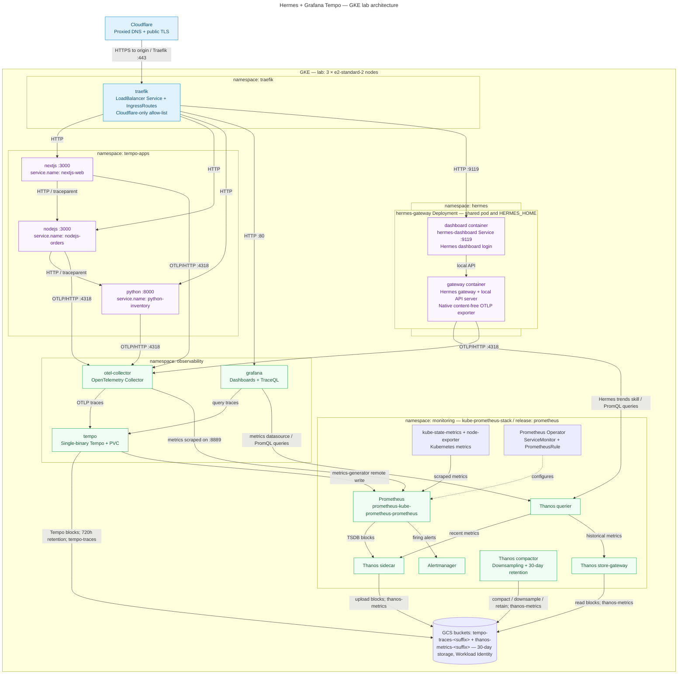

# 🔭 Hermes + Grafana Tempo on GKE

Distributed tracing on GKE that finds real code problems. Three sample apps (Next.js → Node.js → Python) carry
deliberate, realistic bugs: N+1 calls, unhandled exceptions, a cross-service error chain, an external-call timeout, a
slow endpoint, CPU hogs and a memory leak. They send OpenTelemetry traces through an OpenTelemetry Collector to Grafana
Tempo; Grafana shows each bug as spans, errors, latency and a service graph, and TraceQL finds it.
[Hermes Agent](https://hermes-agent.nousresearch.com/docs/) sends its own content-free health telemetry into the same
pipeline; its chat sends prompts only to the configured model provider, never into telemetry. **Why:** one place to see where time goes and where errors start, built only from official Helm charts and
official OpenTelemetry SDKs, with production-grade defaults and a small lab profile.

> 📘 **New to these tools?** Start with [**Every technology explained**](docs/technologies/README.md): one request's
> journey through the whole stack, a glossary, and a card per technology (what it is, why it is here, alternatives,
> version). Then [every Grafana dashboard explained](docs/dashboards/README.md).

**Status:** ✅ lab profile live on GKE 1.36 (3 × `e2-standard-2`) with object storage on GCS via Workload Identity,
2026-11-08: `scripts/verify.sh` 0 failures on three
consecutive runs, every planted issue found by its TraceQL query, `hermes/verify.sh` 31/31 (2026-11-08; Hermes runs
its production overlay). The production profile
(tempo-distributed with GCS and Kafka, HA Prometheus, Collector HPA) renders and passes `helm lint` and
`kubeconform -strict`; it has **not** been run on a cluster. See [Tests](#-tests).

## 🌐 Live URLs

| URL | What | Login |
|---|---|---|
| <https://grafana-tempo.saqlainmushtaq.com> | Grafana: traces (Tempo), metrics (Prometheus), dashboards ([explained](docs/dashboards/README.md)), alerts | Grafana login; credentials in Secret `observability/grafana-admin` ([how](helm/grafana/README.md)) |
| <https://tempo-nextjs.saqlainmushtaq.com> | Next.js sample app (`nextjs-web`), the entry point of the traced chain | None (demo) |
| <https://tempo-nodejs.saqlainmushtaq.com> | Node.js sample app (`nodejs-orders`) | None (demo) |
| <https://tempo-python.saqlainmushtaq.com> | Python sample app (`python-inventory`) | None (demo) |
| <https://hermes-gke.saqlainmushtaq.com> | Hermes Agent web dashboard and chat | Hermes login; credentials in Secret `hermes/hermes-dashboard-auth` ([how](hermes/README.md#-log-in)) |

Every hostname is a proxied Cloudflare record (public TLS at Cloudflare) in front of one Traefik load balancer that
accepts only Cloudflare's address ranges. Read a login without printing it anywhere else:
`kubectl -n observability get secret grafana-admin -o jsonpath='{.data.admin-password}' | base64 -d; echo`.

## 📚 What is OpenTelemetry?

| Term | One line |
|---|---|
| OpenTelemetry (OTel) | Vendor-neutral standard, APIs and SDKs for traces, metrics and logs ([what is it](https://opentelemetry.io/docs/what-is-opentelemetry/)) |
| Trace / span | A trace is one request's path; each span is one timed step (HTTP call, SQL query) with status and attributes ([traces](https://opentelemetry.io/docs/concepts/signals/traces/)) |
| Instrumentation | Code that creates spans: **automatic** (a library patches frameworks) or **manual** (you call the SDK) ([docs](https://opentelemetry.io/docs/concepts/instrumentation/)) |
| Context propagation | The W3C `traceparent` header carries the trace ID between services ([docs](https://opentelemetry.io/docs/concepts/context-propagation/)) |
| OTLP | The OTel wire protocol (gRPC 4317, HTTP 4318) the apps, Hermes and the Collector speak ([spec](https://opentelemetry.io/docs/specs/otlp/)) |
| Collector | Receives, processes and routes telemetry to backends ([docs](https://opentelemetry.io/docs/collector/)) |
| Tempo | Grafana's trace store, queried with TraceQL; its metrics-generator turns spans into RED metrics and a service graph ([docs](https://grafana.com/docs/tempo/latest/)) |

Language guides used by the apps: [JavaScript / Node.js](https://opentelemetry.io/docs/languages/js/) ·
[Next.js](https://nextjs.org/docs/app/guides/open-telemetry) · [Python](https://opentelemetry.io/docs/languages/python/).

## 🏗️ Architecture



| Component | What it is (one line) | Defined in |
|---|---|---|
| Cloudflare | Proxied DNS records and the public TLS certificate for every hostname | [`k8s/`](k8s/README.md) |
| Traefik | Ingress controller: one LoadBalancer, IngressRoutes per host, Cloudflare-only allow-list | [`k8s/`](k8s/README.md) |
| cert-manager | Optional origin certificates via Let's Encrypt DNS-01 (`TLS_MODE=letsencrypt`, production); not installed in the lab | [`k8s/`](k8s/README.md) |
| `nextjs` | Next.js app (`nextjs-web`), calls `nodejs`; planted N+1, 500 and timeout cascade | [`apps/nextjs/`](apps/nextjs/README.md) |
| `nodejs` | Node.js app (`nodejs-orders`), calls `python`; planted 500, 502, timeout, CPU hog, memory leak | [`apps/nodejs/`](apps/nodejs/README.md) |
| `python` | Python app (`python-inventory`); planted N+1 SQL, 500, slow endpoint, CPU hog | [`apps/python/`](apps/python/README.md) |
| Hermes `gateway` | Hermes Agent gateway; its native exporter sends content-free health metrics, spans and logs over OTLP; agent turns call the model provider | [`hermes/`](hermes/README.md) |
| Hermes `dashboard` | Hermes web UI and chat on the same `HERMES_HOME`, behind Hermes's own login | [`hermes/`](hermes/README.md) |
| OpenCode bridge | Deployment + Service `opencode-bridge:18282` in `hermes`: the OpenCode client behind an OpenAI-compatible endpoint, the default model provider for Hermes (free models); OpenCode's tools run in this pod | [`hermes/base/opencode-bridge.yaml`](hermes/base/opencode-bridge.yaml), [details](hermes/README.md#opencode-free-via-bridge-default) |
| Model provider | External LLM API over HTTPS `:443`: OpenCode (via the bridge, default) or Cloudflare Workers AI (alternative) | [`hermes/`](hermes/README.md#-model-provider) |
| OpenTelemetry Collector | The single OTLP entry point: traces → Tempo, metrics → Prometheus, logs → debug | [`helm/otel-collector/`](helm/otel-collector/README.md) |
| Tempo | Trace store and TraceQL API; metrics-generator writes span metrics and the service graph | [`helm/tempo/`](helm/tempo/README.md), [`helm/tempo-distributed/`](helm/tempo-distributed/README.md) |
| Grafana | UI with Prometheus, Tempo and Alertmanager data sources and the official Tempo dashboards | [`helm/grafana/`](helm/grafana/README.md) |
| Prometheus | Metrics store; scrapes the Collector and exporters, receives Tempo's remote write, evaluates rules; keeps 2 days locally | [`helm/kube-prometheus-stack/`](helm/kube-prometheus-stack/README.md) |
| Thanos | Sidecar uploads Prometheus blocks to object storage; store gateway, querier and compactor serve 30 days of metrics (downsampled, deduplicated) | [`helm/thanos/`](helm/thanos/README.md) |
| GCS buckets | Object storage for both profiles: `tempo-traces-<suffix>` (Tempo blocks) and `thanos-metrics-<suffix>` (Thanos blocks), keyless via GKE Workload Identity; optional SeaweedFS fallback in [`helm/seaweedfs/`](helm/seaweedfs/README.md) | [`infra/`](infra/README.md) |
| Alertmanager | Groups and routes firing alerts (critical → paging, warning → channel) | [`helm/kube-prometheus-stack/`](helm/kube-prometheus-stack/README.md) |
| Prometheus Operator | Turns ServiceMonitors and PrometheusRules into Prometheus config | [`helm/kube-prometheus-stack/`](helm/kube-prometheus-stack/README.md) |
| kube-state-metrics, node-exporter | Kubernetes object and node metrics | [`helm/kube-prometheus-stack/`](helm/kube-prometheus-stack/README.md) |

## 🔀 Telemetry flow

```mermaid
---
title: Telemetry — traces, metrics, queries and alerts
---
flowchart LR
  %% Sources: apps/README.md, hermes/README.md, helm/otel-collector/values*.yaml,
  %% helm/tempo/values.yaml, helm/tempo-distributed/values.yaml, helm/grafana/values*.yaml,
  %% helm/kube-prometheus-stack/values*.yaml and scripts/deploy.sh.
  subgraph senders["Telemetry producers"]
    apps["Apps: OpenTelemetry SDKs<br/>nextjs-web / nodejs-orders / python-inventory<br/>Traces only; W3C trace context"]
    hermes["hermes-gateway native OTLP exporter<br/>Content-free health spans, metrics, diagnostic logs<br/>No prompts, messages or tool output"]
  end
  subgraph collector["observability / otel-collector"]
    receiver["OTLP receiver<br/>HTTP :4318 / gRPC :4317"]
    processors["memory_limiter → k8s_attributes<br/>→ resource → batch"]
    traces["otlp_grpc/tempo<br/>Retry + bounded in-memory queue"]
    metrics["prometheus exporter :8889<br/>OTLP metrics"]
    logs["debug exporter<br/>Basic verbosity; no log backend"]
    receiver --> processors
    processors -->|traces| traces
    processors -->|metrics| metrics
    processors -->|logs| logs
  end
  subgraph tempo["observability / Tempo — logical paths in both profiles"]
    ingest["OTLP gRPC :4317<br/>Lab: tempo<br/>Production: tempo-distributor"]
    store["Trace storage + query API<br/>Lab: tempo :3200<br/>Production: tempo-query-frontend :3200"]
    mg["metrics-generator<br/>span-metrics + service-graphs"]
    ingest -->|trace storage path| store
    ingest -->|span processing path; Kafka in production| mg
  end
  subgraph monitoring["monitoring / kube-prometheus-stack"]
    prom["Prometheus<br/>prometheus-kube-prometheus-prometheus :9090<br/>Remote-write receiver enabled"]
    rules["PrometheusRule evaluation<br/>App SLOs, Hermes and platform alerts"]
    am["Alertmanager"]
    prom --> rules -->|firing alerts| am
  end
  graf["observability / grafana"]
  apps -->|OTLP/HTTP :4318 — traces| receiver
  hermes -->|OTLP/HTTP :4318 — all three signals| receiver
  traces -->|traces| ingest
  metrics -->|metrics pulled by Prometheus / ServiceMonitor| prom
  mg -->|remote write /api/v1/write; each replica in production| prom
  graf -->|PromQL / metrics + exemplars| prom
  graf -->|TraceQL / traces| store
  classDef telemetry fill:#f0fdf4,stroke:#16a34a,color:#14532d
  classDef source fill:#faf5ff,stroke:#9333ea,color:#581c87
  classDef query fill:#e0f2fe,stroke:#0284c7,color:#0c4a6e
  class receiver,processors,traces,metrics,ingest,store,mg,prom telemetry
  class apps,hermes source
  class graf,rules,am query
```



| Signal | From | Path | Read in Grafana with |
|---|---|---|---|
| Traces | Apps (SDKs), Hermes | OTLP/HTTP → Collector → OTLP gRPC → Tempo | TraceQL (Explore → Tempo) |
| Span metrics, service graph | Tempo metrics-generator | Remote write → Prometheus | PromQL, Service Graph, exemplars → traces |
| Hermes health metrics | Hermes gateway | OTLP → Collector `:8889` → scraped by Prometheus | PromQL, dashboard "Hermes Agent gateway" |
| Logs | Hermes gateway | OTLP → Collector debug exporter (no log backend) | — |
| Alerts | PrometheusRules (apps, Hermes, Tempo, Collector, platform) | Prometheus → Alertmanager | Alerting |

## ⚖️ Lab vs production

```mermaid
---
title: Tempo — lab versus production profiles
---
flowchart TB
  %% Sources: helm/README.md, helm/tempo/values.yaml,
  %% helm/tempo-distributed/README.md and values.yaml, scripts/deploy.sh.
  %% These are alternate deployments, not a migration or replication link.
  subgraph lab["LAB — PROFILE=lab — GKE: 3 × e2-standard-2"]
    direction TB
    lc["otel-collector<br/>1 replica"]
    lt["tempo — single binary<br/>grafana-community/tempo<br/>1 replica; in-process span delivery; no Kafka<br/>Embedded metrics-generator"]
    lp[("PVC: 10Gi standard-rwo<br/>WAL + generator WAL")]
    lg["grafana"]
    lm["Prometheus<br/>1 replica"]
    ls[("GCS buckets: tempo-traces-&lt;suffix&gt; + thanos-metrics-&lt;suffix&gt; — 30-day storage, Workload Identity (bucket-scoped IAM condition)")]
    subgraph lmon["namespace: monitoring"]
      lsidecar["Thanos sidecar"]
      lstore["Thanos store-gateway"]
      lquerier["Thanos querier"]
      lcompactor["Thanos compactor<br/>Downsampling + 30-day retention"]
    end
    lh["Hermes trends skill"]
    lm -->|TSDB blocks| lsidecar
    lsidecar -->|upload blocks; thanos-metrics| ls
    lstore -->|read blocks; thanos-metrics| ls
    lcompactor -->|compact / downsample / retain; thanos-metrics| ls
    lquerier -->|recent metrics| lsidecar
    lquerier -->|historical metrics| lstore
    lg -->|metrics datasource / PromQL queries| lquerier
    lh -->|PromQL queries| lquerier
    lt -->|Tempo blocks; 720h retention; tempo-traces| ls
    lc -->|OTLP :4317| lt
    lt -->|WAL + generator WAL| lp
    lg -->|query :3200| lt
    lt -->|span metrics / service graph remote write| lm
  end
  subgraph prod["PRODUCTION — PROFILE=prod — regional GKE, at least 2 zones; larger node pool"]
    direction TB
    pc["otel-collector<br/>HPA: 3–12 replicas"]
    subgraph distributed["observability — grafana-community/tempo-distributed / release: tempo"]
      d["tempo-distributor<br/>HPA: 3–9"]
      live["tempo-live-store-zone-a / -b<br/>3 replicas per zone; 20Gi PVC each"]
      bb["tempo-block-builder<br/>3 replicas"]
      mg["tempo-metrics-generator<br/>2 replicas"]
      qf["tempo-query-frontend<br/>2 replicas"]
      q["tempo-querier<br/>HPA: 3–9"]
      bs["tempo-backend-scheduler<br/>1 replica"]
      bw["tempo-backend-worker<br/>2 replicas; compaction + retention"]
      wi["ServiceAccount: observability/tempo<br/>GKE Workload Identity Federation<br/>Keyless; IAM scoped to trace bucket"]
    end
    kafka[("External Kafka-compatible queue<br/>Topic: tempo-traces<br/>TLS + SCRAM; replication factor 3<br/>Required; not installed by Tempo chart")]
    gcs[("Google Cloud Storage<br/>Trace blocks<br/>30-day Tempo retention (720h)")]
    pg["grafana"]
    pm["Prometheus<br/>2 replicas; remote write to each pod"]
    gm[("Google Cloud Storage<br/>Metrics bucket: thanos-metrics<br/>30-day retention")]
    subgraph pmon["namespace: monitoring"]
      psidecar["Thanos sidecar"]
      pstore["Thanos store-gateway"]
      pquerier["Thanos querier"]
      pcompactor["Thanos compactor<br/>Downsampling + 30-day retention"]
      pwi["Thanos ServiceAccounts<br/>GKE Workload Identity Federation<br/>Keyless; IAM scoped to metrics bucket"]
    end
    ph["Hermes trends skill"]
    pm -->|TSDB blocks| psidecar
    psidecar -->|upload blocks| gm
    pstore -->|read blocks| gm
    pcompactor -->|compact / downsample / retain| gm
    pwi -.->|authorizes GCS access for Thanos components| gm
    pquerier -->|recent metrics| psidecar
    pquerier -->|historical metrics| pstore
    pg -->|metrics datasource / PromQL queries| pquerier
    ph -->|PromQL queries| pquerier
    pc -->|OTLP :4317| d
    d -->|produce spans| kafka
    kafka -->|consume| live & bb & mg
    bb -->|write blocks| gcs
    pg -->|query :3200| qf
    qf --> q
    q -->|recent traces| live
    q -->|historical blocks| gcs
    bs -->|schedule jobs| bw
    bw -->|compact / delete expired blocks| gcs
    wi -.->|authorizes GCS access for Tempo components| gcs
    mg -->|span metrics / service graph remote write| pm
  end
  classDef storage fill:#fff7ed,stroke:#ea580c,color:#7c2d12
  classDef tempo fill:#f0fdf4,stroke:#16a34a,color:#14532d
  classDef access fill:#e0f2fe,stroke:#0284c7,color:#0c4a6e
  class lp,ls,kafka,gcs,gm storage
  class lt,d,live,bb,mg,qf,q,bs,bw,lsidecar,lstore,lquerier,lcompactor,psidecar,pstore,pquerier,pcompactor tempo
  class wi,pwi,lc,pc,lg,pg,lm,pm,lh,ph access
```



Production-grade settings are the defaults (`PROFILE=prod`); the lab profile (`PROFILE=lab`) only shrinks sizes to
fit 3 × `e2-standard-2`. Each folder's README is authoritative for its numbers.

| Component | Lab profile (`PROFILE=lab`, live unless noted) | Production default (rendered, not run live unless noted) | Defined in |
|---|---|---|---|
| Cluster | Zonal, 3 × `e2-standard-2` (6 vCPU / 24 GB) | Regional (≥ 2 zones), larger node pool | [`infra/`](infra/README.md) |
| Tempo | Single binary `grafana-community/tempo` 3.2.1, embedded metrics-generator, no Kafka | `grafana-community/tempo-distributed` 3.27.0: distributor, zone-aware live-stores, block-builder, metrics-generator, queriers | [`helm/tempo/`](helm/tempo/README.md), [`helm/tempo-distributed/`](helm/tempo-distributed/README.md) |
| Object storage | GCS buckets `tempo-traces-<suffix>` and `thanos-metrics-<suffix>`, keyless GKE Workload Identity, IAM limited to each bucket by condition (`ACCESS_MODE=conditional`) | Same GCS + Workload Identity; IAM bound on each bucket (`ACCESS_MODE=bucket`) | [`infra/`](infra/README.md), [`helm/thanos/`](helm/thanos/README.md) |
| Retention | 30 days: traces 720h (Tempo `block_retention`), metrics 30 days through Thanos (Prometheus keeps 2 days locally) | Same 30 days | [`helm/tempo/`](helm/tempo/README.md), [`helm/thanos/`](helm/thanos/README.md) |
| Ingest queue | None (in-process) | External Kafka-compatible queue (TLS + SCRAM, RF 3), required by Tempo 3.x distributed mode | [`helm/tempo-distributed/`](helm/tempo-distributed/README.md) |
| OTel Collector | 1 replica, 100m / 256Mi | HPA 3–12, PDB, zone spread; `memory_limiter`, batching, retry + sending queue | [`helm/otel-collector/`](helm/otel-collector/README.md) |
| Prometheus | 1 replica, 2 days local + Thanos sidecar | 2 replicas (HA pair, deduplicated by Thanos), 2 days local on a 100Gi PVC + Thanos sidecar, PDB | [`helm/kube-prometheus-stack/`](helm/kube-prometheus-stack/README.md) |
| Thanos | Query, store gateway, compactor (1 replica each) on GCS with Workload Identity | Same components, HA replicas | [`helm/thanos/`](helm/thanos/README.md) |
| Alertmanager | 1 replica | 2 replicas, critical → paging, warning → channel (receivers from a Secret) | [`helm/kube-prometheus-stack/`](helm/kube-prometheus-stack/README.md) |
| Grafana | 1 replica | 2 replicas with an external database (Secret `grafana-db`); no anonymous access | [`helm/grafana/`](helm/grafana/README.md) |
| Sample apps | Same manifests as production | 2 replicas, PDB, spread, SLO alerts (the app code itself is a demo) | [`apps/`](apps/README.md) |
| Hermes Agent | Lab overlay `hermes/lab/` (`emptyDir` home, 50m / 256Mi): validated, not the one running | **Runs live on the lab cluster:** `hermes/base/` (10Gi PVC home, 100m / 384Mi, PDB, runbooks) | [`hermes/lab/`](hermes/lab/README.md), [`hermes/base/`](hermes/base/README.md) |
| Edge TLS | Cloudflare edge TLS on every host (proxied records, SSL mode Full); Traefik serves its default certificate to Cloudflare; no cert-manager (`TLS_MODE=cloudflare`) | Cloudflare **Full (strict)** with validated origin certificates (`TLS_MODE=letsencrypt` or a Cloudflare Origin CA certificate) | [`k8s/`](k8s/README.md), [`scripts/`](scripts/README.md) |
| Costs | All software is free and open source (no licences); billed: persistent disks, GCS storage and operations for the trace and metrics buckets, and the GKE nodes and load balancer | Same, at production size | [`helm/thanos/`](helm/thanos/README.md) |
| Everywhere | Pinned chart versions. By digest: platform chart images, Hermes, the deployed sample-app images (`apps/deploy-apps.sh` resolves each tag to `@sha256`) and the apps' Node.js and Python base images. Requests/limits, Pod Security `restricted` where the workload allows, default-deny NetworkPolicies, PrometheusRules with runbooks | Same | each folder |

## 🚀 Quickstart

Run from this folder (`hermes-grafana-tempo/`). Each step is idempotent.

```bash
infra/create-cluster.sh                     # 1. GKE cluster (lab: zonal, 3 x e2-standard-2, Dataplane V2)
PROFILE=lab scripts/deploy.sh               # 2. Prometheus, edge, Tempo, Collector, Grafana, dashboards, routes, DNS
apps/build-push.sh && apps/deploy-apps.sh lab   # 3. build + push the sample apps, deploy them by digest (repo setup: apps/README.md)
hermes/deploy.sh                            # 4. Hermes gateway, dashboard, OpenCode bridge; providers: hermes/README.md
scripts/load.sh public                      # 5. traffic that triggers every planted issue
PROFILE=lab scripts/verify.sh && hermes/verify.sh   # 6. PASS/FAIL checks; exit code = failures
```

Production: `PROFILE=prod KAFKA_BOOTSTRAP=... scripts/deploy.sh` after creating the bucket
(`infra/create-tempo-bucket.sh`); see [`scripts/`](scripts/README.md) and [`helm/`](helm/README.md).

## 🔎 Find the planted bugs in Tempo

Open Grafana → Explore → Tempo and paste a query. Every bug is marked `PLANTED ISSUE:` in the code; each app README has
its exact queries, what the trace looks like and the fix.

| Issue | Where | Quick TraceQL |
|---|---|---|
| Any failure | all apps | `{ status = error }` |
| Unhandled exception (500) | nextjs, nodejs, python | `{ event:name = "exception" }` |
| Slow spans (slow endpoint, N+1 waterfall, CPU hog, timeout) | all apps | `{ span:duration > 1s }` |
| Cross-service chain | nextjs → nodejs → python | `{ resource.service.name = "nextjs-web" } >> { resource.service.name = "python-inventory" }` |
| Hermes gateway lifecycle | Hermes | `{ name = "hermes.gateway_health" && span.hermes.name = "gateway.lifecycle" }` |

Details: [`apps/`](apps/README.md#-planted-issues-summary) · span-metric PromQL:
[`apps/`](apps/README.md#-the-same-issues-in-promql-span-metrics).

## 🤖 Hermes Agent

Hermes runs as a plain Kubernetes Deployment in namespace `hermes` (gateway + dashboard containers); details, setup
and runbooks are in [`hermes/README.md`](hermes/README.md).

### 💬 Chat

Log in at <https://hermes-gke.saqlainmushtaq.com> and open **Chat**, or call the in-pod OpenAI-compatible API server.
Chat turns go to an external model provider over HTTPS; the gateway's telemetry stays content-free.

| Provider | Status | Setup |
|---|---|---|
| OpenCode free models via the in-cluster bridge (default; `opencode/deepseek-v4.1-flash-free`, no OpenCode account key) | Deployed, `verify.sh` checks the bridge; chat **not proven yet**: OpenCode answered "Free usage limit reached" for every free model from this cluster (`hermes/chat-proof.sh` reruns it) | [`hermes/README.md`](hermes/README.md#opencode-free-via-bridge-default) |
| Cloudflare Workers AI (alternative; `@cf/qwen/qwen3.8-27b`, tool calling, free daily quota) | ✅ chat live-tested 2026-11-08 | [`hermes/README.md`](hermes/README.md#-model-provider) |
| OpenCode Zen / Go (`MODEL_PROVIDER=opencode`) | Supported alternative; Zen bills per token, Go is a subscription | [`hermes/README.md`](hermes/README.md#-model-provider) |

### 🧰 Observability skill

A read-only Hermes skill ([`SKILL.md`](hermes/base/skills/grafana-tempo-observability/SKILL.md) + `scripts/obs.py`, Python standard library only) lets the chat
diagnose this platform: query Tempo (TraceQL), metrics (PromQL through the Thanos querier) and Grafana, quote numbers and trace IDs, and
explain the OpenTelemetry setup. Ask, for example, "diagnose the platform" or "which endpoint is slowest?". It is
mounted read-only into the Hermes and OpenCode bridge pods, and only those pods may reach the Thanos querier `:10902`, Tempo `:3200`
and Grafana `:3000` ([`networkpolicy-observability.yaml`](hermes/base/networkpolicy-observability.yaml)); Grafana
access uses the Viewer role. Prometheus `:9090` is deliberately not reachable from Hermes: it serves remote write,
`/-/reload` and `/-/quit` without authentication. Details: [`hermes/README.md`](hermes/README.md).

## 🧭 Documentation map

| README | Covers |
|---|---|
| [`infra/`](infra/README.md) | GKE cluster and Tempo bucket scripts |
| [`helm/`](helm/README.md) | Releases, profiles, install order, pinned versions; per chart: [`kube-prometheus-stack/`](helm/kube-prometheus-stack/README.md), [`tempo/`](helm/tempo/README.md), [`tempo-distributed/`](helm/tempo-distributed/README.md), [`otel-collector/`](helm/otel-collector/README.md), [`grafana/`](helm/grafana/README.md) |
| [`k8s/`](k8s/README.md) | Namespaces, Traefik, cert-manager, IngressRoutes, NetworkPolicies |
| [`apps/`](apps/README.md) | Sample apps: [`nextjs/`](apps/nextjs/README.md), [`nodejs/`](apps/nodejs/README.md), [`python/`](apps/python/README.md), [`monitoring/`](apps/monitoring/README.md), [`lab/`](apps/lab/README.md), [`local/`](apps/local/README.md) |
| [`hermes/`](hermes/README.md) | Hermes Agent telemetry and dashboard: [`base/`](hermes/base/README.md) (production), [`lab/`](hermes/lab/README.md) |
| [`scripts/`](scripts/README.md) | `deploy.sh`, `verify.sh`, `load.sh`, `teardown.sh` |
| [`docs/`](docs/README.md) | [Every technology explained](docs/technologies/README.md), [every Grafana dashboard explained](docs/dashboards/README.md) and the diagram sources ([`docs/diagrams/`](docs/diagrams/README.md)) |

## 🔧 Instrumentation standards

| Rule | Why |
|---|---|
| Set `service.name` (`OTEL_SERVICE_NAME`) on every workload | Traces and span metrics are searched by it |
| Send to the Collector (`otel-collector.observability:4318`, `http/protobuf`), never straight to Tempo | One place to batch, enrich (`k8s.*` attributes) and route |
| Propagate W3C Trace Context between services | One trace ID across Next.js → Node.js → Python |
| Manual spans around business steps auto-instrumentation can't see | The planted N+1 and slow paths show as named child spans |
| Low-cardinality span names; IDs only as attributes | Keeps span metrics and the service graph small |
| Never put secrets, tokens or full payloads in attributes | Traces are readable by every Grafana viewer |

> **Label gotcha:** Tempo's metrics-generator labels span metrics `service` (not `service_name`, which the OTel
> Collector's `spanmetrics` connector uses). When a query says "No data", look at one series' real labels first:
> `{__name__=~"traces_spanmetrics.*"}`.

## 🛡️ Security model

| Threat | Control | Where |
|---|---|---|
| Direct access to the origin, bypassing Cloudflare | Traefik accepts only Cloudflare's address ranges (`externalTrafficPolicy: Local` keeps the source IP) | [`k8s/`](k8s/README.md), [`hermes/base/ingress.yaml`](hermes/base/ingress.yaml) |
| Unauthenticated access to Grafana or Hermes | Grafana login (no anonymous access, no sign-up); Hermes password login (scrypt hash in the pod) | [`helm/grafana/`](helm/grafana/README.md), [`hermes/`](hermes/README.md) |
| Lateral movement between namespaces | Default-deny NetworkPolicies, enforced by Dataplane V2 | [`k8s/`](k8s/README.md), each folder |
| Container privilege abuse | Non-root, read-only root FS, all capabilities dropped, seccomp; Pod Security `restricted` where possible (`monitoring` is `privileged` for node-exporter) | each folder |
| Secrets in Git | Grafana admin, Cloudflare token, Hermes credentials only in Kubernetes Secrets (or synced from Secret Manager); never printed | [`scripts/`](scripts/README.md), [`hermes/`](hermes/README.md) |
| Conversation content in telemetry | Hermes exports only content-free health signals; chat text never reaches metrics, traces or logs | [`hermes/`](hermes/README.md) |
| Hermes reading the observability stack | Observability skill: query APIs only, Grafana Viewer role (writes → 403); NetworkPolicies admit only the Hermes gateway and OpenCode bridge pods to the Thanos querier `:10902`, Tempo `:3200` and Grafana `:3000`; OpenCode's tools run in the bridge pod, not in the Hermes pod; Prometheus `:9090` (unauthenticated remote write, `/-/reload`, `/-/quit`) is not reachable from Hermes | [`hermes/base/networkpolicy-observability.yaml`](hermes/base/networkpolicy-observability.yaml) |
| Prompts leaving the cluster | Chat prompts go to the model provider over HTTPS: by default from the OpenCode bridge pod. Hermes pod egress: DNS, Collector `:4318`, bridge `:18282`, Thanos querier `:10902`, Tempo `:3200`, Grafana `:3000`, public `:443` (Cloudflare alternative). Bridge pod egress: DNS, public `:443` and the same three read-only endpoints. Private, metadata and Service ranges are excluded; keys only in Secrets | [`hermes/`](hermes/README.md) |

Not protected (by design): the sample apps have no login and include CPU- and memory-heavy endpoints; Cloudflare rate
limits are not set.

## 🛠️ Operations and troubleshooting

"No data" in a panel, top to bottom:

| Step | Check |
|---|---|
| 1. Metric name | `{__name__=~"traces_spanmetrics.*"}` or `{__name__=~"hermes_.*"}` returns series |
| 2. Label keys | Read the labels of one series; fix `service` vs `service_name` and similar |
| 3. Time range | Range ≥ 3 × the `rate()` window (e.g. 15 min for `[5m]`) |
| 4. Delivery | Tempo remote write without failures; Prometheus `enableRemoteWriteReceiver: true`; Collector `:8889` target up |

Component health checks, alerts and runbooks are in each folder's README ([`helm/`](helm/README.md),
[`apps/monitoring/`](apps/monitoring/README.md), [`hermes/`](hermes/README.md#-runbooks)).

## 🧪 Tests

| Date | What | Result |
|---|---|---|
| 2026-11-08 | `PROFILE=lab scripts/verify.sh` (releases, pods, health, test trace through Collector → Tempo → Grafana, scraping, NetworkPolicy, public HTTPS) | ✅ 0 failures, three consecutive runs |
| 2026-11-08 | Sample apps live (`scripts/load.sh public`, TraceQL per issue, alert rules) | ✅ every planted issue found; 200/500/502/504 mix as designed; 12 rules loaded |
| 2026-11-08 | `hermes/verify.sh` (pod, Prometheus metrics and rules, Tempo, Grafana, public URL, Hermes login, model settings, OpenCode bridge Ready and `/v1/models`, observability skill: Thanos/Tempo/Grafana reads, Prometheus `:9090` blocked, Grafana write → 403, `diagnose`, `trends`) | ✅ 31/31 (no model call). Chat through the OpenCode bridge is not proven yet: every free model answered "Free usage limit reached" from this cluster; `hermes/chat-proof.sh` runs the two chat prompts when the limits reset. Earlier chats with Workers AI got model replies |
| 2026-11-08 | Production profiles: `helm template`, `helm lint`, `kubeconform -strict` (Kubernetes 1.36) | ✅ render and validate; not run live |

## ✅ Production checklist

| Area | Do this before go-live | Where |
|---|---|---|
| HA sizing | Regional cluster ≥ 2 zones; size nodes from the production requests (Tempo alone ≈ 14.2 vCPU / 54.7 GiB at HPA minimum, plus Kafka) | [`helm/`](helm/README.md#-sizing-requests) |
| Ingest queue | Provide an external Kafka-compatible service (RF 3, TLS + SCRAM) and pre-create the topic | [`helm/tempo-distributed/`](helm/tempo-distributed/README.md) |
| Backups | GCS bucket lifecycle (and versioning if required); Prometheus PVC snapshots or accept rebuild; Hermes PVC snapshots | [`infra/`](infra/README.md), [`hermes/`](hermes/README.md#-production-checklist) |
| Upgrades | One pinned chart or image at a time, read its release notes, `helm diff`, apply, run `scripts/verify.sh` | [`scripts/`](scripts/README.md) |
| Secrets | Sync from Secret Manager (External Secrets); rotate Grafana, Hermes and Alertmanager receiver credentials | [`helm/grafana/`](helm/grafana/README.md), [`hermes/`](hermes/README.md) |
| TLS | Cloudflare **Full (strict)** with validated origin certificates (`TLS_MODE=letsencrypt` or an Origin CA certificate) | [`scripts/`](scripts/README.md), [`k8s/`](k8s/README.md) |
| SLOs | App availability and p95 latency from span metrics with burn-rate alerts; Hermes gateway availability | [`apps/monitoring/`](apps/monitoring/README.md), [`hermes/`](hermes/README.md) |
| Alert routing | Create Secret `alertmanager-receivers` (paging + channel) before install | [`helm/kube-prometheus-stack/`](helm/kube-prometheus-stack/README.md) |
| Sampling | Tail sampling at the Collector at high volume (keep errors and slow traces) | [`helm/otel-collector/`](helm/otel-collector/README.md) |
| Runbooks | Every alert carries `runbook_url` | component READMEs |

## 💰 Cost and limits

| Item | Lab | Production |
|---|---|---|
| Compute | 3 × `e2-standard-2` | Sized from the production requests (see [`helm/`](helm/README.md#-sizing-requests)) |
| Storage | Persistent disks 126Gi ≈ $12.60/month (Prometheus 40Gi, Thanos 25Gi, Tempo WAL 50Gi, Grafana 1Gi, Hermes 10Gi); GCS buckets for traces + metrics, 30 days (storage + operations; Thanos bucket estimated ~$1–$3.50/month) | Prometheus 2 × 100Gi, Tempo live-store PVCs, GCS buckets (storage + operations) |
| Network | One load balancer; Cloudflare in front | Same, plus Kafka and cross-zone traffic |

All components are open source (Tempo and Grafana AGPL-3.0; Prometheus, Thanos and the OTel Collector Apache-2.0), so
there are no licence fees: only the cloud resources above are billed. Bills were not measured (disk and bucket figures
are list-price estimates, [`helm/thanos/`](helm/thanos/README.md#-sizing-and-cost)); trim them with retention, sampling
and the HPA limits.

## 🧹 Teardown

```bash
scripts/teardown.sh             # Helm releases, namespaces, CRDs
scripts/teardown.sh --cluster   # also the Tempo and Thanos buckets and the GKE cluster (asks before each)
```

## 📌 Pinned versions

| Component | Chart | App / image |
|---|---|---|
| kube-prometheus-stack | `prometheus-community/kube-prometheus-stack` 93.1.0 | prometheus-operator v0.95.1 |
| Tempo (production) | `grafana-community/tempo-distributed` 3.27.0 | `grafana/tempo:3.1.1` |
| Tempo (lab) | `grafana-community/tempo` 3.2.1 | `grafana/tempo:3.1.1` |
| OTel Collector | `open-telemetry/opentelemetry-collector` 0.178.2 | `otel/opentelemetry-collector-contrib:0.165.0` |
| Grafana | `grafana-community/grafana` 14.4.0 | `grafana/grafana:13.3.0` |
| Hermes Agent | — | `nousresearch/hermes-agent:v0.23.0` |

Image digests: [`helm/`](helm/README.md#-pinned-versions), [`hermes/`](hermes/README.md#-pinned-versions) and each app README.

## 🔗 References

- [OpenTelemetry documentation](https://opentelemetry.io/docs/) · [Collector](https://opentelemetry.io/docs/collector/) · [OTLP specification](https://opentelemetry.io/docs/specs/otlp/) · [Semantic conventions](https://opentelemetry.io/docs/specs/semconv/)
- [OpenTelemetry Helm charts](https://github.com/open-telemetry/opentelemetry-helm-charts)
- [Grafana Tempo](https://grafana.com/docs/tempo/latest/) · [TraceQL](https://grafana.com/docs/tempo/latest/traceql/) · [metrics-generator](https://grafana.com/docs/tempo/latest/metrics-generator/)
- [Grafana community Helm charts](https://github.com/grafana-community/helm-charts) (Tempo and Grafana; the older `grafana/helm-charts` versions are deprecated)
- [prometheus-community Helm charts](https://github.com/prometheus-community/helm-charts) · [Prometheus histograms](https://prometheus.io/docs/practices/histograms/)
- [Hermes Agent documentation](https://hermes-agent.nousresearch.com/docs/)
