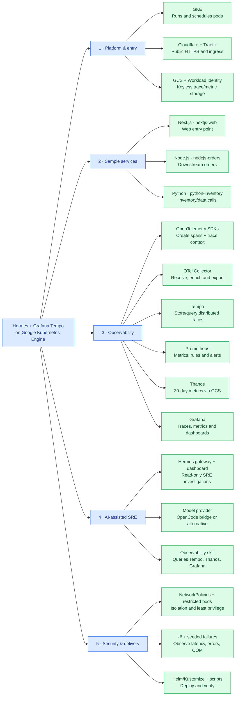
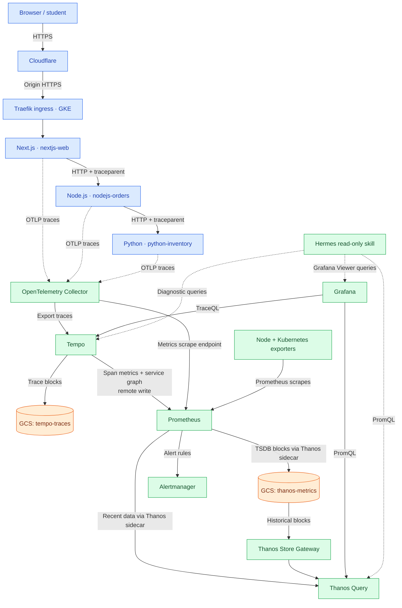

# Visual learning map — Hermes + Grafana Tempo on GKE

A beginner-friendly companion to the [detailed architecture](architecture.mmd), [telemetry flow](telemetry-flow.mmd), and [lab vs production diagram](lab-vs-production.mmd). This explains **what each component does, how a request becomes a trace, and how to study the repository**. The diagrams are conceptual: refer to the linked component READMEs for exact ports, replicas, and deployment commands.

## 1. Start here: system learning map

Read **left to right**. Each group answers a different engineering question.

**Five questions to remember:** Where does traffic enter? Which app handles it? Where does telemetry go? How does an engineer investigate? What protects and tests the system?

## 2. Follow one request — do not confuse application traffic with telemetry

**How to read it:**

1. **Solid blue-path arrows are application requests.** A Next.js call can create downstream Node.js and Python calls. W3C `traceparent` associates their spans with one distributed trace.
2. **Dotted arrows from apps to the Collector are observability data, not application requests.** The OpenTelemetry SDKs export traces over OTLP.
3. **Tempo stores traces; Prometheus stores time-series metrics.** Tempo's metrics-generator produces metrics from spans and remote-writes them to Prometheus. Prometheus also scrapes the Collector and Kubernetes exporters.
4. **Thanos extends metrics retention.** The sidecar uploads Prometheus blocks to a dedicated GCS bucket; Thanos Query reads recent data through the sidecar and historical data through the Store Gateway. Compactor maintains retention and downsampling.
5. **Grafana visualizes, Hermes investigates.** Grafana queries Tempo and Thanos. Hermes's observability skill uses read-only queries; its separate LLM provider is for chat/analysis, **not** the source of traces.
6. **The log pipeline is limited.** The Collector's logs pipeline uses a debug exporter, not a searchable logs backend such as Loki. Do not promise full central log search.

The **Hermes gateway also exports content-free health spans/metrics and diagnostic logs** to the Collector. This does *not* send conversations or prompts through the telemetry pipeline. The default OpenCode free-model bridge depends on an external model service with availability/quota limits.

## 3. Lab profile versus proposed production profile

| Area | Lab example | Production configuration |
|---|---|---|
| GKE | Zonal, 3 × `e2-standard-2` | Regional, larger node pools and higher availability |
| Tempo | Single-binary deployment, PVC, GCS trace blocks | Distributed components; external Kafka-compatible queue required |
| OpenTelemetry Collector | One replica | Autoscaling Collector replicas |
| Prometheus | One replica, ~2 days local retention | High-availability replicas |
| Thanos | Sidecar + Query + Store + Compactor | HA-oriented deployment of metrics components |
| Storage | Separate GCS trace and metrics buckets, ~30-day application retention | Same separation, least-privilege bucket IAM |
| TLS edge | Cloudflare Full; Traefik default origin certificate | Prefer validated origin TLS: Cloudflare Full (strict) |

**Security nuance:** The lab's Cloudflare **Full** mode encrypts traffic to the origin but does **not authenticate the origin certificate**. Full (strict) with a valid origin certificate is preferable for production.

## 4. Understand planted failures through SRE signals

| Example | What to look for | Where |
|---|---|---|
| N+1 calls | Repeated child spans; total request time | Grafana Explore → Tempo |
| Unhandled exception | Error spans and HTTP 5xx | Tempo + Prometheus |
| Downstream timeout | Long wait on a dependency span | Trace waterfall |
| CPU saturation | CPU throttling, rising p95 latency | Prometheus / Stress tests dashboard |
| Memory pressure or OOM | Working set, memory limit and pod termination | Prometheus / Kubernetes |
| Dependency outage | Increased error rate and failed cross-service calls | Tempo service graph + metrics |

The repository's k6 scenarios deliberately create failures and sometimes change Kubernetes workloads. **Run disruption tests only in a disposable lab or staging cluster**, never unannounced on production.

## 5. Learning path and the authoritative README files

| Lesson | Read first | What you should be able to explain |
|---|---|---|
| Infrastructure and storage | [infra](../../infra/README.md) | GKE cluster, nodes, GCS and Workload Identity |
| Edge and isolation | [k8s](../../k8s/README.md) | Cloudflare, Traefik, TLS and NetworkPolicies |
| Request chain | [apps](../../apps/README.md) | Next.js → Node.js → Python and seeded issues |
| Telemetry pipeline | [OTel Collector](../../helm/otel-collector/README.md) | OTLP receivers, processors and exporters |
| Distributed tracing | [Tempo](../../helm/tempo/README.md) | Spans, TraceQL and span-derived metrics |
| Metrics and history | [Prometheus](../../helm/kube-prometheus-stack/README.md) + [Thanos](../../helm/thanos/README.md) | Scraping, rules, object-store history and querying |
| Explore and alert | [Grafana](../../helm/grafana/README.md) | Tempo/Thanos data sources and dashboards |
| AI-assisted diagnosis | [Hermes](../../hermes/README.md) | Gateway telemetry, model bridge and read-only skill |
| Deployment and evidence | [scripts](../../scripts/README.md) + [tests](../../tests/README.md) | Deploy, verify, load tests and what passed |

For deeper explanations and the pinned software versions, see [Every technology explained](../technologies/README.md). For detailed infrastructure flows, use [architecture.mmd](architecture.mmd), [telemetry-flow.mmd](telemetry-flow.mmd), and [lab-vs-production.mmd](lab-vs-production.mmd).

## 6. A simple way to teach the architecture

> "Our demo services intentionally contain slow requests and errors. OpenTelemetry traces requests across Next.js, Node.js and Python. The Collector forwards spans to Tempo, and Tempo turns those spans into useful metrics. Prometheus records metrics, Thanos stores their history, Grafana helps engineers explore the evidence, and Hermes can query that evidence with read-only access. All of this runs on GKE, with Cloudflare/Traefik at the edge and GCS for durable storage."

**Note:** A valid trace explains *where* time was spent and *where* errors appeared. It does not, on its own, prove the root cause. Confirm hypotheses with code, metrics and controlled tests.
