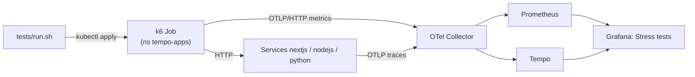

# 🔥 Stress and resilience tests

Load, resource and failure tests for the three sample apps (`nextjs`, `nodejs`, `python`). Everything runs **inside
the cluster** as Kubernetes Jobs and Pods in `tempo-apps` against the internal Services, so the public edge is never
load-tested. The one exception is the `netpol` negative probe: a short-lived, Pod Security `restricted`-compliant curl
pod in namespace `default`, on purpose (a namespace with no allow rule into `tempo-apps`). **For lab and staging
clusters only, not for production clusters:** the tests patch Deployments, scale an app to 0, delete a pod and run an
OOM pod.
[Grafana k6](https://grafana.com/docs/k6/latest/) sends its metrics through its
[OpenTelemetry output](https://grafana.com/docs/k6/latest/results-output/real-time/opentelemetry/) to the existing
OTel Collector, so every run shows up in Prometheus and in the **Stress tests** Grafana dashboard next to the pods'
CPU, memory and restarts and the traces in Tempo. **Why:** see what each kind of overload and failure looks like in
metrics and traces before it happens in production.

> ⚠️ **Disruption warning.** `dependency` scales `nodejs` to 0 for 45 s (nextjs answers errors), `podkill` deletes an
> app pod (with 1 replica: a few seconds of errors), `cpu`/`memory` restart the target Deployment to switch the stress
> endpoints on, and `stress`/`spike` push the apps to errors on purpose. Run them on a test cluster or in a quiet window.

## 🏗️ Architecture



| Component | What it does (one line) | Where defined |
|---|---|---|
| `run.sh` | Runs one test: creates the k6 Job or throwaway Pod, breaks/restores things, prints and saves results | [run.sh](run.sh) |
| k6 load script | Smoke, load, stress, spike and soak scenarios with p95 and error-rate thresholds | [k6/load.js](k6/load.js) |
| k6 resource script | Drives the stress endpoints, the OOM call, dependency and pod-kill traffic, with a healthy-latency probe | [k6/resource.js](k6/resource.js) |
| k6 Job | `grafana/k6:2.3.0` by digest; restricted Pod Security, uid 12345, read-only root, 1 CPU / 512Mi limit | generated by `run.sh` |
| Stress endpoints | `/stress/cpu` and `/stress/memory` in every app; off by default, capped by env, in-cluster only, traced | apps (see below) |
| Dashboard | Grafana **Stress tests** (folder Tests) | [dashboards/](dashboards/README.md) |

## 🔥 Stress endpoints (in every app)

| Endpoint | What it does | Cap (env, default) | Span |
|---|---|---|---|
| `GET /stress/cpu?ms=500` | Busy loop (sha256 / arithmetic) for `ms` | `STRESS_MAX_CPU_MS` 5000 | `stress.cpu` (`app.stress.cpu.ms`, `.rounds`) |
| `GET /stress/memory?mb=32&hold_s=5` | Allocates and fills `mb` MiB, holds it `hold_s` s, releases it | `STRESS_MAX_MB` 128 (total held by all requests; above: 429), `STRESS_MAX_HOLD_S` 30 | `stress.memory` (events `memory.allocated`, `memory.released`) |

Safety: `STRESS_ENABLED=false` in every Deployment (404 until switched on); any request carrying `X-Forwarded-For`
(set by Traefik for all public traffic; nextjs checks `X-Real-Ip`/`X-Forwarded-Server` instead, because the Next.js server adds `X-Forwarded-For` itself) gets 404, so only in-cluster callers reach them; the caps keep a busy loop
under the 60 s liveness budget and held memory (128 MiB) under every app's memory limit (256Mi, nextjs 384Mi).
Code: [nodejs/server.js](../apps/nodejs/server.js), [python/main.py](../apps/python/main.py),
[nextjs/app/stress/](../apps/nextjs/app/stress/README.md).

## 📋 Prerequisites

| Need | Version / note |
|---|---|
| Cluster with the platform deployed | `scripts/deploy.sh` + `apps/deploy-apps.sh` (apps 1.0.3 or later; 1.0.2 nextjs rejects in-cluster stress calls) |
| `kubectl` | context on the cluster; rights to create Jobs/Pods in `tempo-apps` and `default`, and patch Deployments |
| `python3`, `curl`, `bash` 4+ | used by `run.sh` |
| Capacity | one k6 Job at a time: 100m / 128Mi requested, 1 CPU / 512Mi limit (fits the `tempo-apps` quota) |

## 🚀 Run it

```bash
kubectl apply -f tests/dashboards/stress-tests.yaml      # once: the Grafana dashboard
tests/run.sh python smoke                                # does it work at all? (15 s)
tests/run.sh nodejs load                                 # expected traffic, 10 VUs (60 s)
tests/run.sh nextjs stress                               # ramp to 150 VUs, find the breaking point (90 s)
tests/run.sh python spike                                # 2 -> 100 VUs in 5 s and back (50 s)
SOAK_DURATION=2h tests/run.sh nodejs soak                # long steady load (default 120 s)
tests/run.sh python cpu                                  # 4 VUs on /stress/cpu?ms=500 + healthy probe
tests/run.sh python memory                               # 4 VUs on /stress/memory?mb=40&hold_s=10 + probe
tests/run.sh python oom                                  # one controlled OOMKill in a throwaway pod
tests/run.sh nextjs dependency                           # nodejs scaled to 0 for 45 s under nextjs traffic
tests/run.sh nodejs podkill                              # delete the nodejs pod under 20 req/s
tests/run.sh python netpol                               # NetworkPolicy + edge negative tests
tests/run.sh all cleanup                                 # remove test Jobs/Pods, stress endpoints off
```

`SCALE=0.5` halves every duration; `EVIDENCE_DIR=<dir>` saves each k6 summary and pod table. The k6 exit code
(thresholds) is the script's exit code for the load scenarios. `cpu` and `memory` switch `STRESS_ENABLED=true` on the
target Deployment (a rolling restart) and back to `false` on exit unless `KEEP_STRESS=1`. A later
`apps/deploy-apps.sh` also resets it to `false`.

## 🧪 What each test does

| Test | What it does | Thresholds / pass rule | What to look at |
|---|---|---|---|
| `smoke` | 2 VUs, 15 s, healthy endpoint | p95 < 500 ms, errors < 1 % | k6 summary; RPS and p95 panels |
| `load` | ramp to 10 VUs, hold 40 s | p95 < 500 ms, errors < 1 % | p95 flat, CPU below limit, no throttling |
| `stress` | ramp 20 → 50 → 100 → 150 VUs | p95 < 2 s, errors < 5 % (breaking point is where they fail) | where p95 bends; CPU hits the 500m limit; throttling rises |
| `spike` | 2 → 100 VUs in 5 s, hold 20 s, drop | p95 < 2 s, errors < 5 % | latency spike and recovery time |
| `soak` | 10 VUs, constant (120 s; `SOAK_DURATION`) | p95 < 500 ms, errors < 1 % | memory working set flat (no leak), no restarts |
| `cpu` | 4 VUs on `/stress/cpu?ms=500` for 60 s, 1 VU probing a healthy endpoint | probe p95 < 1 s (informational) | CPU at limit, throttling; probe latency; `stress.cpu` spans in Tempo |
| `memory` | 4 VUs on `/stress/memory?mb=40&hold_s=10` (128 MiB budget, so some 429s) | probe p95 < 1 s (informational) | working set steps up and back down, stays under the limit; `stress.memory` spans |
| `oom` | throwaway pod from the app image with a 160Mi limit and a 400 MiB budget, asked for 300 MiB | pod ends `OOMKilled` (exit 137) | OOMKilled panel; the Deployment is untouched |
| `dependency` | 5 req/s to nextjs `/api/dashboard`; nodejs scaled to 0 at 30 s for 45 s, then back | errors only while nodejs is down | error rate panel; service graph failed calls nextjs → nodejs; error traces |
| `podkill` | 20 req/s to the app; its pod deleted at 30 s | errors only until the new pod is Ready | error rate, restarts, request gap |
| `netpol` | curl pod in `default` → app Service; public `https://tempo-<app>.<domain>/stress/cpu` | blocked (timeout) and 404 | output of `run.sh` |

**Tempo:** the dashboard links open Explore with `{ name =~ "stress.*" }`, slow server spans and errors. Under CPU
stress, compare `{ resource.service.name = "python-inventory" && kind = server && duration > 500ms }` before and during
the run: healthy requests queue behind the busy loop (python: GIL; Node.js: event loop).

| Test | Peak VUs | Requests | RPS | p95 | p99 | Errors | Result |
|---|---|---|---|---|---|---|---|
| python smoke / load / soak | 2 / 10 / 10 | 636 / 2689 / 5624 | 71 / 75 / 78 | 63 / 246 / 261 ms | 118 / 429 / 384 ms | 0 % | ✅ pass |
| python spike | 100 | 2528 | 84 | 1.47 s | 1.66 s | 0 % | ✅ pass |
| python stress | 150 | 4038 | 75 | 2.90 s | 3.23 s | 0 % | ❌ p95 > 2 s: breaking point ~75 req/s at 500m CPU |
| nodejs smoke / load / soak | 2 / 10 / 10 | 850 / 4595 / 8986 | 94 / 128 / 125 | 75 / 156 / 175 ms | 105 / 208 / 257 ms | 0 % | ✅ pass |
| nodejs spike / stress | 100 / 150 | 3912 / 6812 | 130 / 126 | 0.90 / 1.33 s | 1.02 / 1.61 s | 0 % | ✅ pass (plateau ~128 req/s) |
| nextjs smoke / load | 2 / 10 | 210 / 1444 | 23 / 40 | 228 / 443 ms | 273 / 638 ms | 0 % | ✅ pass |
| nextjs soak | 10 | 1820 | 25 | 821 ms | 1.08 s | 0 % | ❌ p95 > 500 ms |
| nextjs spike | 100 | 1066 | 35 | 9.99 s | 10 s | 5.06 % | ❌ timeouts |
| nextjs stress | 150 | 2476 | 45 | 3.67 s | 9.99 s | 1.57 % | ❌ breaking point ~40 req/s (CPU 0.49 of 0.5, 96 % periods throttled) |
| python cpu (4 × 500 ms) | 5 | 2107 | 39 | probe 50 ms | probe 693 ms | 0 % | ✅ |
| nodejs cpu | 5 | 1060 | 20 | probe 37 ms | probe 85 ms (max 10 s) | probe 0.3 % | ✅ |
| python / nodejs memory (4 × 40 MiB, 10 s) | 5 | 6470 / 12479 | 120 / 231 | probe 68 / 40 ms | 126 / 78 ms | probe errors 0 % | ✅ budget 429s as designed (k6 `http_req_failed` counts these 429s) |
| nextjs cpu / memory | 5 | 493 / 2893 | 9 / 54 | probe 94 / 125 ms | probe 313 / 326 ms | probe errors 0.5 % / 0 % | ✅ stress calls 200 (memory: 200/429, the 429s count in k6 `http_req_failed`). ⚠️ liveness probe timeouts under 4 × 500 ms loops at the 500m limit; use fewer VUs or a lower `CPU_MS` for nextjs |
| python oom (300 MiB vs 160Mi) | 1 | 1 | - | - | - | EOF | ✅ pod `OOMKilled`, exit 137, Deployment untouched |
| dependency (nodejs at 0 for 46 s) | - | 551 | 4.6 | - | - | 33.8 % (186) | ✅ errors only during the outage |
| podkill nodejs (20 req/s) | - | 1069 | 19.8 | 59 ms | 296 ms | 1.0 % (11) | ✅ ~2 s of refused connections with 1 replica |
| netpol | - | - | - | - | - | - | ✅ python and nextjs: blocked from `default`; public `/stress/cpu` 404 |

Peak during load phase (Prometheus): CPU nextjs 0.49, python 0.44, nodejs 0.38 cores (limit 0.5); throttled share 96 / 82 / 57 %; working set 102 / 70 / 63 MiB.

## 🛡️ Safety limits

| Risk | Control |
|---|---|
| Public edge or DNS provider gets load | k6 targets `*.tempo-apps` Services only; stress endpoints answer 404 to Traefik traffic |
| Stress endpoint left on | `STRESS_ENABLED=false` in the manifests; `run.sh` switches it back on exit; `cleanup` forces it off |
| OOM loop on a real app | per-request and total caps below the limit; the OOM test uses a separate pod with `restartPolicy: Never` |
| Runaway k6 Job | `activeDeadlineSeconds` 1800 (`K6_DEADLINE`), `backoffLimit: 0`, TTL 1 h, 1 CPU / 512Mi limit |
| Pod Security | k6 and probe pods pass `restricted` (non-root, no privilege escalation, all capabilities dropped, seccomp) |
| Dependency left down | `dependency` restores the nodejs replica count on exit (trap), also on Ctrl-C |

## 🛠️ Troubleshooting

| Symptom | Cause | Fix |
|---|---|---|
| `/stress/*` returns 404 in-cluster | `STRESS_ENABLED` is `false` | `run.sh` switches it on; or `kubectl -n tempo-apps set env deploy/<app> STRESS_ENABLED=true` |
| No k6 data in Grafana | Collector not reachable or not scraped | check the Job log line `output: opentelemetry (http/protobuf, ...)`; Prometheus target `otel-collector` port 8889 |
| `/stress/memory` returns 429 | total budget `STRESS_MAX_MB` in use | expected under concurrency; lower `mb` or VUs |
| Job pending | `tempo-apps` quota or node capacity | `kubectl -n tempo-apps describe job k6-<name>`; run one test at a time |

## 🧹 Cleanup

```bash
tests/run.sh all cleanup                                   # Jobs, Pods, k6 ConfigMap, STRESS_ENABLED=false
kubectl delete -f tests/dashboards/stress-tests.yaml       # optional: remove the dashboard
scripts/verify.sh                                          # platform health after the tests
```

## 📌 Pinned versions

| Tool | Version |
|---|---|
| Grafana k6 | 2.3.0 (`grafana/k6@sha256:2dd4756e…`) |
| curl (netpol probe) | 8.23.0 (`curlimages/curl@sha256:3fb7e13e…`) |

## 🔗 References

- [k6 documentation](https://grafana.com/docs/k6/latest/) and [test types](https://grafana.com/docs/k6/latest/testing-guides/test-types/)
- [k6 OpenTelemetry output](https://grafana.com/docs/k6/latest/results-output/real-time/opentelemetry/)
- [k6 thresholds](https://grafana.com/docs/k6/latest/using-k6/thresholds/) and [scenarios](https://grafana.com/docs/k6/latest/using-k6/scenarios/)
- [Kubernetes resource management](https://kubernetes.io/docs/concepts/configuration/manage-resources-containers/) and [Pod Security Standards](https://kubernetes.io/docs/concepts/security/pod-security-standards/)
- [Grafana Tempo TraceQL](https://grafana.com/docs/tempo/latest/traceql/)
