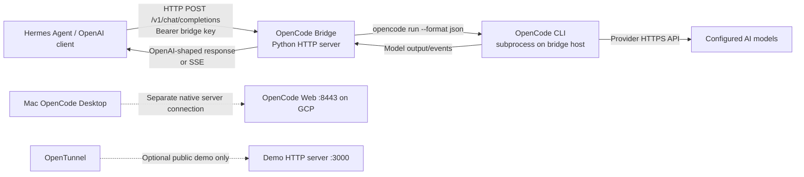

# 🌉 OpenCode Bridge — OpenAI-compatible API for Hermes and other clients

This is the **central entry point** for the OpenCode → OpenAI-compatible bridge already implemented elsewhere in this repository. **It does not duplicate or fork tested scripts.** Use the linked implementations so fixes remain in one place.

The bridge translates requests such as `GET /v1/models` and `POST /v1/chat/completions` into `opencode run` calls. It is **not** an official OpenCode service, not the same as `opencode web`, and not the same as OpenTunnel.

## 📂 1. Platform directories — Hermes is the default client

**Default client = Hermes Agent**, not the name of an LLM model. Configure Hermes as a **Custom Endpoint** with provider ID `opencode-bridge`. The existing bridge returns the dynamically discovered catalogue of **all OpenCode Zen models whose published input and output cost are zero**. It is not restricted to MiMo or DeepSeek; the list changes as upstream providers add and retire models. A *single* currently available free model must still be selected as the **initial Hermes model**.

| Directory | Platform | Included files | Status |
|---|---|---|---|
| 🍎 [`macos/`](macos/) | macOS | [`install.sh`](macos/install.sh), [README](macos/README.md) | Thin wrapper around existing launchd installer |
| 🐧 [`linux/`](linux/) | Ubuntu / Linux | [`install.sh`](linux/install.sh), [README](linux/README.md) | Thin wrapper around existing systemd --user installer |
| 🪟 [`windows/`](windows/) | Windows + WSL2 Ubuntu | [README](windows/README.md) | WSL2 compatibility approach; not yet end-to-end verified |
| ☁️ [`gcp-vm/`](gcp-vm/) | GCP Ubuntu VM | [README](gcp-vm/README.md) | Manual secured Python bridge, separate from verified Desktop server |
| ☸️ [`kubernetes/`](kubernetes/) | Kubernetes / GKE | [README](kubernetes/README.md) | Existing full Hermes + OpenCode sidecar Kustomize root |
| 🐳 [`docker/`](docker/) | Docker / container environments | [README](docker/README.md) | Existing Kubernetes container workflow; no tested standalone OpenCode Compose |

**Existing implementation is the source of truth:** [OpenCode bridge Python code](../kubernetes/bridge/opencode_bridge.py), [macOS/Linux scripts](../hermes-desktop/README.md), and [Kubernetes manifests](../kubernetes/README.md). These platform directories **reuse** the existing scripts rather than maintain diverging copies.

### All free OpenCode models, not a hard-coded selection

The Python bridge already supports:
- `--free-only` (**default**) and provider `opencode`.
- `--models` omitted or empty to discover all currently advertised free IDs; don't set a comma-separated allowlist if you want all of them.
- `GET /v1/models` to expose the discovered catalogue to Hermes.
- `GET /v1/models` is a discovery test, **not** proof of successful inference or unlimited free quotas.
- The Kubernetes environment also configures automatic rediscovery every 3600 seconds. The standalone Python bridge has its own catalogue refresh default.

```bash
# After starting the local bridge. macOS/Linux script default is :18383;
# GCP/Kubernetes examples use :18282. Send Bearer credentials when configured.
curl -fsS http://127.0.0.1:18383/v1/models | python3 -c \
  'import json,sys; print("\\n".join(m["id"] for m in json.load(sys.stdin)["data"]))'
```

**Hermes first-run defaults in existing Kubernetes manifests:** `HERMES_DEFAULT_PROVIDER=opencode-bridge`, `HERMES_DEFAULT_BASE_URL=http://127.0.0.1:18282/v1`, `HERMES_DEFAULT_MODEL=opencode/mimo-v2.5-free`. This is just the **initial model**; it does not limit the discoverable free model catalog.

**Port distinctions:** `:8443` is the separately verified OpenCode Web/native server on GCP; `:18383/v1` is the existing desktop/Linux script's OpenAI-compatible bridge default; `:18282/v1` is the bridge port used in the GCP manual example and existing Kubernetes manifests.

## 🏗️ 2. Architecture



**Where tools execute:** The bridge invokes OpenCode **on the machine/container hosting the bridge**. Its filesystem, shell and cloud permissions govern tool execution. A bridge on GCP does **not** automatically edit your Mac's local directories or reuse the conversation open in Mac OpenCode Desktop.

## 🚀  3. macOS / Linux — use the existing tested scripts

```bash
git clone https://github.com/ch-muhammad-asim/OpenDevOps.git
cd OpenDevOps/opencode/hermes-desktop

# Review the scripts and permissions first.
chmod +x install-opencode-bridge.sh run-bridge.sh
./install-opencode-bridge.sh

# Test existing service and endpoints:
./run-bridge.sh service-status
./run-bridge.sh selfcheck
./run-bridge.sh models
./run-bridge.sh test
./run-bridge.sh stream
./run-bridge.sh logs
```

By default the existing Bash scripts use `127.0.0.1:18383`. On **macOS** the service uses a `launchd` LaunchAgent; on **Linux** it uses a `systemd --user` service. To stop/remove the persistent service:

```bash
./run-bridge.sh uninstall-service
```

For a foreground session without installing a service:

```bash
./install-opencode-bridge.sh --no-service
./run-bridge.sh
```

To change port safely, set `BRIDGE_PORT=18282` **before installing/reinstalling the service**, then use `http://127.0.0.1:18282/v1` in the client. Script defaults and options are documented in the [existing desktop README](../hermes-desktop/README.md).

### Authentication and agent permissions

The existing installer defaults to an **empty bridge API key**, which means no HTTP authentication. That can be acceptable only for a carefully controlled local-loopback test; **set an API key for shared/remote access** and do not publish the process to the internet.

```bash
# Example: run a protected foreground bridge, not a persistent unattended service.
cd OpenDevOps/opencode/hermes-desktop
mkdir -p "$HOME/opencode-bridge-workspace"
read -rs -p "Bridge API key: " OPENCODE_BRIDGE_API_KEY; echo
export OPENCODE_BRIDGE_API_KEY
export OPENCODE_BRIDGE_CWD="$HOME/opencode-bridge-workspace"
./run-bridge.sh
```

The existing runner does **not** forward the Python bridge's `--no-auto-approve` switch. Its Python bridge **defaults to auto-approved tool execution**. If security is important, run the Python source directly with `--no-auto-approve` (next section), or add independent OS, filesystem, model-tool, IAM and Kubernetes restrictions before using the launcher. A working-directory setting alone is **not a sandbox**.

## 🔧  4. Run the existing Python bridge directly — GCP VM example

This is the most predictable way to bind a specific port and disable OpenCode's auto-approval while validating a new deployment:

```bash
# On the VM:
git clone https://github.com/ch-muhammad-asim/OpenDevOps.git
cd OpenDevOps/opencode/kubernetes/bridge
BRIDGE_SELFCHECK=1 python3 opencode_bridge.py

mkdir -p "$HOME/opencode-bridge-workspace"
read -rs -p "Bridge API key: " OPENCODE_BRIDGE_API_KEY; echo
export OPENCODE_BRIDGE_API_KEY

python3 opencode_bridge.py \
  --host 127.0.0.1 --port 18282 \
  --cwd "$HOME/opencode-bridge-workspace" \
  --api-key "$OPENCODE_BRIDGE_API_KEY" \
  --model opencode/deepseek-v4.1-flash-free \
  --no-auto-approve
```

**The model ID is an example from the earlier successful GCP CLI test.** Choose a model actually available from `opencode models opencode` and the bridge catalog. The exact GCP bridge workflow has **not** yet been end-to-end verified. See the [detailed VM-to-Hermes guide](../opentunnel/hermes-bridge-gcp.md) for firewall, SSH, auth and GKE routing.

## 🧪  5. Test API routes with curl

**From a terminal that can reach the running bridge**, enter the same API key using a hidden prompt if needed. Substitute `18383` if using the default Mac/Linux service.

```bash
read -rs -p "Bridge API key: " OPENCODE_BRIDGE_API_KEY; echo
export OPENCODE_BRIDGE_API_KEY
BASE=http://127.0.0.1:18282

# Health
curl -fsS -H "Authorization: Bearer $OPENCODE_BRIDGE_API_KEY" "$BASE/health" | jq .

# Discover models (choose the model from THIS response)
curl -fsS -H "Authorization: Bearer $OPENCODE_BRIDGE_API_KEY" "$BASE/v1/models" | jq -r '.data[].id'

# Real inference: replace the model with one advertised above
curl --fail-with-body -sS --max-time 360 \
  -H "Authorization: Bearer $OPENCODE_BRIDGE_API_KEY" \
  -H "Content-Type: application/json" \
  "$BASE/v1/chat/completions" \
  -d '{"model":"opencode/deepseek-v4.1-flash-free","stream":false,"messages":[{"role":"user","content":"Reply OK only"}]}' | jq .

# Authentication must reject missing keys if you configured one:
curl -sS -o /dev/null -w 'without key HTTP %{http_code}\n' "$BASE/v1/models"
```

Additional endpoints in this implementation: `GET /config`, `GET /metrics`, `GET /v1/models/{id}`, and SSE streaming when `stream: true`. **A JSON model list only proves discovery, not that the model can actually complete a request.**

For the default local installer when no API key is configured, the [existing `./run-bridge.sh test`](../hermes-desktop/run-bridge.sh) already handles the correct authentication mode.

## 🔐  6. Use from another computer through SSH

**On GCP** run the protected bridge at `127.0.0.1:18282`. **On the Mac** forward the port, independently of the existing OpenCode Web tunnel:

```bash
gcloud compute ssh instance-20261110-043424 \
  --project=playground-s-11-fffe4a40 \
  --zone=us-central1-c \
  -- -N -L 127.0.0.1:18282:127.0.0.1:18282
```

The Mac can now query `http://127.0.0.1:18282/v1/models` as long as the tunnel remains open. This is a local-only, encrypted SSH forward, **not** a public endpoint and not something GKE pods inherit.

## 🤖  7. Configure Hermes Agent

For Hermes **on the same host as the bridge** or on a Mac with the forward above, use **Settings → Providers → Custom Endpoints → New endpoint**:

| Hermes field | Value |
|---|---|
| Name | `OpenCode Bridge` |
| Provider ID | `opencode-bridge` (avoid ambiguous built-in aliases) |
| Endpoint URL | `http://127.0.0.1:18282/v1` (or `:18383/v1` if using the installer default) |
| API key | The same `OPENCODE_BRIDGE_API_KEY`, if configured |
| Default model | One selected from the real `/v1/models` result |
| Discover models | Enabled |

Click **Test**, then **Save**, then **Use** in Hermes. The existing [desktop integration README](../hermes-desktop/README.md) includes the detailed UI and example config file. A successful test should return assistant text through `/v1/chat/completions`, not merely show an endpoint in the picker.

**For Hermes on GKE:** `127.0.0.1` refers to the **pod**, not a separate VM. Either use the [existing in-cluster Kubernetes implementation](../kubernetes/README.md), with its appropriate in-pod loopback address, or design a private authenticated GKE-to-VM connection. Do **not** expose the bare Python bridge publicly to avoid network configuration.

## ☸️  8. Kubernetes / GKE — existing deployment

The [`../kubernetes/`](../kubernetes/README.md) directory is a **full Hermes + OpenCode bridge deployment**, including workloads, ConfigMaps, Secrets template, service, IngressRoute, and RBAC. It is **not just a standalone bridge Kustomize patch**. Review it before applying to an existing cluster to avoid namespace/resource conflicts.

```bash
cd OpenDevOps/opencode/kubernetes
kubectl kustomize .       # inspect rendered resources first
# Only after configuring namespace, secrets, domain, IAM/RBAC and reviewing manifests:
kubectl apply -k .
```

Secrets from `secrets/secret.template.yaml` are intentionally not generated by `kubectl apply -k .`. Read the [Kubernetes README](../kubernetes/README.md) and apply required Secrets separately. Review default tool auto-approval and the project's read-only policies and RBAC before deploying an agent with cluster access.

## 🖥️  9. OS support: important clarification

This repository has an **OpenCode Bash installer for macOS and Linux** and a **Kubernetes OpenCode deployment**. It does **not** establish that every operating system has a tested **OpenCode** installer. In particular, the repository-root [Windows scripts](../../windows/README.md), [macOS scripts](../../mac/README.md), [Ubuntu desktop scripts](../../ubuntu-desktop/README.md) and [Docker bridge](../../docker-bridge/README.md) are **Claude Code** bridge implementations, not interchangeable OpenCode binaries. Do not run them expecting to install an OpenCode bridge.

The Python `opencode_bridge.py` is written mostly with the standard library and contains some Windows-aware code paths, but that is **not proof of a tested native Windows service setup**.

## 🛠️  10. Troubleshooting and operational security

| Symptom | What to check |
|---|---|
| `localhost:8443/v1/models` returns 404 or HTML | This is OpenCode Web, not the OpenAI-compatible bridge |
| `jq` says invalid JSON | Check HTTP status/content type; HTML frontend or error body is not model JSON |
| `localhost:18282` connection refused | Did you actually start the Python bridge on port 18282? |
| `localhost:18383` connection refused | Inspect `./run-bridge.sh service-status`, logs and port binding |
| 401 | Missing/wrong bridge API key; server and client must share it |
| 400 invalid model | Use the exact model ID advertised by `/v1/models` |
| 429 | Bridge concurrency or provider rate limit |
| `Free usage limit reached` | Upstream model quota/access policy; SSH, OpenTunnel and bridge cannot bypass it |
| Hermes custom provider lists one model only | Test/Discover before Save; verify Base URL ends in `/v1` |
| GKE Hermes cannot reach `127.0.0.1:18282` on a VM | Pod loopback is different; use in-cluster bridge or private GKE-to-VM network route |
| Tools can modify unexpected files | Restrict agent permissions, service OS user, filesystem, cloud IAM; `--cwd` alone is insufficient |
| Persistent service is unexpectedly permissive | Check runner configuration; it may auto-approve; use a hardened launcher/isolated runtime |

**Security baseline:** Keep the bridge on loopback for local testing, require a strong key for remote/shared clients, restrict filesystem and cloud credentials, and use private networking (prefer in-cluster deployment for a GKE client). Bridge free-only mode filters catalog prices; it is **not a billing guarantee** or proof of upstream availability.

## ✅  11. Verification status and source of truth

| Item | Status |
|---|---|
| Existing macOS/Linux bridge scripts and tests | Present in repository; use `./run-bridge.sh selfcheck/test` to validate your installed environment |
| Existing Kubernetes deployment | Present in repository; requires environment-specific configuration/verification |
| Mac OpenCode Desktop → GCP native OpenCode Web on `:8443` | **Observed successful** in the November 2026 session |
| New GCP bridge on `:18282` → Hermes | **Not yet observed as deployed or tested** |
| Windows OpenCode bridge native installer | **Not verified / not present** |

**Authoritative implementation and detailed runbooks:** [macOS/Linux bridge and launcher](../hermes-desktop/README.md) · [Python bridge source](../kubernetes/bridge/opencode_bridge.py) · [Kubernetes deployment](../kubernetes/README.md) · [GCP VM / Hermes runbook](../opentunnel/hermes-bridge-gcp.md) · [verified Mac Desktop remote server](../opentunnel/remote-desktop-gcp.md).
