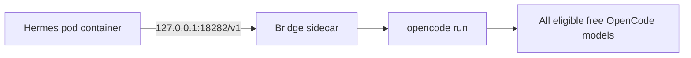

# Kubernetes / GKE — Hermes defaults to OpenCode bridge and all free catalog models

[← Main bridge guide](../README.md) · [Existing full deployment](../../kubernetes/README.md)

This directory is an **entry point to the existing implementation**, not a copy of Kubernetes manifests. The [actual Kustomize root](../../kubernetes/kustomization.yaml) already includes Hermes + bridge sidecar + security controls; it uses the provider ID `opencode-bridge`.

The actual checked-in settings in [bridge env](../../kubernetes/configmaps/configmap-opencode-bridge-env.yaml) are:

```yaml
OPENCODE_BRIDGE_HOST: "127.0.0.1"
OPENCODE_BRIDGE_PORT: "18282"
OPENCODE_BRIDGE_MODEL_PROVIDERS: opencode
OPENCODE_BRIDGE_FREE_ONLY: "true"
OPENCODE_BRIDGE_MODELS: ""                  # empty means auto-discover all free models
OPENCODE_BRIDGE_MODEL_REFRESH_INTERVAL: "3600"
```

And the checked-in [Hermes runtime config](../../kubernetes/configmaps/configmap-hermes-runtime-env.yaml) defaults to:

```yaml
HERMES_DEFAULT_PROVIDER: opencode-bridge
HERMES_DEFAULT_BASE_URL: http://127.0.0.1:18282/v1
HERMES_DEFAULT_API_MODE: chat_completions
```

The currently configured **initial Hermes model** is `opencode/mimo-v2.5-free`, **not** a hardcoded list of all available models. The bridge discovers the entire zero-advertised-cost OpenCode model catalog and Hermes can offer those models. **A default model is one selection; a catalog is many models.** Availability is provider-dependent.



Before deployment, read the [complete Kubernetes README](../../kubernetes/README.md), configure Secrets, namespace, ingress/domain, policy and IAM/RBAC, and render manifests:

```bash
cd OpenDevOps/opencode/kubernetes
kubectl kustomize .
# Only after reviewing environment-specific prerequisites:
# kubectl apply -k .
```

Applying these manifests may install a **full Hermes stack**, so do not apply blindly to an existing Hermes deployment. The bridge auto-approval and read-only safety policy should be independently reviewed.
