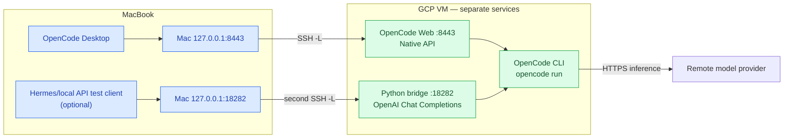
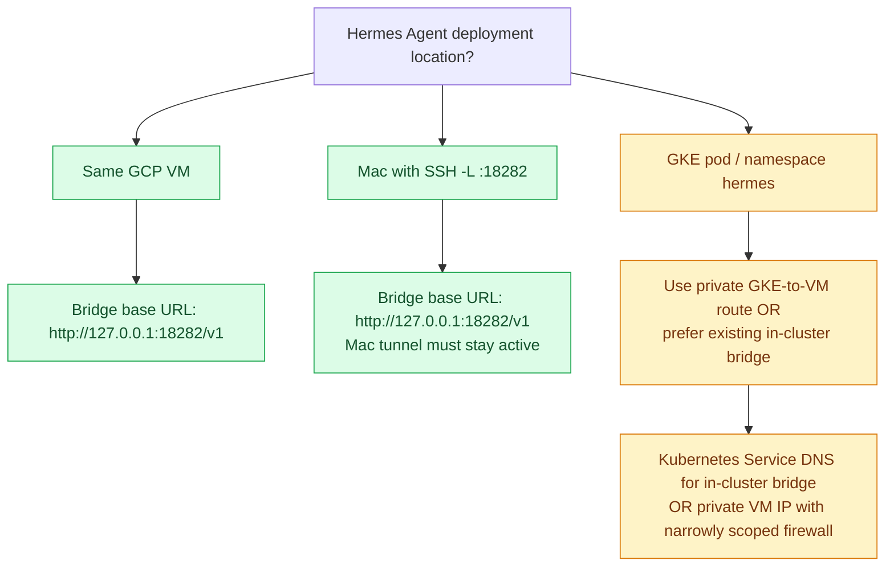
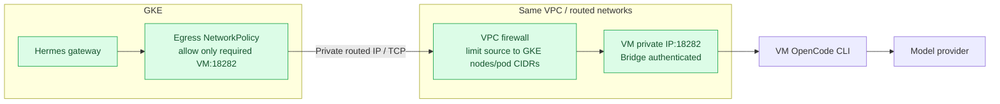
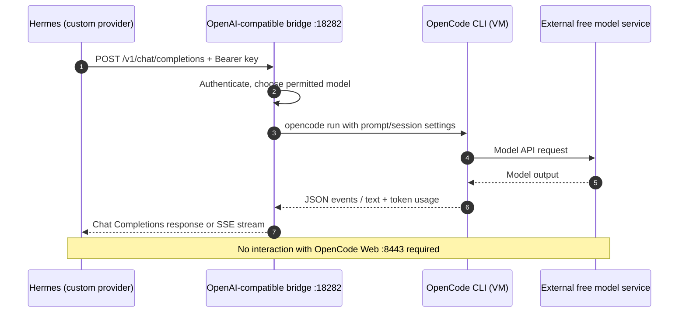

# OpenCode on GCP → OpenAI-compatible bridge → Hermes Agent

**Purpose:** Keep the **already verified** macOS OpenCode Desktop → GCP OpenCode Web connection on port `8443`, while optionally adding an **independent OpenAI-compatible bridge** on port `18282` for Hermes Agent or another Chat Completions client.

**Status as of 2026-11-10:** OpenCode v2.2.6 on the VM, the private SSH forward, the Mac Desktop's `gcp-vm` server selection and successful DeepSeek V4.1 Flash Free replies have been **observed working**. The *additional Python bridge on this VM*, Hermes integration with that bridge, and GKE-to-VM networking have **not yet been deployed or verified**. All bridge commands in this document are instructions to test, not claims of completed setup.

> ✅ **Update — a standalone bridge VM has since been built and verified.** 🎉
> A separate GCE instance (`hermes-bridge-vm`, `us-central1-a`, Ubuntu 24.04.5, `e2-medium`)
> now runs `opencode/hermes-desktop/opencode_bridge.py` as the systemd unit
> `opencode-bridge.service` under an unprivileged `bridge` user, on `127.0.0.1:18383`,
> with bearer auth from `/etc/opencode-bridge.env`. Verified from a workstation over an
> SSH tunnel: 🩺 `/health` → `ok`, 📚 `/v1/models` → 12 free models, 🔐 missing/wrong key →
> `401`, 💬 `/v1/chat/completions` → live reply, and 🗂️ **real filesystem access** — the
> model listed `/srv/bridge/workspace`, read the fixture files (marker matched the
> provisioner's), ran `ps`, and wrote a file that was confirmed on the VM with `ls`/`cat`.
> That VM's opencode is **v1.19.5**, which caught a case-sensitivity regression the v2 work
> introduced: 1.x wants `--log-level ERROR`, v2 wants `error`. The bridge now probes
> `opencode run --help` and mirrors whichever spelling the CLI advertises. 🧪
>
> 🔁 **Reproduce it:** [`vm-bridge-provision.sh`](vm-bridge-provision.sh) does the whole VM
> (packages, `bridge` user, OpenCode CLI, fixtures, API key, systemd unit, health check):
>
> ```bash
> gcloud compute scp opencode/opentunnel/vm-bridge-provision.sh hermes-bridge-vm:/tmp/
> gcloud compute ssh hermes-bridge-vm --command='sudo bash /tmp/vm-bridge-provision.sh'
> # 🔌 then tunnel it to the workstation (18383 is the local desktop bridge, so use 28383):
> gcloud compute ssh hermes-bridge-vm -- -N -L 127.0.0.1:28383:127.0.0.1:18383
> curl -s -H "Authorization: Bearer $OPENCODE_BRIDGE_API_KEY" http://127.0.0.1:28383/health
> ```

For the working, bridge-free Mac Desktop solution, see [remote-desktop-gcp.md](remote-desktop-gcp.md).

## 1. The three different things (avoid mixing them up)

| Component | Function | Address | Client |
|---|---|---|---|
| OpenCode Web/native server | Native OpenCode server and user interface | GCP `127.0.0.1:8443` | Mac OpenCode Desktop (through SSH) |
| `opencode_bridge.py` | **Translation** from OpenAI-compatible Chat Completions to `opencode run` | GCP `127.0.0.1:18282` by default in this example | Hermes custom endpoint (through a *reachable* network path) |
| OpenTunnel | **Connectivity** for an incoming public URL, not API translation | Optional separate public demo route | Browser/public test app |

Port `18282` is **our chosen bridge port, not an official OpenCode server port**. `/v1/models` and `/v1/chat/completions` belong to the bridge, **not** the `8443` OpenCode Web server.



**Note:** This diagram's optional local Hermes client is on the **Mac**. For an actual **GKE-based Hermes** deployment, see section 8. Its localhost points *inside its own pod*, not at this VM.

## 2. Prerequisites

- VM: Ubuntu/Debian with Python 3 and `opencode` installed. Existing VM example: `instance-20261110-043424` in `playground-s-11-fffe4a40`, `us-central1-c`.
- The VM's OpenCode CLI must be able to complete a model request: `opencode run -m opencode/deepseek-v4.1-flash-free 'Reply OK only'`. This was successful in one earlier test; upstream free access may change.
- Git, Python, curl, and ideally `jq` available. `setup.sh` in this directory installs OpenCode, OpenTunnel and Herdr but **does not currently install or start the bridge**.
- A separate bridge-only working directory whose contents are safe for agent tools to read. Do not point the bridge at `/`, your personal home directory, cloud credentials or production source secrets.
- Mac: `gcloud` login and an SSH tunnel, if testing Hermes or the bridge client on the Mac.
- The bridge's actual source of truth is **[`opencode_bridge.py`](../kubernetes/bridge/opencode_bridge.py)**. Reuse this Python source; don't invent another server implementation.

## 3. On the GCP VM — retrieve and inspect the bridge

```bash
sudo apt-get update -qq && sudo apt-get install -y git python3 curl jq openssl
git clone https://github.com/ch-muhammad-asim/OpenDevOps.git ~/OpenDevOps
cd ~/OpenDevOps/opencode/kubernetes/bridge

# Offline self-tests of the Python bridge implementation:
BRIDGE_SELFCHECK=1 python3 opencode_bridge.py
python3 opencode_bridge.py --help
opencode --version
opencode models opencode | grep -i free
```

For an existing clone, use `git -C ~/OpenDevOps pull --ff-only` after checking that the working tree has no uncommitted changes.

The bridge is **stdlib-only**. It starts subprocesses using the OpenCode CLI installed on this VM; it does **not** call the `8443` OpenCode Web API. The CLI and web server can coexist, but they are separate processes.

## 4. Generate and store an API key

**`OPENCODE_BRIDGE_API_KEY` is a shared secret for authenticating Hermes-to-bridge HTTP requests.** It is not an OpenCode inference API key, a Hugging Face key, or an OpenRouter key.

For an initial *foreground-only test* on the VM:

```bash
umask 077
export OPENCODE_BRIDGE_API_KEY="$(openssl rand -hex 32)"
# Save the key securely in a password manager or a secret manager.
# Do NOT print it to a shared terminal, commit it, or post it in logs.
```

This key must be available to the **bridge process** and its **Hermes client**. A key exported in a different terminal will not automatically be inherited by an already running service. For an unattended service, load it from a protected file / secret store, not a command typed with the literal secret.

## 5. Start the OpenAI-compatible bridge on GCP (foreground test)

Use **a restricted empty workspace** so commands the model invokes cannot inadvertently work in your home directory. The bridge's default is `--auto-approve`, which is risky on a VM with cloud credentials. Use `--no-auto-approve` for the first test, or apply a properly reviewed OpenCode permission policy and read-only OS/IAM sandbox before permitting headless tool actions.

```bash
mkdir -p ~/opencode-bridge-workspace
cd ~/OpenDevOps/opencode/kubernetes/bridge

# Run in foreground. The bridge will listen ONLY on VM loopback.
python3 opencode_bridge.py \
  --host 127.0.0.1 \
  --port 18282 \
  --cwd "$HOME/opencode-bridge-workspace" \
  --model opencode/deepseek-v4.1-flash-free \
  --api-key "$OPENCODE_BRIDGE_API_KEY" \
  --no-auto-approve
```

Keep this terminal open. Separately check:

```bash
ss -lntp | grep -E ':8443|:18282'
```

**Caution:** Some tool-using or headless requests may fail or stop for approval with `--no-auto-approve`. Never disable safeguards just to make a demo work. The existing Kubernetes deployment enforces additional permission policy, wrapper, RBAC and container controls; a bare VM Python process **does not automatically inherit those protections**. If you choose to use `--auto-approve`, do it only with an isolated unprivileged service account, non-sensitive workspace, strict filesystem permissions and narrowly scoped cloud credentials.

## 6. Verify the bridge locally on the VM

In a **second terminal on the VM**, enter the same secret locally in a non-echoing prompt if it was not injected from your secret store:

```bash
read -rs -p "Bridge API key: " OPENCODE_BRIDGE_API_KEY; echo
export OPENCODE_BRIDGE_API_KEY
```

### Health

```bash
curl --fail-with-body -sS \
  -H "Authorization: Bearer $OPENCODE_BRIDGE_API_KEY" \
  http://127.0.0.1:18282/health | jq .
```

### List models

```bash
curl --fail-with-body -sS \
  -H "Authorization: Bearer $OPENCODE_BRIDGE_API_KEY" \
  http://127.0.0.1:18282/v1/models | jq -r '.data[].id'
```

**Model discovery is not proof of inference.** Select the exact ID returned in the catalog. It may differ from the one used during the previous successful CLI run, and "free" catalog entries can become unavailable.

### Execute a completion (the decisive test)

```bash
curl --fail-with-body -sS --max-time 360 \
  -H "Authorization: Bearer $OPENCODE_BRIDGE_API_KEY" \
  -H 'Content-Type: application/json' \
  http://127.0.0.1:18282/v1/chat/completions \
  -d '{
    "model": "opencode/deepseek-v4.1-flash-free",
    "stream": false,
    "messages": [{"role": "user", "content": "Reply OK only"}]
  }' | jq .
```

If the model is not advertised, replace it with an actual listed ID. The full end-to-end test must receive a successful `choices[0].message.content`, not just HTTP 200 from `/health`.

### Negative authentication tests

```bash
# Should be denied (normally 401):
curl -sS -o /dev/null -w 'No key: %{http_code}\n' http://127.0.0.1:18282/v1/models
curl -sS -o /dev/null -w 'Wrong key: %{http_code}\n' \
  -H 'Authorization: Bearer wrong-key' http://127.0.0.1:18282/v1/models
```

If requests without the key succeed, **do not expose the bridge**; investigate before proceeding.

## 7. Mac testing via a second SSH forward

Your current Desktop path `8443 → 8443` remains unchanged. To reach the **bridge** privately from your Mac, forward **another port** too:

```bash
gcloud compute ssh instance-20261110-043424 \
  --project=playground-s-11-fffe4a40 \
  --zone=us-central1-c \
  -- -N \
  -L 127.0.0.1:8443:127.0.0.1:8443 \
  -L 127.0.0.1:18282:127.0.0.1:18282
```

Stop the **old** 8443-only SSH tunnel first (or keep it and create a second, 18282-only forward) to avoid `Address already in use`.

On the **Mac**, provide the same bridge secret securely and test:

```bash
read -rs "OPENCODE_BRIDGE_API_KEY?Bridge API key: "; echo
export OPENCODE_BRIDGE_API_KEY
curl --fail-with-body -sS \
  -H "Authorization: Bearer $OPENCODE_BRIDGE_API_KEY" \
  http://127.0.0.1:18282/v1/models | jq .
```

Now a Hermes instance actually **running on the Mac** can use `http://127.0.0.1:18282/v1`, with this API key. The tunnel needs to stay running.

## 8. Hermes Agent: where is it running?



### A. Hermes on same VM or on Mac

In the Hermes dashboard: **Settings → Providers → Custom Endpoints → New endpoint** (labels vary by Hermes version):

- Name / provider ID: `opencode-bridge` (avoid collisions with a built-in `opencode` alias).
- Base URL: `http://127.0.0.1:18282/v1`.
- API key: your bridge API key.
- Default model: an ID actually returned by `/v1/models`.
- Discover/Test the models **before** saving, then select/use the endpoint.

Some versions of Hermes store a custom provider in `~/.hermes/config.yaml` and credentials in `~/.hermes/.env`. The existing [Hermes desktop bridge README](../hermes-desktop/README.md) describes its supported provider configuration; follow that version's field names rather than guessing with an arbitrary `model:` YAML stanza.

### B. Hermes deployed in GKE (your observability lab)

**Do not configure `http://127.0.0.1:18282/v1` in a GKE Hermes pod** unless you have explicitly installed a **sidecar in that same pod**. Inside GKE, `127.0.0.1` is the pod's network namespace. Your Mac's SSH forward does not provide that address to Kubernetes workloads.

**Recommended, least-network-complex:** run the [existing bridge as an in-cluster sidecar/deployment](../kubernetes/README.md) alongside Hermes, with authentication and read-only tool/cluster permissions. This avoids an exposed VM bridge service and a dependency on your laptop staying connected. Observe that the repository's Kubernetes example is its own deployment, not necessarily a drop-in patch for the separate `hermes-grafana-tempo/hermes` manifests. **Review namespaces, Services, accounts, secret names and network policies before combining them.**

**Alternative: bridge on external VM:** requires a deliberately configured, **authenticated private GKE-to-VM route**:



Requirements: discover the VM's **actual internal IP**; verify routes from pod CIDRs, GKE Dataplane V2 policy and node/VM firewalls; use least-privilege egress and ingress, secrets for authentication, and preferably end-to-end TLS/mTLS or a private proxy. Unlike loopback-only mode, any VM bridge reachable on its private IP must bind to that address (or a restricted ingress proxy). **Do not simply change `--host` to `0.0.0.0` and open port 18282 to the internet.** A custom network design is required before attempting this path.

See [the Hermes GKE deployment](../../hermes-grafana-tempo/hermes/README.md) and its NetworkPolicies before making changes to a cluster. This document does **not** assert GKE-to-VM connectivity currently exists.

## 9. End-to-end request sequence



### Critical behavioral limitation

The bridge flattens chat history and launches a **new `opencode run` process** per completion; it is **not** the same session as your Mac Desktop conversation on port 8443. It may run commands with the **VM's OS permissions**. The bridge advertises free-model costs as metadata, but actual access still depends on provider quota and availability. The bridge is a custom compatibility adapter rather than an official hosted OpenAI API and may not implement every optional OpenAI feature.

## 10. Production guardrails and operations

| Control | Required practice |
|---|---|
| Authentication | High-entropy `OPENCODE_BRIDGE_API_KEY`; never publish or check it into Git |
| Network | Loopback-only on the VM for SSH testing; private authenticated connection only if GKE is remote |
| Authorization | Dedicated unprivileged OS user; avoid ambient broad `gcloud` credentials and sensitive mounts |
| OpenCode tools | Review `--auto-approve` default; use `--no-auto-approve` initially or enforce independent sandbox/allowlist |
| Input handling | Treat Hermes/user prompts as untrusted; possible prompt injection could trigger tool actions |
| Filesystem | Restricted `--cwd`; understand that `--cwd` **is not a filesystem security boundary by itself** |
| Observability | Avoid exposing secret-bearing prompts, model outputs and `/config`/metrics unprotected |
| Availability | Plan process supervision, restarts, concurrency, timeout, upstream quota/rate handling |
| Rotation | Rotate the bridge key in its process and Hermes secret together |
| Verification | Repeat auth-denial, model listing, actual completion and negative/error-path tests |

To run persistently, prefer a reviewed `systemd` service under its own service user with a root-owned credential file, fixed working directory, restricted filesystem and restart policy. This guide intentionally does **not** install an always-on, automatically approving agent into a credentialed VM.

## 11. Troubleshooting quick reference

| Symptom | What it means / next action |
|---|---|
| `curl localhost:8443/v1/models` returns 404 | You contacted OpenCode Web; use bridge `localhost:18282/v1/models` |
| `curl localhost:18282` connection refused | Bridge process not started / not listening |
| Bridge returns 401 | Missing or wrong Bearer token |
| `/v1/models` works but chat fails | Model was discovered, but quota/permissions/tool execution or upstream request failed |
| `Free usage limit reached` | Upstream OpenCode model access restriction; tunnel/bridge do not bypass it |
| Model not listed | Check `opencode models opencode --verbose` and bridge's free-only filter |
| 429 | Bridge concurrency or upstream rate limit |
| Timeout / 504 | Increase carefully after checking logs and process health |
| Mac works but GKE Hermes fails | `127.0.0.1` points to GKE pod; configure in-cluster or private networking |
| Mac OpenCode Desktop shows remote sessions but Hermes does not | Desktop uses the native API on `8443`; Hermes uses the separate `/v1` bridge |
| Bridge model returns tool permission error | `--no-auto-approve` blocks headless tool execution; adjust only in an isolated permission-controlled environment |

## 12. Acceptance checklist

- [ ] Python bridge passes `BRIDGE_SELFCHECK=1`.
- [ ] Bridge listens only on `127.0.0.1:18282` for VM/Mac test.
- [ ] Missing and invalid API keys are denied.
- [ ] `/v1/models` returns JSON with usable IDs.
- [ ] `/v1/chat/completions` returns a genuine assistant response with an approved model.
- [ ] Mac local SSH forward reaches the bridge on `18282`, independently of the already working Desktop server on `8443`.
- [ ] Hermes custom endpoint Test/Save succeeds and a conversation receives a response.
- [ ] If Hermes runs on GKE, network policy, private route, authentication, and pod-side endpoint are verified separately.
- [ ] Permissions, logs, secrets, update/restart behavior and upstream quota limitations have been reviewed.

## Sources within this repository

- [Verified Mac Desktop → GCP server](remote-desktop-gcp.md)
- [Python bridge implementation](../kubernetes/bridge/opencode_bridge.py)
- [Bridge implementation README](../kubernetes/bridge/README.md)
- [Hermes desktop provider instructions](../hermes-desktop/README.md)
- [Existing Kubernetes bridge deployment and security boundaries](../kubernetes/README.md)
- [Hermes GKE observability deployment](../../hermes-grafana-tempo/hermes/README.md)
