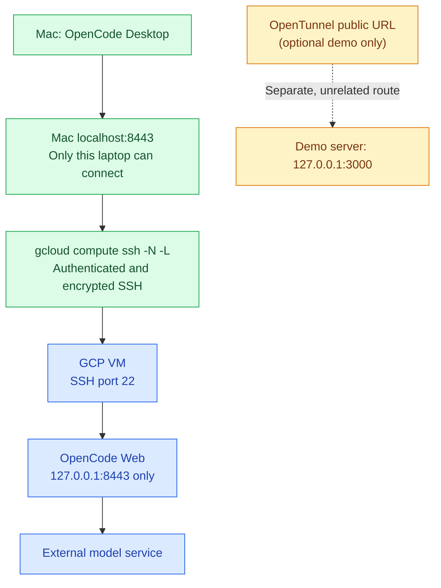
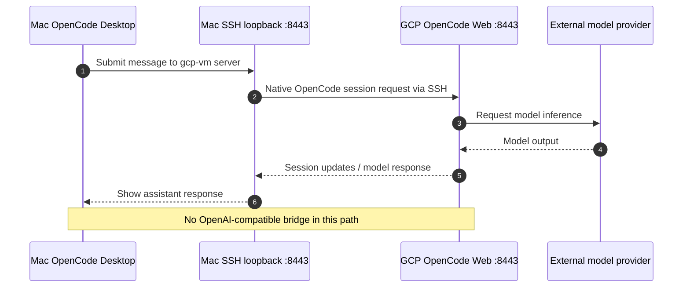

# OpenCode Desktop on macOS → OpenCode on GCP (verified)

**Working result — 2026-11-10:** The OpenCode Desktop application on macOS connected to a GCP VM using the built-in **Settings → Servers → Add server** flow. The GCP instance was reached through a **local, encrypted SSH port-forward** at `http://127.0.0.1:8443`. In the remote session, **DeepSeek V4.1 Flash Free** generated responses, as shown in the user's successful test. This is an end-to-end manual verification, **not a load, security, or availability benchmark**.

**No Hermes, OpenAI-compatible bridge, or public OpenTunnel route is required for this solution.**

## 1. Complete, minimal architecture

```mermaid
flowchart LR
  subgraph laptop["MacBook — local"]
    desktop["OpenCode Desktop GUI"]
    loop["127.0.0.1:8443<br/>SSH local forward"]
    desktop -->|"Native OpenCode server API"| loop
  end
  subgraph cloud["Google Cloud — us-central1-c"]
    ssh["GCE VM SSH service"]
    server["OpenCode Web/server<br/>127.0.0.1:8443"]
    ssh -->|"Forwarded HTTP on VM loopback"| server
  end
  model["OpenCode model backend<br/>DeepSeek V4.1 Flash Free"]
  loop -->|"Encrypted SSH transport"| ssh
  server -->|"Outbound model request"| model
  model -->|"Model response"| server
  classDef client fill:#dbeafe,stroke:#2563eb,color:#1e3a8a
  classDef remote fill:#dcfce7,stroke:#16a34a,color:#14532d
  classDef network fill:#ffedd5,stroke:#ea580c,color:#7c2d12
  class desktop,loop client
  class server,ssh remote
  class model network
```



**Key distinction:** OpenCode Desktop uses the remote OpenCode **server connection**. Its **Providers** screen is for connecting to LLM inference providers, *not* for connecting to another OpenCode server. The remote server controls sessions, workspace operations and upstream model access.

## 2. Network and trust boundaries



- The SSH command's `-L 127.0.0.1:8443:127.0.0.1:8443` binds the **Mac** listener to its loopback address and forwards to the **VM** loopback address. This does **not** publish port 8443 through the GCP firewall.
- The OpenCode Web server also binds to **VM loopback**. Keep `OPENCODE_SERVER_PASSWORD` set and secret; do not publicly expose its API without strong access controls.
- The OpenTunnel demo is separate. It does **not** translate API protocols and does not change the outbound IP used to request models.
- **Remote tools run with permissions of the GCP VM process.** Start OpenCode in a limited workspace, with the minimum cloud credentials and OS privileges needed.

## 3. Setup — exact commands

### A. On GCP VM: start authenticated OpenCode Web

Install OpenCode from [the parent setup script](setup.sh) or the [official OpenCode instructions](https://opencode.ai/docs/).

```bash
opencode --version
# Choose and save a strong secret; input is not echoed.
read -rs -p "OpenCode server password: " OPENCODE_SERVER_PASSWORD; echo
export OPENCODE_SERVER_PASSWORD
opencode web --hostname 127.0.0.1 --port 8443
```

The foreground process must stay running. OpenCode Web serves both the application and its native backend. Do **not** replace it with a Python `http.server` instance.

### B. On Mac: forward private port 8443 over gcloud SSH

Install `gcloud` locally and authenticate to the correct Google Cloud project. The VM in the verified example was `instance-20261110-043424`, project `playground-s-11-fffe4a40`, zone `us-central1-c`. **Change these values for a different environment.**

```bash
gcloud auth login

gcloud compute ssh instance-20261110-043424 \
  --project=playground-s-11-fffe4a40 \
  --zone=us-central1-c \
  -- -N -L 127.0.0.1:8443:127.0.0.1:8443
```

This terminal remains busy while forwarding. Leave it open. Do **not** insert an extra word `instance` after the VM name. Use `--tunnel-through-iap` before `--` if your network requires IAP and IAM/firewall are configured accordingly.

Alternative for a regular SSH-accessible VM:

```bash
ssh -N -L 127.0.0.1:8443:127.0.0.1:8443 cloud_user@d8d0041c.mylabserver.com
```

### C. On Mac: verify HTTP access without dumping HTML

```bash
curl -sS -u opencode \
  -o /dev/null \
  -w 'HTTP %{http_code} / %{content_type}\n' \
  http://127.0.0.1:8443/
```

This prompts for the password set on the GCP server. `HTTP 200 / text/html` on **/** means the OpenCode Web frontend is reachable, **not** by itself that a model inference request succeeds.

`curl -v telnet://localhost:8443` can check the TCP connection, but it does **not** validate authentication, application APIs or inference. An IPv6 `::1` failure is expected when the tunnel listens only on IPv4 `127.0.0.1`.

### D. In the OpenCode Desktop app on macOS

1. Go to **Settings → Servers** (not **Providers**).
2. Select **Add server**.
3. Set a name such as `gcp-vm` and URL **`http://127.0.0.1:8443`** (no `/v1` suffix).
4. Supply the server credentials if prompted. The server should appear with a **green connection dot**.
5. Return to the app, select `gcp-vm` as the current server, create or select a session, and select an available model (the test used **DeepSeek V4.1 Flash Free**).
6. Send `hi` or `Reply OK only` and verify an assistant response. This final step, not the green dot alone, validates the full remote inference path.

The desktop app also displays a separate local server, normally bound to a dynamically chosen loopback port. Select **gcp-vm**, not the local server, for remote execution.

## 4. Request/response sequence (what happens when you send 'hi')



## 5. What is and isn't verified

| Test | Result | What it proves |
|---|---|---|
| GCP `opencode --version` | ✅ v2.2.6 observed | CLI installed on the VM |
| Free model via VM CLI | ✅ `OK` in one test | That model request succeeded once |
| Mac SSH forwarding | ✅ local port connected | TCP listener and SSH forwarding present |
| OpenCode Web on forwarded URL | ✅ HTML received | Web frontend reachable |
| Desktop → Servers → `gcp-vm` | ✅ green indicator | Desktop recognized remote server |
| Desktop conversation → remote model | ✅ response displayed | **End-to-end user scenario succeeded** |
| Remote OpenAI-compatible `/v1/models` | ❌ not supported by this design | Server connection is not model-protocol translation |
| Public OpenTunnel route | Not needed | Different network-access tool |

## 6. Troubleshooting

| Symptom | Diagnosis / action |
|---|---|
| `gcloud compute ssh ... unrecognized arguments: instance` | Remove the stray `instance` argument after the VM name |
| SSH command looks stuck | Normal with `-N`; it remains active to forward ports |
| `localhost:8443` refuses IPv6 `::1` but connects via IPv4 | Use explicit `127.0.0.1` |
| `curl /v1/models` yields 404 | OpenCode Web is *not* an OpenAI-compatible bridge |
| `curl /provider` yields HTML or `jq` parse error | Not valid JSON from this route; don't interpret HTML as a model catalog |
| Desktop green server, but no AI response | Verify the selected server, chosen model, VM `opencode run` test, auth and upstream quota |
| `Free usage limit reached` | Provider-side free-tier restriction; SSH and OpenTunnel do not reset quotas |
| SSH stops or local port is occupied | Reconnect SSH or use a different **local** forwarding port; update Desktop's URL to match |

For the generic installation, OpenTunnel demonstration and other SSH options, see the [main guide](README.md).

## 7. Final takeaway

**This successfully tested solution uses only OpenCode Desktop + a GCP-hosted OpenCode server + private SSH forwarding.** OpenTunnel can be kept for unrelated demo endpoints; it is **not involved** in the working Desktop-to-GCP request path.
