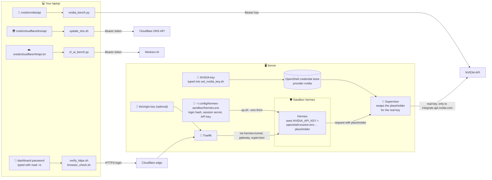

# 🔧 Environment variables and credentials

This is the reference for **every environment variable, `.env` file and credential** in the Hermes OpenShell sandbox (`sandbox/`): what each one does, its default, who reads it, and where an **API key or secret is required**. Each Docker Compose stack has a ready-to-copy `.env.example` file.

- 📘 Setup guide: [README.md](README.md) · 🛡️ Security: [SECURITY.md](SECURITY.md) · ☸️ Kubernetes: [KUBERNETES.md](KUBERNETES.md)
- ✅ Verified on 2026-10-31 against the live server (`docker compose config` for every stack, the scripts' own defaults and the running containers).

## 📑 Contents

1. [Where an API key or secret is required](#-1-where-an-api-key-or-secret-is-required)
2. [How the secrets flow](#️-2-how-the-secrets-flow)
3. [Rules for secrets](#️-3-rules-for-secrets)
4. [Example files at a glance](#-4-example-files-at-a-glance)
5. [Docker Compose and `.env` files](#-5-docker-compose-and-env-files)
6. [Hermes inside the sandbox](#-6-hermes-inside-the-sandbox)
7. [Compose stacks](#-7-compose-stacks): [OpenShell gateway](#71-openshell-gateway) · [hermes-tunnel](#72-hermes-tunnel) · [Traefik](#73-traefik) · [OpenCode bridge](#74-opencode-bridge)
8. [Operator scripts](#-8-operator-scripts)
9. [Tests](#-9-tests)
10. [Model benchmarks](#-10-model-benchmarks)
11. [Kubernetes](#️-11-kubernetes)
12. [Rotating a credential](#-12-rotating-a-credential)
13. [Troubleshooting](#-13-troubleshooting)

---

## 🔑 1. Where an API key or secret is required

| # | Credential | Needed for | Variable(s) | Where the real value lives | Example / template |
|---|---|---|---|---|---|
| 1 | 🔐 **Hermes dashboard login** | Logging in at `https://hermes…/` (web chat) | `HERMES_DASHBOARD_BASIC_AUTH_USERNAME`, `…_PASSWORD_HASH`, `…_SECRET` | `~/.config/hermes-sandbox/hermes.env` on the server (`600`), passed into the sandbox | [`hermes/hermes.env.example`](hermes/hermes.env.example) |
| 2 | 🗝️ **Hermes API key** | The OpenAI-compatible API (`/v1/…`, `Authorization: Bearer`) | `API_SERVER_KEY` (Hermes) · `HERMES_API_KEY` (tests) | Same `hermes.env` | [`hermes/hermes.env.example`](hermes/hermes.env.example) |
| 3 | 🤖 **NVIDIA API key** (`nvapi-…`) | Hermes's default models (NVIDIA API Catalog) | `NVIDIA_API_KEY` (placeholder in the sandbox; typed into `set_nvidia_key.sh`) | **OpenShell's credential store** (provider `nvidia`); operator copy on your laptop `~/Desktop/sandbox/creds/nvidia/api` (`600`, used by `nvidia_bench.py`) | [`providers/hermes-nvidia.yaml`](providers/hermes-nvidia.yaml), [`k8s/secret.example.yaml`](k8s/secret.example.yaml) |
| 4 | 🌍 **Cloudflare DNS API token** | Pointing the `A` record at a new server IP (`update_dns.sh`) | `CLOUDFLARE_API_TOKEN` / `CLOUDFLARE_API_TOKEN_FILE` | `~/Desktop/sandbox/creds/cloudflare/dns/api` (`600`) on your laptop | [`operator.env.example`](operator.env.example) |
| 5 | ☁️ **Cloudflare Workers AI token + account ID** | Testing Cloudflare's free models (`cf_ai_bench.py`) | `CLOUDFLARE_AI_TOKEN`, `CLOUDFLARE_ACCOUNT_ID` / `CLOUDFLARE_AI_CREDS_FILE` | `~/Desktop/sandbox/creds/cloudflare/AI/api.txt` (`600`) | [`cloudflare-ai/cloudflare-ai.env.example`](cloudflare-ai/cloudflare-ai.env.example) |
| 6 | 🏅 **Cloudflare Origin Certificate** *(optional)* | SSL mode *Full (strict)* between Cloudflare and Traefik | `TRAEFIK_TLS_DIR` (folder) | `~/.config/hermes-sandbox/tls/origin.pem` + `origin.key` (`600`) | [`traefik/.env.example`](traefik/.env.example) |
| 7 | 🪪 **OIDC client secret** *(Kubernetes only)* | The provider-bootstrap Job logging in to the gateway | `OIDC_CLIENT_SECRET_FILE` | A Kubernetes Secret mounted as a file | [`k8s/provider-bootstrap-job.yaml`](k8s/provider-bootstrap-job.yaml) |

**No key is needed for:**

- 🌉 **The OpenCode bridge.** It has no authentication. It's published on `127.0.0.1` only, and Hermes reaches it through the sandbox rule. Hermes still requires a key variable, so `OPENCODE_BRIDGE_API_KEY=not-needed` is a placeholder. The free models run under an anonymous OpenCode client identity, kept in the bridge's `bridge-config` volume (see [7.4](#74-opencode-bridge)).
- 🚦 **Traefik.** There's no Let's Encrypt and no Cloudflare token: Cloudflare's edge holds the browser-facing certificate.
- 🚪 **The OpenShell gateway.** It listens on loopback, unauthenticated, on a single-user host (see [`openshell/gateway.toml`](openshell/gateway.toml)).

---

## 🗺️ 2. How the secrets flow

This diagram shows only where secrets live and travel. The network path itself is in [README.md → Architecture at a glance](README.md#architecture-at-a-glance).



The point of this layout: **Hermes never holds the NVIDIA key**. It only sees a placeholder, and the OpenShell supervisor swaps in the real key only on requests to `integrate.api.nvidia.com`. The secrets Hermes does hold (its own login and API key) are scrubbed from the commands its tools run, and nothing in the sandbox can send them anywhere except the approved model routes (see [README §6](README.md) and [SECURITY.md](SECURITY.md)).

---

## 🛡️ 3. Rules for secrets

1. 🙈 **Never in git.** `.gitignore` blocks `*.env`, `.env`, `.env.*`, `*.key` and `*.pem`; only `*.env.example`, `.env.example` and `site.env` are committed. Example files hold **placeholders only** (`REPLACE`). `scripts/scan.sh` (gitleaks) fails CI on a leaked secret.
2. 🔒 **`chmod 600` files, `700` folders.** Create them with `install -m 600 …` or under `umask 077`. `update_dns.sh`, `cf_ai_bench.py` and `https_up.sh` (for `origin.key`) **refuse** a credential file that's readable by others.
3. ⌨️ **Never on a command line.** Values on a command line show up in `ps` and shell history. Type them with `read -rs VAR; export VAR`, or let the script read the file. The scripts pass secrets on **stdin** or in private temp files (curl `-H @file`, `--env-from`).
4. 🧾 **Never printed.** No script prints a secret, its length or a prefix. Reports from `cf_ai_bench.py` and `nvidia_bench.py` are redacted, and `cf_ai_bench.py` deletes a report that would contain one.
5. 🚫 **Don't `source` `hermes.env`.** The scrypt password hash contains `$`, which a shell would expand. `up.sh` reads the file literally, line by line.
6. 🧱 **Keys stay outside the image and the sandbox.** No credential is baked into an image. The NVIDIA key never enters the sandbox at all.

---

## 📂 4. Example files at a glance

| Example file (in git) | Copy to (never in git) | Read by | Secrets? |
|---|---|---|---|
| [`hermes/hermes.env.example`](hermes/hermes.env.example) | `~/.config/hermes-sandbox/hermes.env` (`600`) | `scripts/up.sh` → Hermes in the sandbox; tests read the username and API key | ✅ yes |
| [`openshell/.env.example`](openshell/.env.example) | `sandbox/openshell/.env` | `docker compose` for the OpenShell gateway | no |
| [`tunnel/.env.example`](tunnel/.env.example) | `sandbox/tunnel/.env` | `docker compose` for `hermes-tunnel` | no |
| [`traefik/.env.example`](traefik/.env.example) | `sandbox/traefik/.env` | `docker compose` for Traefik (`https_up.sh` sets these for you) | no (points at the origin key's folder) |
| [`opencode/bridge.env.example`](opencode/bridge.env.example) | `sandbox/opencode/bridge.env` | [`opencode/docker-compose.example.yml`](opencode/docker-compose.example.yml) (`env_file`) | no |
| [`operator.env.example`](operator.env.example) | `~/.config/hermes-sandbox/operator.env` (`600`) | You, before running scripts (`set -a; . file; set +a`) | no (paths only) |
| [`cloudflare-ai/cloudflare-ai.env.example`](cloudflare-ai/cloudflare-ai.env.example) | `~/Desktop/sandbox/creds/cloudflare/AI/api.txt` (`600`) | `cloudflare-ai/cf_ai_bench.py` | ✅ yes |
| [`site.env`](site.env) | (committed as is) | `update_dns.sh`, `verify_https.sh`, `browser_check.sh` (the other scripts carry the same hostname as a built-in default) | no: hostname, server IP, SSH user |
| [`k8s/secret.example.yaml`](k8s/secret.example.yaml) | Created with `kubectl create secret … --from-file=/dev/stdin` | Kubernetes provider-bootstrap Job | ✅ yes (placeholder only) |

Every `.env` for Compose is **optional**: each variable has a default in the compose file, so the stack runs without one.

---

## 🐳 5. Docker Compose and `.env` files

How Compose finds its `.env`:

- 📁 Compose reads **`.env` from the project directory**, which is the folder of the first `-f` file. So `docker compose -f sandbox/tunnel/docker-compose.yml up -d` reads `sandbox/tunnel/.env`, whatever folder you run it from.
- 🔁 The variables fill in **`${VAR:-default}`** in the compose file. A value exported in your shell **wins** over the `.env` file, and the `.env` file wins over the default.
- 🧾 `env_file:` (used by the OpenCode bridge example) is different: it passes the file's variables **into the container** instead of filling in the compose file.
- 🧪 **Check before you start:** `docker compose -f <file> config` prints the compose file with every value filled in. Look for `environment:`, `image:` and `user:`.

```bash
# Example: run the tunnel's health probe every 20 s instead of 15 s
cp sandbox/tunnel/.env.example sandbox/tunnel/.env
sed -i 's/^HEALTH_INTERVAL=.*/HEALTH_INTERVAL=20/' sandbox/tunnel/.env
docker compose -f sandbox/tunnel/docker-compose.yml config | grep HEALTH_INTERVAL   # 👉 "20"
docker compose -f sandbox/tunnel/docker-compose.yml up -d --build                   # re-creates hermes-tunnel
```

> ⚠️ Changing a value re-creates that container. For `hermes-tunnel` this **disconnects open chats**: reload the page.

Hermes itself doesn't run under Compose. OpenShell creates its container, so its variables come from `hermes.env` and `up.sh` (next section).

---

## 🤖 6. Hermes inside the sandbox

Hermes's variables come from four places. Only `hermes.env` is yours to edit; the rest are set by the repo.

### 6.1 `hermes.env`: your secrets (template [`hermes/hermes.env.example`](hermes/hermes.env.example))

```bash
install -d -m 700 ~/.config/hermes-sandbox
install -m 600 sandbox/hermes/hermes.env.example ~/.config/hermes-sandbox/hermes.env
# then replace every REPLACE (commands below)
```

| Variable | Required | What it is | How to create it |
|---|---|---|---|
| `HERMES_DASHBOARD_BASIC_AUTH_USERNAME` | ✅ | Dashboard login name | e.g. `admin` |
| `HERMES_DASHBOARD_BASIC_AUTH_PASSWORD_HASH` | ✅ | **scrypt hash** of the dashboard password (Hermes never stores the password itself) | Hermes's helper, see the command in the example file (password on stdin) |
| `HERMES_DASHBOARD_BASIC_AUTH_SECRET` | ✅ | Secret that signs the login session cookies; changing it logs everyone out | `openssl rand -hex 32` |
| `API_SERVER_KEY` | ✅ | Bearer key for Hermes's API (`/v1/models`, `/v1/chat/completions`) | `openssl rand -base64 32` |

`up.sh` passes each line with `openshell sandbox create --env-from <NAME>`. The values travel in the environment, not as command-line arguments, and are never sourced by a shell. The plain-text dashboard password isn't needed on the server; keep your own copy in a `600` file, or in a password manager, for logging in and for `HERMES_DASHBOARD_PASSWORD` in the tests.

### 6.2 Set by `scripts/up.sh` (`openshell sandbox create --env`)

| Variable | Value | Why |
|---|---|---|
| `HERMES_DASHBOARD_PORT` | `9119` (`DASHBOARD_PORT`) | Dashboard port inside the sandbox |
| `API_SERVER_ENABLED` | `true` | Turns on the OpenAI-compatible API |
| `API_SERVER_HOST` | `0.0.0.0` | Inside the sandbox only (it has no network interface); reached through the tunnel |
| `API_SERVER_PORT` | `8642` (`API_PORT`) | API port |
| `HERMES_DASHBOARD_BASIC_AUTH_TTL_SECONDS` | `43200` | Login lasts 12 h |
| `OPENCODE_BRIDGE_API_KEY` | `not-needed` | Placeholder: Hermes wants a key variable for the `opencode-bridge` provider; the bridge has no auth |

### 6.3 Set by OpenShell (credential provider)

| Variable | Value Hermes sees | Real value |
|---|---|---|
| `NVIDIA_API_KEY` | `openshell:resolve:env:NVIDIA_API_KEY` (placeholder) | Held by OpenShell; added by the supervisor **only** to requests to `integrate.api.nvidia.com` ([`providers/hermes-nvidia.yaml`](providers/hermes-nvidia.yaml)). Set or rotate it with `scripts/set_nvidia_key.sh`. |
| `SSL_CERT_FILE`, `REQUESTS_CA_BUNDLE`, `CURL_CA_BUNDLE`, `NODE_EXTRA_CA_CERTS`, `GIT_SSL_CAINFO`, `DENO_CERT` | OpenShell's CA bundle | The supervisor inspects HTTPS to apply the REST rules and add the key, so programs must trust its CA. A tool that ignores these variables fails TLS. |
| `OPENSHELL_SANDBOX` | set | Marks the process as running inside an OpenShell sandbox |

> 🔍 The supervisor injects all of these, plus everything from sections 6.1 and 6.2, into Hermes's process when it starts. `docker inspect` of the sandbox container on the host shows only the image's own variables, not these values.

### 6.4 Set by the image and `start-hermes`

| Variable | Value | Set in |
|---|---|---|
| `HERMES_HOME`, `HERMES_WRITE_SAFE_ROOT`, `HOME` | `/sandbox/hermes` (the `hermes-data` volume) | [`hermes/Dockerfile`](hermes/Dockerfile) |
| `PATH` | Hermes's bundled Python and tools first | [`hermes/Dockerfile`](hermes/Dockerfile) |
| `HERMES_PYTHON`, `HERMES_RUNTIME_DIR`, `HERMES_TUI_DIR`, `HERMES_WEB_DIST`, `PLAYWRIGHT_BROWSERS_PATH`, `XDG_RUNTIME_DIR`, `PYTHON*` | upstream values | The upstream `nousresearch/hermes-agent` image's own `ENV` (not changed here) |
| `HERMES_IMAGE` *(build arg)* | `nousresearch/hermes-agent:v0.22.5` | `up.sh` → `docker build --build-arg` |
| `TERM` | `xterm-256color` (replaces OpenShell's `dumb`) | [`hermes/start-hermes.sh`](hermes/start-hermes.sh) |
| `COLORTERM` | `truecolor` | `start-hermes.sh` |
| `LANG` | `C.UTF-8` | `start-hermes.sh` |
| `HERMES_DASHBOARD_HOST` | `0.0.0.0` (default), so Hermes enforces the login | `start-hermes.sh` |

> 🧠 Model choice isn't an environment variable. It's in [`hermes/config.yaml`](hermes/config.yaml) (`model:`, `providers:`, `fallback_providers:`), and `start-hermes` restores the `model:` block on every start.

---

## 🐳 7. Compose stacks

### 7.1 OpenShell gateway

File [`openshell/docker-compose.yml`](openshell/docker-compose.yml), example [`openshell/.env.example`](openshell/.env.example). No secrets.

| Variable | Default | Meaning |
|---|---|---|
| `OPENSHELL_VERSION` | `0.1.6` | Gateway and init image tag. Keep it equal to the `openshell` CLI and the images pinned in [`openshell/gateway.toml`](openshell/gateway.toml). |

Fixed in the compose file (not meant to change):

| Variable | Value | Meaning |
|---|---|---|
| `OPENSHELL_GATEWAY_CONFIG` | `/etc/openshell/gateway.toml` | Gateway settings (loopback listeners, Docker driver, pinned images) |
| `OPENSHELL_DB_URL` | `sqlite:/var/lib/openshell/gateway.db?mode=rwc` | Gateway state, including the credential store |
| `XDG_DATA_HOME`, `HOME` | `/var/lib/openshell` | Where the gateway keeps its data and JWT keys |
| `OPENSHELL_TELEMETRY_ENABLED` | `false` | Turns off OpenShell's anonymous telemetry |

### 7.2 hermes-tunnel

File [`tunnel/docker-compose.yml`](tunnel/docker-compose.yml), example [`tunnel/.env.example`](tunnel/.env.example). No secrets.

| Variable | Default | Meaning |
|---|---|---|
| `SANDBOX_NAME` | `hermes` | Sandbox to forward into |
| `DASHBOARD_PORT` | `9119` | Dashboard forward. Traefik's routes ([`traefik/dynamic/hermes.yml`](traefik/dynamic/hermes.yml)) use the same port: change both together. |
| `API_PORT` | `8642` | API forward (same rule) |
| `HEALTH_INTERVAL` | `15` | Seconds between health probes; 3 failures in a row restart that forward |
| `OPENSHELL_GATEWAY_ENDPOINT` | `http://gateway:8080` *(fixed)* | Gateway on the `openshell_default` network |
| `BIND_ADDRESS` | `172.31.250.10` *(fixed)* | The tunnel's own address on `hermes_edge`; it must match `ipv4_address` and Traefik's routes |
| `OPENSHELL_VERSION` *(build arg)* | `0.1.6` | OpenShell CLI version in the image ([`tunnel/Dockerfile`](tunnel/Dockerfile), checksum-verified). Not settable from `tunnel/.env` (the compose file passes no build args): edit the Dockerfile's `ARG` or use `docker build --build-arg`. |

### 7.3 Traefik

File [`traefik/docker-compose.yml`](traefik/docker-compose.yml), example [`traefik/.env.example`](traefik/.env.example). `scripts/https_up.sh` sets these for you; a `.env` is only for running `docker compose` by hand.

| Variable | Default | Meaning |
|---|---|---|
| `TRAEFIK_UID`, `TRAEFIK_GID` | `65532` in compose; `https_up.sh` uses your own (`id -u`, `id -g`) | Non-root user Traefik runs as. Use yours so it can read a `600` origin key. |
| `TRAEFIK_TLS_DIR` | `~/.config/hermes-sandbox/tls` | **Optional** Cloudflare Origin Certificate folder: `origin.pem` (`644`) and `origin.key` (`600`). Without them Traefik uses its self-signed certificate (Cloudflare SSL mode *Full*). |

### 7.4 OpenCode bridge

Reference file [`opencode/docker-compose.example.yml`](opencode/docker-compose.example.yml), env file [`opencode/bridge.env.example`](opencode/bridge.env.example). On the server the bridge runs as service `bridge` of the SourceCheck stack (`~/SourceCheck-Ai/docker-compose.yml`); the example matches it. Details: [`opencode/README.md`](opencode/README.md).

| Variable | Value on the server | Meaning |
|---|---|---|
| `BRIDGE_HOST` | `0.0.0.0` | Listen address **inside** the container. Publishing is done by `ports: "127.0.0.1:18383:18383"`, which must stay on loopback (no auth). |
| `BRIDGE_PORT` | `18383` | Listen port; Hermes's provider and the sandbox rule use `18383` |
| `OPENCODE_BRIDGE_MODEL` | `opencode/mimo-v2.6-flash-free` | Default model |
| `OPENCODE_BRIDGE_MAX_CONCURRENCY` | `1` | Requests at a time |
| `OPENCODE_BRIDGE_QUEUE_WAIT` | `30` *(bridge default)* | Seconds a request waits for a slot before `429 bridge busy` |
| `OPENCODE_BRIDGE_TIMEOUT` | `180` | Seconds per request |
| `OPENCODE_BRIDGE_FREE_ONLY` | `1` | Not read by bridge `1.0.0`; free-only is its built-in default |
| `OPENCODE_BRIDGE_API_KEY` | *(unset)* | Optional client key (`Authorization: Bearer`). If you set it, Hermes must send the same value: `up.sh` hard-codes `--env OPENCODE_BRIDGE_API_KEY=not-needed`, so change that line (or delete it and put the key in `hermes.env`, never both) and re-create the sandbox. |

Other variables bridge `1.0.0` reads, all left at their defaults here: `OPENCODE_BRIDGE_MODELS`, `OPENCODE_BRIDGE_MODEL_PROVIDERS`, `OPENCODE_BRIDGE_MODEL_REFRESH_INTERVAL` (3600 s), `OPENCODE_BRIDGE_MODEL_CACHE`, `OPENCODE_BRIDGE_AGENT`, `OPENCODE_BRIDGE_VARIANT`, `OPENCODE_BRIDGE_SHOW_REASONING`, `OPENCODE_BRIDGE_SHOW_TOOLS`, `OPENCODE_BRIDGE_MAX_IMAGES`, `OPENCODE_BRIDGE_MAX_IMAGE_BYTES`, `OPENCODE_BRIDGE_MAX_PROMPT_CHARS`, `OPENCODE_BRIDGE_CWD` (image: `/work`), `OPENCODE_BIN` (image: `/home/bridge/.opencode/bin/opencode`) and `BRIDGE_SELFCHECK`. Their meaning is in the bridge's source, [`../opencode/hermes-desktop/opencode_bridge.py`](../opencode/hermes-desktop/opencode_bridge.py) (`--help`).

🔐 The bridge has **no API key** and no OpenCode login. The free models run under an anonymous OpenCode client identity, which OpenCode creates on first use and keeps in the **`bridge-config`** volume (`service.json`, mode `600`). The free quota is tied to that identity, so treat the volume as private.

---

## 🧰 8. Operator scripts

Run on the server unless noted. Put your settings in a copy of [`operator.env.example`](operator.env.example) and load it with `set -a; . ~/.config/hermes-sandbox/operator.env; set +a`. That file holds **paths, not secrets**.

### 8.1 Shared by most scripts

| Variable | Default | Used by | Meaning |
|---|---|---|---|
| `HERMES_HOST` | `hermes.saqlainmushtaq.com` (from `site.env` in `update_dns.sh`, `verify_https.sh`, `browser_check.sh`; built-in default elsewhere) | `https_up.sh`, `update_dns.sh`, `verify.sh`, `verify_https.sh`, `browser_check.sh` | Public hostname |
| `HERMES_ORIGIN_IP` | from `site.env` | `update_dns.sh`, `verify_https.sh` | Server's public IP. **Changes on every restart.** |
| `OPENSHELL` | `openshell` | almost all | CLI binary (`~/.local/bin/openshell`) |
| `SANDBOX_NAME` | `hermes` | almost all | Sandbox name |
| `HERMES_ENV_FILE` | `~/.config/hermes-sandbox/hermes.env` | `up.sh`, `verify.sh`, `verify_https.sh`, demo | Hermes secrets (section 6.1) |
| `HERMES_IMAGE` | `nousresearch/hermes-agent:v0.22.5` | `up.sh`, `scan.sh`, tests | Upstream Hermes image |
| `DASHBOARD_PORT` / `API_PORT` | `9119` / `8642` | `up.sh`, `down.sh`, tests | Hermes ports |
| `HERMES_ADDR` | `172.31.250.10` | `verify.sh`, `set_nvidia_key.sh`, demo | Reach Hermes through `hermes-tunnel` (use `127.0.0.1` for `up.sh`'s host forwards) |

### 8.2 Per script

| Script | Variable | Default | Meaning |
|---|---|---|---|
| `up.sh` | `GATEWAY_NAME` | `hermes-gw` | CLI name for the local gateway |
| | `SANDBOX_IMAGE` | `hermes-openshell:v0.22.5` | Image built from `hermes/` |
| | `DATA_VOLUME` | `hermes-data` | Volume holding `HERMES_HOME` |
| | `TMP_SIZE_BYTES` | `536870912` | Size of the sandbox's `/tmp` (512 MiB) |
| | `HERMES_PROVIDERS` | `nvidia` if it exists | OpenShell providers to attach |
| `down.sh` | `DATA_VOLUME` | `hermes-data` | Deleted only with `--purge` |
| `https_up.sh` | `NETWORK` | `openshell_default` | Gateway's Docker network |
| | `TRAEFIK_UID` / `TRAEFIK_GID` / `TRAEFIK_TLS_DIR` | your uid/gid, `~/.config/hermes-sandbox/tls` | Passed to Traefik's compose (7.3) |
| `set_nvidia_key.sh` | 🔑 *(no variable)* | hidden prompt, or **stdin** | The NVIDIA key is read from a hidden prompt or piped in (`< key-file`, a raw `nvapi-…` or an `API: nvapi-…` line); it is never taken from the environment or a command line. Option `--no-restart`: don't restart the Hermes processes and the tunnel. |
| | `PROVIDER` | `nvidia` | OpenShell provider to create or update |
| `update_dns.sh` *(laptop)* | 🔑 `CLOUDFLARE_API_TOKEN_FILE` | `~/Desktop/sandbox/creds/cloudflare/dns/api` | File with the token (`600`, the first `cfat_…` or bare token in it). Needs **Zone → DNS → Edit** and **Zone → Zone → Read** on this zone. |
| | 🔑 `CLOUDFLARE_API_TOKEN` | *(unset)* | The token itself, instead of a file |
| | `CLOUDFLARE_ZONE` | the domain part of `HERMES_HOST` | Zone name |
| `housekeeping.sh` | `HOUSEKEEPING_LOG` | `~/.local/state/hermes-housekeeping.log` | Log file |
| | `WARN_FREE_MIB` | `4096` | Warn below this much free disk |
| `scan.sh` | `SKIP_IMAGES` | `0` | `1` = static checks only (CI) |
| | `FAIL_ON_IMAGE_VULNS` | `0` | `1` = fixable CRITICAL CVEs fail |
| | `REPORTS` | `~/hermes-security-reports` | Report folder |
| | `TUNNEL_IMAGE`, `TRAEFIK_IMAGE` | `hermes-tunnel:0.1.6`, `traefik:v3.7.15` | Images to scan |
| `policy_check.sh` | `OPENSHELL_VERSION` | `0.1.6` | Policy prover version to download |
| | `PROVER_DIR` | `~/.local/bin` | Where to install it |
| `security_compare.sh` | `BRIDGE_CONTAINER` | `sourcecheck-bridge` | Bridge whose network the unsandboxed baseline joins |

---

## 🧪 9. Tests

🔐 Tests that log in need the **dashboard password**. Type it in; don't store it in a file the scripts read:

```bash
read -rs HERMES_DASHBOARD_PASSWORD; export HERMES_DASHBOARD_PASSWORD
read -rs HERMES_API_KEY; export HERMES_API_KEY      # verify_https.sh API tests only
```

| Script | Variable | Default | Meaning |
|---|---|---|---|
| `verify.sh` (server) | 🔑 `HERMES_DASHBOARD_PASSWORD` | *(unset: login tests skipped)* | Dashboard password |
| | `LLM_CHECKS` | `0` | `1` = also ask the model (uses quota) |
| | *(reads)* `API_SERVER_KEY`, username | from `HERMES_ENV_FILE` | The API key is put in a private header file, never on a command line |
| `verify_https.sh` (laptop) | `HERMES_URL` | `https://$HERMES_HOST` | Public URL |
| | `ORIGIN_IP` | `HERMES_ORIGIN_IP` | Server IP for the origin checks |
| | `CF_PROXIED` | `1` | DNS must point at Cloudflare |
| | 🔑 `HERMES_DASHBOARD_PASSWORD` | *(unset: login, chat and browser tests skipped)* | Dashboard password |
| | `HERMES_DASHBOARD_USERNAME` | from `HERMES_ENV_FILE`, else `admin` | Login name |
| | 🔑 `HERMES_API_KEY` | *(unset: API tests skipped)* | Hermes API key (`API_SERVER_KEY`) |
| | `BROWSER_CHECK` | `1` | `0` skips the real-browser section |
| | `BROWSER_IDLE_SECONDS` | `180` | Idle time per browser round |
| | `SOAK_SECONDS` | `130` | WebSocket idle soak |
| | `CHAT_RUNNER` | `auto` | `python` = use local python3 instead of the Hermes image |
| | `EDGE_MIN_DAYS` / `ORIGIN_MIN_DAYS` | `14` / `30` | Certificate expiry thresholds |
| | `UA` | `hermes-verify-https/1.0` | User agent |
| `browser_check.sh` | 🔑 `HERMES_DASHBOARD_PASSWORD` | **required** | Dashboard password |
| | `HERMES_URL` | `https://$HERMES_HOST` | Page to test |
| | `HERMES_DASHBOARD_USERNAME` | `admin` | Login name |
| | `CHROME` | auto-detected | Chrome/Chromium binary |
| | `IDLE_SECONDS` | `180` | Idle time per round |
| | `LLM_CHECKS` | `0` | `1` = ask the model (2 prompts; 4 with `SWITCH_CHECK=1`) |
| | `SWITCH_CHECK` | `0` | `1` = switch the model in the side panel and back. **Changes the live default for everyone for 1–2 min**, then always restores it. |
| | `SWITCH_MODEL` / `SWITCH_PROVIDER` | `openai/gpt-oss-20b` / the restore provider | Model to switch to |
| | `SWITCH_RESTORE_MODEL` / `SWITCH_RESTORE_PROVIDER` | `nvidia/nemotron-3.5-super-vl-120b-a12b` / `nvidia` | Default to restore |
| | `SWITCH_IDLE_SECONDS` | `30` | Idle after the switch |
| | `SCREENSHOT` | temp file | Where to save the screenshot |
| | `BROWSER_CHECK_CACHE` | `~/.cache/hermes-browser-check` | `playwright-core` install folder |
| `chat_e2e.py`, `ws_soak.py` | 🔑 `HERMES_DASHBOARD_PASSWORD` | **required** | Started by `verify.sh` / `verify_https.sh`; the password arrives on stdin |
| | `HERMES_DASHBOARD_USERNAME` | `admin` | As above |
| `chat_e2e.py` | `LLM_CHECKS` | `0` | `1` = send a prompt |
| `opencode/test_bridge.sh` | `LLM_CHECKS` | `0` | `1` = 2 real prompts through the bridge |
| | `BRIDGE_CONTAINER` / `BRIDGE_PORT` | `sourcecheck-bridge` / `18383` | Bridge to test |
| | `OPENCODE_MODEL` | `opencode/mimo-v2.6-flash-free` | Model for the prompts |
| `demo/scripts/*.sh` | `LLM_BUDGET` | `3` | Max model prompts per run (`--with-llm`) |
| | `LLM_TIMEOUT` / `SBX_TIMEOUT` | `600` / `90` | Seconds per model call / per sandbox command |
| | `ABUSE_SANDBOX` | `hermes-abuse` | Throwaway sandbox for UC 08 |
| | `SANDBOX_IMAGE` | `hermes-openshell:v0.22.5` | Image for the throwaway sandbox (UC 08) |
| | `LLM_BUDGET_FILE` | *(set by `run-all.sh`)* | Shares the prompt counter across all steps of one run |
| | `POLICY_FILE` | `sandbox/hermes/policy.yaml` | Policy the reset compares against |
| | `RESET_NO_REAPPLY` | `0` | `1` = report policy drift, don't fix it |

---

## 📊 10. Model benchmarks

Run from your laptop. Each needs its own API key; the reports are redacted.

| Script | Variable | Default | Meaning |
|---|---|---|---|
| `scripts/nvidia_bench.py` | 🔑 `NVIDIA_API_KEY_FILE` | `~/Desktop/sandbox/creds/nvidia/api` | File with one line `API: nvapi-…` (or the bare key) |
| | 🔑 `NVIDIA_API_KEY` | *(unset)* | The key itself, instead of a file |
| `cloudflare-ai/cf_ai_bench.py` | 🔑 `CLOUDFLARE_AI_CREDS_FILE` | `~/Desktop/sandbox/creds/cloudflare/AI/api.txt` | `600` file with `Account ID: …` and `API: …` lines. Token from Cloudflare's **Workers AI** template. |
| | 🔑 `CLOUDFLARE_ACCOUNT_ID` + `CLOUDFLARE_AI_TOKEN` | *(unset)* | Both values instead of the file (both must be set) |

Neither key is used by Hermes. Hermes's NVIDIA key is the one in OpenShell (6.3), and Hermes isn't connected to Cloudflare Workers AI.

---

## ☸️ 11. Kubernetes

The provider-bootstrap Job ([`k8s/provider-bootstrap-job.yaml`](k8s/provider-bootstrap-job.yaml), script [`k8s/provider-bootstrap.sh`](k8s/provider-bootstrap.sh)) registers the NVIDIA key with an OpenShell gateway in a cluster. Full guide: [KUBERNETES.md](KUBERNETES.md).

| Variable | Default | Meaning |
|---|---|---|
| 🔑 `NVIDIA_API_KEY_FILE` | `/var/run/secrets/nvidia/api-key` | Key mounted read-only from the Secret `nvidia-api-key` ([`k8s/secret.example.yaml`](k8s/secret.example.yaml) shows its shape) |
| `GATEWAY_URL` | **required** | OpenShell gateway, `https://…` |
| `GATEWAY_NAME` | `k8s` | CLI registration name |
| `GATEWAY_CA_FILE` | Job: `/etc/openshell/gateway-ca/ca.crt` | Private CA of the gateway (ConfigMap mount) |
| `OIDC_ISSUER` | Job: empty | OIDC client-credentials login (recommended). Leave it empty for a gateway behind a trusted proxy. |
| `OIDC_CLIENT_ID` | Job: `openshell-provider-bootstrap` | **Required** when `OIDC_ISSUER` is set |
| `OIDC_AUDIENCE` | Job: empty | Optional audience |
| 🔑 `OIDC_CLIENT_SECRET_FILE` | Job: `/var/run/secrets/openshell-oidc/client-secret` | Mounted client secret (required with OIDC). The script hands it to the CLI as `OPENSHELL_OIDC_CLIENT_SECRET`, in that one process only. |
| `PROVIDER` / `PROFILE_FILE` | `nvidia` / `/etc/openshell/profiles/hermes-nvidia.yaml` | Provider name and profile |
| `SANDBOX_NAME` | *(unset)* | Attach the provider to this sandbox |

[`k8s/examples/env-secretkeyref.example.yaml`](k8s/examples/env-secretkeyref.example.yaml) shows the **less preferable** alternative (the key as an environment variable via `secretKeyRef`) and why the file mount is better.

Create the Secret from stdin so the key never touches disk or shell history:

```bash
read -rs NVIDIA_API_KEY
printf '%s' "$NVIDIA_API_KEY" | kubectl create secret generic nvidia-api-key -n hermes \
  --from-file=api-key=/dev/stdin --dry-run=client -o yaml | kubectl apply -f -
unset NVIDIA_API_KEY
```

---

## 🔄 12. Rotating a credential

| Credential | How to rotate | Downtime |
|---|---|---|
| 🔐 Dashboard password | New hash (helper in [`hermes/hermes.env.example`](hermes/hermes.env.example)) → edit `hermes.env` → re-create the sandbox: `sandbox/scripts/down.sh && sandbox/scripts/up.sh` | Chats drop for ~1 min (reload the page); chat history is kept on `hermes-data` |
| 🍪 Session secret | New `openssl rand -hex 32` → same as above | Everyone logs in again |
| 🗝️ `API_SERVER_KEY` | New `openssl rand -base64 32` → same as above → update API clients | API clients fail until updated |
| 🤖 NVIDIA key | `sandbox/scripts/set_nvidia_key.sh` (prompts, hidden); revoke the old key on build.nvidia.com | No sandbox re-create, but the Hermes processes and `hermes-tunnel` restart (seconds to ~1 min); open chats need a page reload. `--no-restart` skips that, and running processes keep the old key until their next restart. |
| 🌍 Cloudflare DNS token | New token from the *Edit zone DNS* template, limited to this zone → replace `creds/cloudflare/dns/api` (`600`) → `update_dns.sh --dry-run` → revoke the old one | None |
| ☁️ Workers AI token | New token from the *Workers AI* template → replace the `API:` line in `creds/cloudflare/AI/api.txt` → `cf_ai_bench.py --list` → revoke the old one | None |
| 🏅 Origin certificate | New certificate in Cloudflare → replace `origin.pem`/`origin.key` → `sandbox/scripts/https_up.sh` | A Traefik restart (seconds) |

After any rotation, run `verify.sh` on the server and `verify_https.sh` from your laptop.

---

## 🧯 13. Troubleshooting

| Symptom | Cause | Fix |
|---|---|---|
| `up.sh`: *"missing …/hermes.env (copy hermes/hermes.env.example)"* | No secrets file | Section 6.1 |
| Login refused although the password is right | `…_PASSWORD_HASH` was made from a different password, or got mangled by a shell (`$` expanded) | Make a new hash with the helper and paste it into the file with an editor, not with `echo` |
| `update_dns.sh`: *"… must be chmod 600"* / `cf_ai_bench.py`: *"must be chmod 600"* | Credential file readable by others | `chmod 600 <file>; chmod 700 <folder>` |
| `update_dns.sh`: *"Cloudflare API call failed"* | Wrong token, or it lacks **DNS Edit** / **Zone Read** on this zone | New token from the *Edit zone DNS* template |
| `cf_ai_bench.py`: *"catalogue failed: HTTP 400 … Authentication failed"* | Wrong or revoked Workers AI token | New token from the *Workers AI* template |
| Hermes: *"connection error"* on NVIDIA models | Provider missing or not attached | `sandbox/scripts/set_nvidia_key.sh` |
| A `.env` change has no effect | It's in the wrong folder (Compose reads it from the compose file's folder), or a shell variable with the same name wins | `docker compose -f <file> config` shows the values in effect; `unset VAR` |
| `git status` shows an env file | Outside `sandbox/`, only `.env` and `.env.*` are ignored, not `name.env`; inside `sandbox/`, a name that doesn't end in `.env` | Rename it, or keep it in `~/.config/hermes-sandbox/` |
| `HERMES_ADDR=127.0.0.1` tests fail, `openshell forward list` shows the 127.0.0.1 forwards as **dead** | `up.sh`'s host forwards don't survive a server or gateway restart (the tunnel's do) | Use the default `HERMES_ADDR=172.31.250.10`, or `sandbox/scripts/down.sh && sandbox/scripts/up.sh` to restore them |
