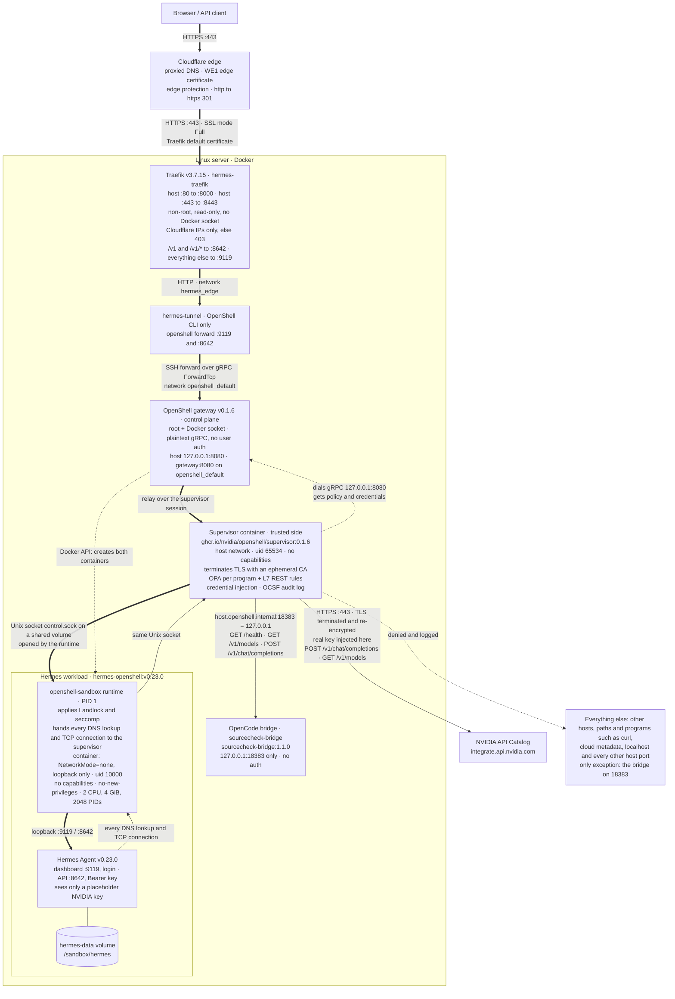

# 🛡️ Hermes Agent in an NVIDIA OpenShell Sandbox

A production-style reference deployment of an autonomous AI agent, contained by a policy-enforced sandbox and published behind a hardened HTTPS edge. The introduction below is written for DevOps and DevSecOps engineers; the setup guide that follows walks you through it step by step, no prior OpenShell knowledge needed. 🙂

> **Status (2026-11-07):** Hermes Agent **v0.23.0** in NVIDIA OpenShell **v0.1.6** on Ubuntu 22.04 (Docker 29.9). The reference server is a cloud lab sandbox that stops or expires after a few hours: it was last verified live at <https://hermes.saqlainmushtaq.com> on 2026-11-07 (dashboard herdr roll 3, kill guard) and is **not running now**, so the site doesn't answer until the stack is redeployed on a new server. Tested there: `verify.sh` 27 passed with a real model call, `verify_https.sh` 53 passed (2 expected certificate warnings), `policy_check.sh` 10 passed, all 10 guardrail prompts, recovery after a reboot including the `hermes-forwards` boot unit ([Latest test results](#-latest-test-results)). Not tested here: Cloudflare **Full (strict)** with an Origin Certificate (the server uses mode **Full**), high availability (one server). GKE: [k8s/README.md](k8s/README.md).

---

## 📖 Table of contents

1. [Quick definitions and architecture 🧭](#-quick-definitions-and-architecture)
2. [What runs where (Docker Compose vs OpenShell vs Kubernetes) 🗂️](#️-what-runs-where-docker-compose-vs-openshell-vs-kubernetes)
3. [Try it yourself: guardrail prompts 🧪](#-try-it-yourself-guardrail-prompts)
4. [What is this? 🤔](#-what-is-this)
5. [How NVIDIA OpenShell sandboxes work 🔒](#-how-nvidia-openshell-sandboxes-work)
6. [Why it matters 🎯](#-why-it-matters)
7. [Why DevOps and DevSecOps engineers should care 👷](#-why-devops-and-devsecops-engineers-should-care)
8. [Evidence, not just claims 🧾](#-evidence-not-just-claims)
9. [What you will see in the demo 🎬](#-what-you-will-see-in-the-demo)
10. [How the pieces fit together 🧩](#-how-the-pieces-fit-together)
11. [Design notes 🔬](#-design-notes)
12. [What you need before you start ✅](#-what-you-need-before-you-start)
13. [Step-by-step setup 🚀](#-step-by-step-setup)
14. [Open the Hermes dashboard 🌐](#-open-the-hermes-dashboard)
15. [NVIDIA models 🤖](#-nvidia-models)
16. [Check that everything works 🧪](#-check-that-everything-works)
17. [HTTPS: certificates and SSL modes explained 📜](#-https-certificates-and-ssl-modes-explained)
18. [Everyday tasks 🛠️](#️-everyday-tasks)
19. [Server restarted / IP changed 🔁](#-server-restarted--ip-changed)
20. [Troubleshooting 🧯](#-troubleshooting)
21. [Security tests and DevSecOps 🔐](#-security-tests-and-devsecops)
22. [Security notes ⚠️](#️-security-notes)
23. [Files in this folder 📁](#-files-in-this-folder)
24. [Teardown 🧹](#-teardown)
25. [Pinned versions 📌](#-pinned-versions)
26. [Links 📚](#-links)

🔧 Every environment variable, `.env` example and API key: **[ENVIRONMENT.md](ENVIRONMENT.md)**.

☸️ Running on Kubernetes? See **[KUBERNETES.md](KUBERNETES.md)**: the NVIDIA API key as a Kubernetes Secret, handed to OpenShell without Hermes ever seeing it.

---

## 🧭 Quick definitions and architecture

> 🎬 **Video cheat sheet:** **Hermes is the worker, the OpenShell Gateway is the manager, and the Supervisor is the network guard.** Kernel controls independently restrict the worker's filesystem, processes and resources. The policy decides what is allowed—not whether the AI's intention is good or bad.

### One-line definitions

**Components**, one line each, in the order they appear in the diagram below:

| Component | What it is and what it does here | Where defined | Security role |
|---|---|---|---|
| **Browser / API client** | A person's browser using the Hermes dashboard, or a program calling the `/v1` API with Hermes's Bearer key. | – | Untrusted; must pass Cloudflare, then the dashboard login or the API key |
| **Cloudflare edge** | Proxied DNS and browser-trusted HTTPS (WE1 certificate) in front of the server; it redirects `http` to `https` and forwards requests to the origin over HTTPS. | Cloudflare DNS `A hermes` (proxied), [`scripts/update_dns.sh`](scripts/update_dns.sh) | Public TLS; hides the origin IP |
| **Linux server / Docker host** | The Linux VM running Docker and every container shown inside the server box; SSH and the hosting platform's web terminal are outside this diagram's scope. | – | Trust boundary of the whole stack; SSH for the operator only |
| **Traefik** (`hermes-traefik`) | The only public door (host `:80`→container `:8000`, host `:443`→container `:8443`), non-root and read-only with no Docker socket; it accepts only Cloudflare IPs and routes `/v1` and `/v1/*` to the API (`:8642`) and everything else to the dashboard (`:9119`). | [`traefik/docker-compose.yml`](traefik/docker-compose.yml), [`traefik/dynamic/hermes.yml`](traefik/dynamic/hermes.yml) | Only public door; Cloudflare-IP allow-list |
| **`hermes_edge` network** | A user-defined Docker bridge network (`172.31.250.0/24`) whose only members are Traefik and hermes-tunnel; restricted membership, not Docker `internal`, so members keep outbound NAT. | [`tunnel/docker-compose.yml`](tunnel/docker-compose.yml) | Keeps Traefik away from the gateway |
| **hermes-tunnel** | A container with only the OpenShell CLI that keeps two `openshell forward` SSH tunnels open (`:9119` dashboard, `:8642` API) through the gateway, listening on `172.31.250.10` only. | [`tunnel/`](tunnel/README.md) | Non-root, read-only; holds no keys |
| **`openshell_default` network** | A user-defined Docker bridge network (`172.19.0.0/16`) whose only members are hermes-tunnel and the gateway, so Traefik can never reach the gateway; restricted membership, not Docker `internal`. | [`openshell/docker-compose.yml`](openshell/docker-compose.yml) | Gateway network; Traefik is not a member |
| **OpenShell gateway** | The control plane (runs as root with the Docker socket; plaintext gRPC with no user auth on host `127.0.0.1:8080`) that creates the sandbox containers, stores the policy and provider credentials, and relays forwards over the supervisor's session. | [`openshell/docker-compose.yml`](openshell/docker-compose.yml), [`openshell/gateway.toml`](openshell/gateway.toml) | Trusted control plane; loopback only (no auth) |
| **Supervisor** | A separate trusted container (`ghcr.io/nvidia/openshell/supervisor:0.1.6`; host network, uid `65534`, no capabilities) that dials the gateway, relays inbound forwards into the workload, terminates Hermes's TLS, enforces the network policy, injects the NVIDIA key and writes OCSF audit events. | Started by the gateway (`OPENSHELL_VERSION`) | Enforces the network policy, injects the key, writes the audit log |
| **Supervisor channel** (`control.sock`) | A Unix socket on a shared Docker volume, opened by the sandbox runtime; it is the only way into or out of the workload. | Created by OpenShell | Only path into or out of the workload |
| **Hermes workload container** | The untrusted container (`hermes-openshell:v0.23.0`): `NetworkMode=none` (loopback only), uid `10000`, no capabilities, no-new-privileges, capped at 2 CPUs, 4 GiB memory and 2048 PIDs. | [`hermes/Dockerfile`](hermes/Dockerfile), limits in [`scripts/up.sh`](scripts/up.sh) | Untrusted zone: no network, non-root, capped |
| **Sandbox runtime** (`openshell-sandbox`) | PID 1 in the workload: applies Landlock and seccomp, starts Hermes, and hands every DNS lookup and TCP connection to the supervisor. | OpenShell sandbox image | Applies Landlock and seccomp |
| **Hermes Agent** | The AI worker (`v0.23.0`) that chats, calls tools and runs commands; it serves the dashboard on `:9119` (login) and the OpenAI-compatible API on `:8642` (Bearer key) and holds only a placeholder NVIDIA key. | [`hermes/config.yaml`](hermes/config.yaml), [`hermes/start-hermes.sh`](hermes/start-hermes.sh) | The untrusted agent; placeholder key only |
| **hermes-data volume** | The persistent Docker volume at `/sandbox/hermes` that keeps Hermes's sessions, memory and configuration across sandbox re-creation. | `DATA_VOLUME` in [`scripts/up.sh`](scripts/up.sh) | Persistent state (chats, login data); back it up |
| **NVIDIA API Catalog** | The default model endpoint (`integrate.api.nvidia.com`), reachable only on two REST routes and only with the key the supervisor injects. | [`providers/hermes-nvidia.yaml`](providers/hermes-nvidia.yaml) | Only allowed internet destination |
| **OpenCode bridge** (`sourcecheck-bridge`, `sourcecheck-bridge:1.1.0`) | An optional, unauthenticated OpenAI-compatible endpoint for free models, on its own network `sourcecheck-ai_default`, published on host `127.0.0.1:18383` only and reached from the sandbox as `host.openshell.internal` on three routes. | [`opencode/docker-compose.example.yml`](opencode/docker-compose.example.yml) | Optional; no auth, so loopback only and 3 routes |
| **Everything else** (denied destinations) | Connections outside the effective policy's allowed hosts, ports, programs and routes, which the supervisor refuses and logs as OCSF events. | [`hermes/policy.yaml`](hermes/policy.yaml) (not listed = denied) | Denied and logged (OCSF) |

**Controls and concepts**, one line each:

| Control / concept | What it is and what it does here |
|---|---|
| **NVIDIA OpenShell** | The sandboxing system (gateway, supervisor, runtime) that enforces access limits independently of what Hermes decides. |
| **Docker compute driver** | The gateway backend that creates the workload and supervisor containers through the Docker API on this host. |
| **Policy as code** | Version-controlled YAML (`hermes/policy.yaml`) that sets the filesystem, user and network access of the sandbox. |
| **Landlock** | A Linux feature, applied by the runtime, that limits which filesystem paths Hermes may read or write. |
| **seccomp** | A Linux syscall filter, applied by the runtime, that blocks risky calls such as `mount`, `unshare` and `ptrace`. |
| **Non-root + no-new-privileges** | Container settings from the Docker driver that start Hermes as uid `10000` and stop setuid binaries from raising privileges. |
| **cgroups / resource limits** | Container limits (2 CPUs, 4 GiB, 2048 PIDs) that bound Hermes's CPU, memory and process use. |
| **OPA / network policy** | The supervisor's decision engine that checks host, port and calling program before any connection is opened. |
| **L7 REST restrictions** | Supervisor rules that allow only listed HTTP methods and paths on approved destinations. |
| **TLS termination** | The supervisor decrypts Hermes's HTTPS with an ephemeral CA the workload trusts, so it can check paths and inject the key, then re-encrypts to the destination. |
| **OpenShell credential provider** | The trusted store (provider `nvidia`) that supplies the real API key only to matching approved requests while Hermes sees a placeholder. |
| **OCSF audit events** | Structured records of every allowed and denied connection, read with `openshell logs`. |
| **Kubernetes RBAC (separate control)** | Kubernetes authorization that should independently restrict which cluster resources Hermes can read or change. |
| **Kubernetes NetworkPolicy (separate control)** | Pod network rules enforced by a compatible CNI; they do not replace OpenShell's per-program and API-route rules. |

### Architecture at a glance

This is the single architecture diagram for this deployment. It covers the Hermes stack only; host infrastructure (SSH on `:22`) is out of scope. It was checked against the live server on 2026-11-01 (`docker inspect`, gateway and supervisor logs, effective policy, in-sandbox probes). **Thick arrows** are inbound web/API traffic, **solid arrows** are Hermes's outbound connections, **dotted arrows** are control-plane or denied paths, and the **plain line** is the persistent volume.



**The three paths, in one line each:**

1. **Inbound:** Browser → Cloudflare → Traefik → hermes-tunnel → OpenShell gateway → supervisor → sandbox runtime → Hermes on `:9119` (dashboard) or `:8642` (`/v1` API). The workload has no network interface, so the only way in is the gateway relaying the tunnel's SSH forward over the session the supervisor opened.
2. **Control:** The **gateway creates both containers** through the Docker API and stores the policy and the NVIDIA provider credential; the **supervisor dials the gateway** at `127.0.0.1:8080` to fetch them. The gateway does *not* evaluate Hermes's outbound requests.
3. **Outbound:** Every DNS lookup and TCP connection Hermes makes goes through the runtime to the **supervisor**, which terminates TLS and allows or denies the request under the effective policy: only Hermes's bundled Python, only the two NVIDIA routes (the key is added here) and the three bridge routes. Everything else is refused and logged as OCSF events. Separately, the runtime applies Landlock and seccomp, and the Docker driver sets the non-root user, no-new-privileges and the cgroup limits on the container.

**Example:** If policy allows `POST https://integrate.api.nvidia.com/v1/chat/completions` but not `https://google.com`, an approved NVIDIA model request can pass and a Google request is blocked. **An allowed request is not necessarily a safe request**—sensitive information can still travel to approved model endpoints, so limit what the agent can read.

**Deployment status:** The live reference environment uses OpenShell's **Docker driver** on a Linux host and has recorded real-world tests. The Kubernetes `k8s/` manifests were separately validated on **kind with a dummy NVIDIA key**; that is not proof of a full live Hermes/OpenShell deployment on Kubernetes. See [KUBERNETES.md](KUBERNETES.md) for the exact scope.

---

## 🗂️ What runs where (Docker Compose vs OpenShell vs Kubernetes)

Hermes itself is never a Compose service or a hand-written Pod: **OpenShell creates its container**. Everything around it is ordinary infrastructure.

| Component | VM: how it runs | GKE: how it runs |
|---|---|---|
| **OpenShell gateway** | Docker Compose project `openshell` (service `gateway`, plus a one-off `init`): [`openshell/docker-compose.yml`](openshell/docker-compose.yml), started by `scripts/up.sh` | Helm chart `oci://ghcr.io/nvidia/openshell/helm-chart` 0.1.6, Helm release `openshell` (gateway StatefulSet): [`k8s/gke/openshell-values.yaml`](k8s/gke/openshell-values.yaml) |
| **Traefik** | Docker Compose project `hermes-traefik` (container `hermes-traefik`): [`traefik/docker-compose.yml`](traefik/docker-compose.yml), started by `scripts/https_up.sh` | Helm chart `traefik/traefik` 42.0.0: [`k8s/gke/traefik-values.yaml`](k8s/gke/traefik-values.yaml), routes in [`k8s/gke/traefik-routes.yaml`](k8s/gke/traefik-routes.yaml) |
| **hermes-tunnel** | Docker Compose project `hermes-tunnel` (container `hermes-tunnel`): [`tunnel/docker-compose.yml`](tunnel/docker-compose.yml), started by `scripts/https_up.sh` | Deployment + Service: [`k8s/gke/hermes-tunnel.yaml`](k8s/gke/hermes-tunnel.yaml) |
| **OpenCode bridge** (optional) | Docker Compose service `bridge` (container `sourcecheck-bridge`) run from [`opencode/docker-compose.example.yml`](opencode/docker-compose.example.yml) (project `opencode-bridge`) or your own Compose stack | Deployment + ClusterIP Service: [`k8s/gke/opencode-bridge.yaml`](k8s/gke/opencode-bridge.yaml) |
| **Hermes sandbox** (supervisor + workload) | Created by the gateway's **Docker** driver from `openshell sandbox create` in `scripts/up.sh`: two containers, the workload (`NetworkMode=none`) and its supervisor (host network) | Created by the gateway's **Kubernetes** driver from `openshell sandbox create` in `k8s/gke/deploy.sh`: a Sandbox resource the **Agent Sandbox controller** turns into the workload Pod, plus a separate supervisor Pod |

**Why Hermes is not a Compose service:** `openshell sandbox create` hands the policy, providers and resource limits to OpenShell, which builds the workload container itself with no network interface, Landlock, seccomp and credential injection; a Compose service would be an ordinary container that OpenShell never wraps.

**Which commands manage what:**

- **VM infrastructure:** `docker compose -f <folder>/docker-compose.yml up -d | ps | logs | down` for the gateway, Traefik and the tunnel; `scripts/up.sh` starts the gateway, `scripts/https_up.sh` starts Traefik and the tunnel, and `scripts/down.sh --purge` stops all three and removes the `hermes-data` volume.
- **OpenCode bridge (VM):** managed on its own with `docker compose` in the SourceCheck stack (service `bridge`) or with `opencode/docker-compose.example.yml`; no script here starts or stops it.
- **The Hermes sandbox (VM):** `openshell sandbox list | get | exec | delete` and `openshell logs hermes`; `scripts/up.sh` creates it, `scripts/down.sh` (without `--purge`) deletes it and keeps the infrastructure and data. Never `docker run`/`docker rm` the sandbox containers directly.
- **GKE:** `kubectl` and `helm` for Traefik, cert-manager, the tunnel, the bridge and the gateway (all wrapped by [`k8s/gke/deploy.sh`](k8s/gke/deploy.sh)); the sandbox is still managed with the OpenShell CLI ([`k8s/gke/openshell-cli.sh`](k8s/gke/openshell-cli.sh)), and the Agent Sandbox controller turns its Sandbox resource into Pods.

---

## 🧪 Try it yourself: guardrail prompts

Ten copy-paste prompts, two per guardrail layer: one that **should work** and one that **should be blocked**. Together they show the policy is precise, not a blanket "deny everything". They give the same results on the VM (<https://hermes.saqlainmushtaq.com>) and on GKE (<https://hermes-gke.saqlainmushtaq.com>, Hermes's own login; see [k8s/README.md → How to log in](k8s/README.md#-how-to-log-in)).

| Layer | ✅ Should work | ⛔ Should be blocked |
|---|---|---|
| Filesystem | [A1](demo/README.md#a1-filesystem-write-and-read-a-file-in-the-workspace) write and read a file in `/sandbox` | [B4](demo/README.md#b4-privilege-escalation-and-filesystem-sudo-and-writes-outside-the-workspace) `sudo`, writes to `/etc` and `/opt/hermes`, change its own policy |
| Code execution / host | [A2](demo/README.md#a2-code-execution-run-a-python-script) run a Python script | [B1](demo/README.md#b1-container-escape-and-host-access-docker) reach Docker or start a daemon |
| Model access / secrets | [A3](demo/README.md#a3-model-access-through-the-credential-provider) ask the approved NVIDIA model | [B3](demo/README.md#b3-secrets-and-credentials) read the NVIDIA key, `/etc/shadow`, cloud metadata |
| Network egress | [A4](demo/README.md#a4-approved-api-route-vs-another-host-port) two of the three allowed bridge routes | [B2](demo/README.md#b2-network-egress-to-a-site-not-in-the-policy) fetch `example.com`, `pip install` |
| Agent memory / injection | [A5](demo/README.md#a5-agent-memory) save a note to memory | [B5](demo/README.md#b5-prompt-injection-exfiltration-attempt) a poisoned note tries to upload the config |

📘 **The prompts, how to run them (web UI, API, CLI), the expected output and the audit evidence for each one** are in [demo/README.md → Try it yourself](demo/README.md#-try-it-yourself-guardrail-prompts). Latest run: [Latest test results](#-latest-test-results).

---

## 🤔 What is this?

**Hermes Agent** (`nousresearch/hermes-agent:v0.23.0`) is an AI agent that chats, runs tools and executes code on a user's behalf. This project runs it inside an **NVIDIA OpenShell** (`v0.1.6`) sandbox on a single Linux server and serves it at **<https://hermes.saqlainmushtaq.com>** through **Cloudflare** and **Traefik** (`v3.7.15`).

- 💬 **Dashboard** (`/chat`) and an **OpenAI-compatible API** (`/v1`), both Hermes's own, protected by Hermes's login and API key.
- 🧠 **Models:** the NVIDIA API Catalog (`integrate.api.nvidia.com`) through an OpenShell credential provider, with the OpenCode bridge as an alternative.
- 🧱 **Containment:** every file access, process and network connection Hermes makes is governed by an OpenShell policy kept in git (`hermes/policy.yaml`).

For the **single architecture diagram** with Gateway, Supervisor, workload boundaries and request flows, see [Architecture at a glance](#architecture-at-a-glance) above.

---

## 🔒 How NVIDIA OpenShell sandboxes work

OpenShell splits an agent deployment into three parts:

- 🚪 **Gateway (control plane):** creates and manages sandboxes through a compute driver (here, Docker), holds credentials and serves policy and logs to the `openshell` CLI.
- 👮 **Supervisor (one per sandbox, the trusted side):** runs *outside* the security boundary. It brokers every connection the workload makes, evaluates it against the policy, injects credentials and writes the audit log.
- 🤖 **Sandbox runtime (the workload):** the container where Hermes runs. It has **no network interface** (`network=none`, loopback only), so every outbound connection must go through the supervisor.

The policy engine has four parts:

| 🔒 Part | How it is enforced | What it means for Hermes |
|---|---|---|
| 📂 **Filesystem** | Linux **Landlock** allow-list, fixed at sandbox creation (`compatibility: hard_requirement`, so it fails closed) | Read-write only in the `/sandbox` workspace and `/tmp` (a 512 MiB tmpfs, mounted `noexec`); system paths and Hermes's code are read-only; everything else is invisible, even world-readable files. Only `/sandbox/hermes` survives a re-create. |
| 👤 **Process** | Non-root **uid 10000**, **seccomp** syscall filter, **no-new-privileges** | No root, setuid binaries can't raise privileges, `ptrace`, `mount`, `unshare` and similar calls are blocked. |
| 🌐 **Network egress** | **Deny by default.** Each rule names a host, a port and the **calling binary**; optional **L7 REST** rules restrict HTTP method and path. Decisions are made by an embedded **OPA** engine. Live-updatable with `openshell policy set`. | Only Hermes's bundled Python (and programs it starts) may reach the model endpoints, and only on the listed routes. `curl` run on its own is refused. Link-local and cloud metadata (`169.254.169.254`) are always refused; host services and localhost are refused too, with one explicit exception: the OpenCode bridge at `host.openshell.internal:18383` (= host `127.0.0.1`), on three routes only. |
| 🔑 **Credentials** | **Providers**: OpenShell holds the real key; the agent sees only an `openshell:resolve:env:…` placeholder, which the supervisor swaps for the real value **only** on requests to the provider's allowed endpoint | The NVIDIA API key (`providers/hermes-nvidia.yaml`) is added only to calls to `integrate.api.nvidia.com`; Hermes never holds it. |

🔐 **Landlock, in one line each.** Landlock is a Linux kernel security module that lets an unprivileged process lock down its own file access, for good and for all its children. OpenShell v0.1.6 refuses to start a sandbox without Landlock ABI 3 or newer (even with `best_effort`), because it also hides OpenShell's own private files from the agent. It needs no root, but containers share the host kernel, so the host (or GKE node) kernel must have Landlock; that is why GKE uses Ubuntu nodes, not Container-Optimized OS (tested COS 125 has no Landlock). On the VM only the OpenShell gateway and its one-off `init` run as root (for the Docker socket); on GKE no Hermes-stack container does. Details and evidence: [Landlock and why the nodes are Ubuntu, not COS](k8s/README.md#-landlock-and-why-the-nodes-are-ubuntu-not-cos).

📡 **Enforcement and logging.** Network decisions are recorded as structured **OCSF** events in `openshell logs`, for example `NET:OPEN … DENIED`, `NET:REFUSE … DENIED` and `HTTP:POST … ALLOWED [policy:_provider_nvidia engine:l7]`. Kernel-level refusals (Landlock, seccomp) are not network events: they surface in the process as `EACCES` (*Permission denied*) or `EPERM` (*Operation not permitted*).

📐 **Policy as code.** `hermes/policy.yaml` and the guardrail it must stay inside, `security/boundary.yaml`, are versioned and reviewed like any other code. `scripts/policy_check.sh` uses the **OpenShell policy prover** (an SMT solver) to prove the policy, and the live sandbox's **effective policy including provider rules**, stays within the boundary, and that a set of risky edits is caught.

---

## 🎯 Why it matters

An agent that runs code and calls tools is a **new attack surface**. A prompt injection hidden in a web page or file, a malicious or compromised tool, or a poisoned dependency in the supply chain can turn the agent against the host it runs on.

OpenShell acts as a **guardrail around the agent**, independent of what the model decides:

- 🎯 Hermes can do only what the policy allows.
- 🌐 It cannot reach unapproved hosts, so it cannot exfiltrate data or download payloads.
- 🗝️ It cannot read host secrets or other processes' environments, and never holds the NVIDIA API key.
- 👤 It cannot escalate privileges.
- 📜 Every denial is logged and auditable.

---

## 👷 Why DevOps and DevSecOps engineers should care

This is a **reusable pattern** for running autonomous agents with **defence in depth**, where each layer is enforced by a different component:

| Layer | Control |
|---|---|
| ☁️ **Edge** | Cloudflare TLS, WAF and DDoS protection; Traefik TLS 1.2+ with a **Cloudflare-only origin** allow-list |
| 🔐 **Application** | Hermes's own authentication: dashboard login and an API key for `/v1` |
| 🧱 **Isolation** | OpenShell sandbox: no network interface, Landlock, seccomp, non-root, cgroup limits |
| 🎯 **Least privilege** | Deny-by-default network policy per host, binary and API route; filesystem allow-list |
| 🔑 **Secrets** | Provider-based credential injection; secrets kept outside the repo |
| 📜 **Audit** | OCSF events from the supervisor; Traefik JSON access log |
| 🤖 **CI security tests** | gitleaks, hadolint, shellcheck, Trivy (misconfiguration, CVEs, SBOM) and the OpenShell policy prover |

---

## 🧾 Evidence, not just claims

The deployment is **hardened and tested against the listed attack classes**; it is not presented as impossible to escape. The evidence is in the repo and can be re-run:

- 🆚 **[security/COMPARISON.md](security/COMPARISON.md):** 23 attacker probes run with and without OpenShell. **17 blocked only with OpenShell**, 5 blocked either way, 1 accepted residual risk, **0 weaker** inside the sandbox.
- 📘 **[SECURITY.md](SECURITY.md):** threat model, layers of defence, incident response and the **risk register**, where residual risks are tracked with a severity and a next step.
- 🎬 **[Demo](demo/README.md):** eight use cases ([`demo/use-cases/01..08`](demo/use-cases/)), each with an automated proof (`demo/scripts/verify-NN.sh`) and a full repeatable run (`demo/scripts/run-all.sh`).

---

## 🎬 What you will see in the demo

The [demo guide](demo/README.md) walks through eight use cases, each proven from the sandbox's own enforcement logs:

- ✅ **Normal work is allowed:** chat through the approved model endpoint (UC 01) and create, edit and delete files in the workspace (UC 02).
- 🌐 **Blocked egress and DNS exfiltration:** websites, package registries, raw TCP, uploads and DNS tunnelling are denied and logged (UC 03).
- 🗝️ **Secrets and host files are out of reach:** `/etc/shadow`, SSH keys, the Docker socket, other processes' environments and cloud metadata (UC 04).
- 👤 **No privilege escalation:** `sudo`, `su`, `mount`, `unshare`, `ptrace` and `docker` are refused (UC 05).
- 📦 **No install or persistence:** packages, cron jobs, systemd units and exposed listeners fail (UC 06).
- 💉 **Prompt injection is contained:** a poisoned file can sway the model, but exfiltration is denied and the policy stays unchanged (UC 07).
- 📏 **Resource abuse is capped:** fork bomb, memory and `/tmp` exhaustion and CPU burn run in a throwaway sandbox and stay within its limits (UC 08).

---

## 🧩 How the pieces fit together

The full diagram, with every hop, port, protocol and trust boundary, is in **[Architecture at a glance](#architecture-at-a-glance)** (the one source of truth). The notes below explain the parts that need context.

🔒 **Who provides HTTPS?** Two certificates work together:

1. **Browser → Cloudflare:** Cloudflare's own **edge certificate**, trusted by every browser and renewed by Cloudflare. Nothing to do.
2. **Cloudflare → server:** Traefik's certificate. The goal is a free **Cloudflare Origin Certificate** checked in SSL mode **Full (strict)**, so this hop is encrypted **and** verified (see [Step 6](#step-6-turn-on-https-with-traefik-)). **Reference server:** no origin certificate is installed (see the Status line), so Traefik presents its built-in default certificate and the zone stays on SSL mode **Full** (encrypted, not verified).

🚦 **Traefik** is the only public door. It accepts traffic **only from Cloudflare** and sends `/v1/…` to the API and everything else (including WebSockets) to the dashboard.

🔌 **`hermes-tunnel`** is a tiny container with just the OpenShell CLI. It keeps the tunnels into the sandbox open. Traefik can reach the tunnel, but **not** the OpenShell gateway: they share no Docker network (`hermes_edge` vs `openshell_default`; both are ordinary bridge networks with restricted membership, not Docker `internal`).

🤖 You talk to **Hermes's own web UI and API**; there's no extra web server in between.

---

## 🔬 Design notes

Facts about OpenShell v0.1.6 and the Hermes image that shape this setup:

### About OpenShell 🧠

- 🏗️ **Architecture.** A **gateway** (control plane) creates sandboxes through a *compute driver*; this setup uses the **Docker** driver. Each sandbox gets two containers:
  - a **workload** container with **no network card at all** (`network=none`);
  - a **supervisor** container that handles every connection on the workload's behalf and checks it against the policy.
- 🧾 **Policy.** One YAML file (`hermes/policy.yaml`) with four parts:
  - `filesystem_policy`, `landlock` and `process` are fixed when the sandbox is created;
  - `network_policies` can be changed live with `openshell policy set`.
- 🚫 **Blocked.** Link-local addresses and the cloud metadata address `169.254.169.254` are always refused, whatever the policy says. Host services and localhost are refused unless a rule names them; here the only such rule is `opencode_bridge` (`host.openshell.internal:18383`, which maps to host `127.0.0.1`, three routes).
- 🔑 **Providers.** OpenShell can hold API keys (Anthropic, OpenAI, OpenRouter, NVIDIA, AWS…) outside the sandbox and add them only to approved requests, so the agent never sees the real key. This setup uses one for the **NVIDIA API key** (provider `nvidia`, see [NVIDIA models](#-nvidia-models)). A provider also brings its own network rule (`_provider_nvidia`), so `policy_check.sh` proves the **effective** policy, not just `policy.yaml`.
- 📦 **Version.** OpenShell is young (`0.1.x`). This setup pins **v0.1.6** everywhere: CLI, gateway, supervisor and sandbox images.
- 📡 **Telemetry.** OpenShell sends anonymous telemetry by default. This setup turns it off with `OPENSHELL_TELEMETRY_ENABLED=false`.

### About Hermes in a sandbox 🤖

- 🧑‍🔧 **The stock image starts as root.** `nousresearch/hermes-agent` uses *s6-overlay*: it starts as root and then drops to user `hermes`. OpenShell refuses root and replaces the image's start command. So `hermes/Dockerfile`:
  - switches to `USER hermes`;
  - moves `HERMES_HOME` to `/sandbox/hermes`;
  - adds a small `start-hermes` script that runs the **dashboard** and the **gateway**, the two jobs s6 normally runs. It also replaces the `TERM=dumb` that OpenShell starts it with, using `TERM=xterm-256color` (plus `COLORTERM=truecolor`), so the Chat terminal is coloured like a plain install, and sets `LANG=C.UTF-8` so the agent's shell tools get a UTF-8 locale.
- 🔐 **Dashboard login.** Hermes only enforces the dashboard password when it listens on a non-loopback address. It is bound to `0.0.0.0` inside the sandbox. That's safe, because the sandbox has no network card: the only way in is through OpenShell's tunnel.
- 🗂️ **First-start config.** The root-only setup step normally creates `config.yaml`. This setup ships its own seed (`hermes/config.yaml`): NVIDIA as the default provider with two fallback models, and the OpenCode bridge as an optional provider.

### Known pitfalls 🪤

| 🐛 Problem | 💡 Fix |
|---|---|
| `COPY --chmod=0644` also set the **folder** to `0644`, so Hermes couldn't open the seed config. | Set the modes with `chmod` in a `RUN` step. |
| The dashboard **Chat** page said *"Chat could not start: out of pty devices"*. | The Chat page runs Hermes in a terminal (PTY). Add `/dev/ptmx` and `/dev/pts` to `read_write` in `policy.yaml`. |
| `openshell forward` said *"Port … is already in use"* inside the Alpine-based `hermes-tunnel` container. | Alpine's BusyBox `lsof` ignores its arguments, so the CLI thinks every port is taken. Install the real `lsof`. |
| Ports worked on the server but not from the internet. | The server's **UFW** firewall only allows SSH. Ports published by Docker skip UFW, so **Traefik** publishes `80` and `443` through Docker. Because UFW can't guard them, Traefik itself only accepts requests from **Cloudflare's IP ranges**. |
| A container couldn't reach a tunnel listening on the host. | Same UFW rule. `hermes-tunnel` runs its **own** tunnels on the gateway's Docker network instead. |
| With Cloudflare SSL mode **Flexible**, a simple "always redirect port 80" rule loops forever. | Flexible sends Cloudflare → server traffic as plain HTTP. Traefik's port 80 checks Cloudflare's `X-Forwarded-Proto` header: if the visitor already used HTTPS, it serves the page instead of redirecting. |
| Test scripts run **on the AWS server** got `403` *"Just a moment..."* from Cloudflare. | Cloudflare's bot protection challenges scripts from data-centre IPs. Run `verify_https.sh` from a normal internet connection, such as your laptop. |
| In `openshell sandbox exec`, the `hermes` command wasn't found. | `exec` doesn't use the image's `PATH`. Use the full path, `/opt/hermes/bin/hermes`. |

---

## ✅ What you need before you start

- 🐧 A **Linux server** with kernel **6.2 or newer** (for Landlock). This was tested on Ubuntu 22.04, kernel 6.8.
- 🐳 **Docker** with the Compose plugin, and your user in the `docker` group. **No `sudo` needed**, except one optional `sudo loginctl enable-linger` for the [reboot unit](systemd/README.md).
- 💽 About **6 GB of free disk** (the Hermes image alone is 4.3 GB, and each rebuild needs about **4.5 GB more for a short while**). The reference server has a 20 GB root disk, which is tight: use **30–40 GB** (see [Disk space and logs](#-disk-space-and-logs)).
- 🖥️ **Host size:** the sandbox is capped at **2 CPUs, 4 GiB RAM, 2048 PIDs** and a 512 MiB `/tmp`; with Traefik, the gateway and the tunnel, plan for **4 vCPU / 8 GiB RAM** (the reference server has 4 vCPU / 15 GiB). The demo's UC 08 starts a second sandbox with the same limits.
- 💻 **On your laptop (for `verify_https.sh`):** bash, curl, openssl and Python 3 (`pip install websockets` for `CHAT_RUNNER=python`); Node.js + Chrome for the real-browser section (`browser_check.sh` installs `playwright-core` 1.50.1 itself).
- 🔑 An **NVIDIA API key** (`nvapi-…`, free from [build.nvidia.com](https://build.nvidia.com)). You store it with `set_nvidia_key.sh` after Step 5 (see [NVIDIA models](#-nvidia-models)).
- 🌉 *(Optional alternative)* The **OpenCode bridge** running on the server on port **18383**, published on **`127.0.0.1` only** (it has no password). `verify.sh` still tests it. Check it with:

  ```bash
  curl http://127.0.0.1:18383/v1/models
  docker port sourcecheck-bridge      # 👉 18383/tcp -> 127.0.0.1:18383 (nothing on 0.0.0.0 or [::])
  ```

  You should see a list of models such as `opencode/mimo-v2.6-flash-free`. Architecture, usage and the full bridge test (`test_bridge.sh`): [`opencode/README.md`](opencode/README.md).
- 🌍 **For HTTPS (Step 6):** the domain on **Cloudflare** (here `saqlainmushtaq.com`) with access to its dashboard, and access to the server's **AWS security group**. You'll create the origin certificate in Cloudflare's dashboard; no API tokens needed.

---

## 🚀 Step-by-step setup

### Step 1. Get the code 📥

```bash
git clone https://github.com/ch-muhammad-asim/OpenDevOps.git
cd OpenDevOps
```

### Step 2. Install the OpenShell CLI 🧰

This puts the `openshell` command in `~/.local/bin`, with no sudo. The checksum line makes sure the download wasn't tampered with.

```bash
mkdir -p ~/.local/bin /tmp/openshell-dl && cd /tmp/openshell-dl
B=https://github.com/NVIDIA/OpenShell/releases/download/v0.1.6
curl -fsSLO $B/openshell-x86_64-unknown-linux-musl.tar.gz
curl -fsSLO $B/openshell-checksums-sha256.txt
grep " openshell-x86_64-unknown-linux-musl.tar.gz$" openshell-checksums-sha256.txt | sha256sum -c -
tar -xzf openshell-x86_64-unknown-linux-musl.tar.gz
install -m 0755 openshell ~/.local/bin/openshell
export PATH="$HOME/.local/bin:$PATH"
openshell --version        # 👉 openshell 0.1.6
cd -
```

### Step 3. Pull the Hermes image 🐳

```bash
docker pull nousresearch/hermes-agent:v0.23.0
```

### Step 4. Create your secrets file 🔐

Hermes needs a dashboard **username**, a **password hash**, a **session secret** and an **API key**. Keep them **outside** the repo.

```bash
mkdir -p ~/.config/hermes-sandbox && chmod 700 ~/.config/hermes-sandbox
cp sandbox/hermes/hermes.env.example ~/.config/hermes-sandbox/hermes.env
chmod 600 ~/.config/hermes-sandbox/hermes.env
```

Now fill in the values:

1. 🔑 **Pick a password** and turn it into a hash with Hermes's own tool:

   ```bash
   printf '%s' 'YOUR-PASSWORD' | docker run --rm -i --entrypoint /opt/hermes/.venv/bin/python \
     -w /opt/hermes nousresearch/hermes-agent:v0.23.0 -I -c \
     "import sys; sys.path.insert(0,'/opt/hermes'); from plugins.dashboard_auth.basic import hash_password; print(hash_password(sys.stdin.read().strip()))"
   ```

   Paste the output (it starts with `scrypt$`) into `HERMES_DASHBOARD_BASIC_AUTH_PASSWORD_HASH=`.
2. 🎲 **Session secret:** run `openssl rand -hex 32` and paste the result into `HERMES_DASHBOARD_BASIC_AUTH_SECRET=`.
3. 🗝️ **API key:** run `openssl rand -base64 32` and paste the result into `API_SERVER_KEY=`.

> 💡 Save the **plain password** in your password manager. The server only keeps the hash.

### Step 5. Start everything ▶️

One command does it all:

```bash
sandbox/scripts/up.sh
```

What it does, in order:

1. 🚪 Starts the **OpenShell gateway** (`sandbox/openshell/docker-compose.yml`).
2. 🏗️ Builds the sandbox-ready image `hermes-openshell:v0.23.0`, then deletes the Docker **build cache** (`docker builder prune -af`). Each rebuild otherwise leaves ~4.5 GB behind.
3. 💾 Creates the Docker volume **`hermes-data`**, so Hermes keeps its data when the sandbox is re-created.
4. 🛡️ Creates the sandbox **`hermes`** with `hermes/policy.yaml`, 2 CPUs and 4 GB of RAM, restarting on failure. If the OpenShell provider **`nvidia`** exists, it's attached automatically (first time: create it with `set_nvidia_key.sh`, see [NVIDIA models](#-nvidia-models)).
5. 🔌 Opens tunnels to the dashboard (`127.0.0.1:9119`) and API (`127.0.0.1:8642`) on the server, for local use only. These host-side tunnels are **not supervised**: they stop when the gateway restarts. That's why `verify.sh` and the demo scripts use the always-on `hermes-tunnel` container instead (Step 6).

The first run takes a few minutes. When it finishes you'll see:

```text
Hermes is running in OpenShell sandbox "hermes".
```

> 🙈 `up.sh` publishes **nothing** to the internet. Hermes is reachable only from the server itself until you do Step 6.

### Step 6. Turn on HTTPS with Traefik 🔒

**Traefik** is a reverse proxy: it's the only thing on the server the internet can reach. **Cloudflare** sits in front of it and gives visitors a browser-trusted HTTPS certificate. Between Cloudflare and Traefik the goal is a free **Cloudflare Origin Certificate** with SSL mode **Full (strict)**, so that hop is encrypted **and** verified. (The reference server has no origin certificate yet, so Traefik serves its default certificate and the zone runs in mode **Full**.) When you finish this step, Hermes lives at:

👉 **<https://hermes.saqlainmushtaq.com>**

☕ Allow about 15 minutes. Do the sub-steps **in order**: switching Cloudflare to Full (strict) before Traefik has the certificate causes error 526.

#### 6.1 🗺️ Check the DNS record

In the Cloudflare dashboard, open **saqlainmushtaq.com → DNS → Records**. You need exactly this record (it may already exist):

| Type | Name | IPv4 address | Proxy status | TTL |
|---|---|---|---|---|
| `A` | `hermes` | `<server public IP>` (the current value is `HERMES_ORIGIN_IP` in your local `sandbox/site.env`) | 🟠 **Proxied** (orange cloud) | Auto |

> 💡 **Proxied** means visitors talk to Cloudflare, never straight to the server. `dig +short hermes.saqlainmushtaq.com` shows **Cloudflare's** IPs, not the server's own IP. That's correct! The orange cloud is **required**: Traefik only accepts traffic from Cloudflare.

#### 6.2 🏭 Create a Cloudflare Origin Certificate

An **Origin Certificate** is a free certificate made **only for the Cloudflare → server connection**. Cloudflare trusts it; browsers don't (and don't need to, because they only ever talk to Cloudflare).

1. Cloudflare dashboard → **saqlainmushtaq.com** → **SSL/TLS** → **Origin Server** → **Create Certificate**.
2. Choose **Generate private key and CSR with Cloudflare**.
3. **Private key type:** RSA (2048) or ECC. Either is fine.
4. **Hostnames:** `hermes.saqlainmushtaq.com` (remove defaults you don't need; `*.saqlainmushtaq.com` is optional).
5. **Certificate validity:** up to **15 years**. A shorter one (for example 1 year) is safer but needs replacing more often. Either way there's **no automatic renewal**, so note the date.
6. Click **Create**. Cloudflare shows the **Origin Certificate** and the **Private Key**. ⚠️ The private key is shown **only once**. Keep the tab open for the next step.

#### 6.3 🗝️ Save the certificate on the server, safely

The files go **outside the repo**, and the key must be readable only by you. Use `cat > file` and paste, so the contents never end up in shell history.

```bash
mkdir -p ~/.config/hermes-sandbox/tls && chmod 700 ~/.config/hermes-sandbox/tls
cd ~/.config/hermes-sandbox/tls
umask 077
cat > origin.pem      # paste the Origin Certificate, press Enter, then Ctrl-D
cat > origin.key      # paste the Private Key,       press Enter, then Ctrl-D
chmod 644 origin.pem && chmod 600 origin.key
ls -l                 # 👉 -rw-r--r-- origin.pem   -rw------- origin.key
openssl x509 -in origin.pem -noout -subject -enddate     # 👉 check name and expiry
cd -
```

> 🚫 **Never** commit these files, paste the key into chat, or copy it into the repo.

#### 6.4 🚦 Start the tunnel and Traefik

Run this **after** `up.sh` (Step 5):

```bash
sandbox/scripts/https_up.sh
```

What it does:

1. 🧹 Removes the old `hermes-proxy` container if it's still there (older versions of this setup used it).
2. 🔌 Starts **`hermes-tunnel`** (`sandbox/tunnel/`), which keeps the OpenShell tunnels to the dashboard and API open on the `hermes_edge` network (shared only with Traefik), at the fixed address **`172.31.250.10`**. It restarts a tunnel by itself if it drops.
3. 🧹 Deletes the Docker build cache after building the tunnel image.
4. 🏅 If `origin.pem` and `origin.key` exist, it checks their permissions and turns them on for Traefik (it writes `traefik/dynamic/tls-origin.yml` from `tls-origin.yml.tmpl`). If they don't exist, it removes that file and Traefik uses its built-in certificate.
5. 🚦 Starts **Traefik** (container `hermes-traefik`) on ports **80** and **443**.

It's safe to re-run at any time, for example after adding or replacing the certificate. Traefik watches its `dynamic/` folder, so certificate changes apply without a restart.

Check Traefik now shows the origin certificate (on the server):

```bash
echo | openssl s_client -connect 127.0.0.1:443 -servername hermes.saqlainmushtaq.com 2>/dev/null \
  | openssl x509 -noout -subject -issuer -enddate
# 👉 issuer mentions "Cloudflare Origin", not "TRAEFIK DEFAULT CERT"
```

#### 6.5 🟩 Set Cloudflare's SSL/TLS mode to **Full (strict)**

1. Cloudflare dashboard → **saqlainmushtaq.com** → **SSL/TLS** → **Overview**.
2. Click **Configure** (if you see *Automatic SSL/TLS*, choose **Custom SSL/TLS**).
3. Pick **Full (strict)** and click **Save**.

Curious what the modes mean? See [HTTPS: certificates and SSL modes explained](#-https-certificates-and-ssl-modes-explained).

#### 6.6 🧱 Open ports 443 and 80 in the AWS security group

UFW doesn't apply to Docker ports, but **AWS** still blocks everything you haven't allowed.

1. AWS console → **EC2** → **Instances** → select the server → **Security** tab → click the **security group**.
2. **Edit inbound rules** → **Add rule**:

   | Type | Port | Source |

   |---|---|---|
   | HTTPS | 443 | Cloudflare IP ranges (best), or `0.0.0.0/0` + `::/0` |

   | HTTP | 80 | Same as above (only used for the redirect to HTTPS) |

3. **Save rules.**

> 💡 Limiting the source to [Cloudflare's IP ranges](https://www.cloudflare.com/ips/) (for example with a *managed prefix list*) adds a second lock. Traefik already refuses non-Cloudflare visitors, so this is defence in depth.

#### 6.7 ✅ Check it

From your laptop:

```bash
curl -sI http://hermes.saqlainmushtaq.com/  | head -1     # 👉 HTTP/1.1 301 (redirect to https)
curl -sI https://hermes.saqlainmushtaq.com/ | head -1     # 👉 HTTP/2 200 or 302 (to /login)
```

Then run the full HTTPS check, `verify_https.sh` (see [HTTPS checks](#-https-checks)). 🎉 Done! Hermes is now served over HTTPS, end to end.

> 🕒 **Haven't added the origin certificate yet?** It still works, just less strictly. Skip 6.2–6.3 and run `https_up.sh` anyway: Traefik uses its own built-in (self-signed) certificate. Set Cloudflare to **Full** (not strict). **Flexible** works too (port 80 is smart enough not to loop), but it sends your traffic unencrypted between Cloudflare and AWS, so avoid it. Come back to 6.2 → 6.5 as soon as you can.
>
> 📌 **Today's live server** is in this state: no origin certificate yet, Cloudflare mode **Full**.

#### 6.8 🔎 Which certificate is checked where?

| Connection | Certificate | Verified? |
|---|---|---|
| 🧑 Browser → ☁️ Cloudflare | Cloudflare's **edge certificate**, issued by **Google Trust Services WE1** | ✅ Yes, by your browser (the 🔒 padlock) |
| ☁️ Cloudflare → 🚦 Traefik | Traefik's built-in self-signed `TRAEFIK DEFAULT CERT` | ❌ **Not yet.** Mode **Full** encrypts this hop but doesn't check the certificate |

To check the Cloudflare → server hop **exactly the way Full (strict) would**, run this from your laptop. It skips Cloudflare, connects straight to the server, and only trusts Cloudflare's Origin CA roots:

```bash
curl -fsS -o cf-origin-roots.pem https://developers.cloudflare.com/ssl/static/origin_ca_rsa_root.pem
curl -fsS https://developers.cloudflare.com/ssl/static/origin_ca_ecc_root.pem >> cf-origin-roots.pem
curl --resolve hermes.saqlainmushtaq.com:443:<server public IP> --cacert cf-origin-roots.pem \
  -sS -o /dev/null -w '%{http_code}\n' https://hermes.saqlainmushtaq.com/
```

- 🟡 **Today:** it fails with *"no alternative certificate subject name matches"*, because Traefik serves its default certificate. So Cloudflare **must stay on Full**: Full (strict) would show error 526.
- 🟢 **After** you put the Cloudflare Origin Certificate in `~/.config/hermes-sandbox/tls/` (Steps 6.2–6.3) and re-run `https_up.sh` (6.4), the same command prints an HTTP status code instead of an error. Then switch to **Full (strict)** (6.5).

`verify_https.sh` runs this exact check for you (section 3).

---

## 🌐 Open the Hermes dashboard

- 🔒 **Over HTTPS (normal way):** open **<https://hermes.saqlainmushtaq.com>** in a browser. You should see a 🔒 padlock.
- 🕳️ **Private, through SSH** (handy if HTTPS is down): run this from your laptop, then open `http://127.0.0.1:9119/`:

  ```bash
  ssh -N -L 9119:127.0.0.1:9119 <user>@<your-server-ip>
  ```

You'll see **"Sign in — Hermes Agent"**. This is Hermes's **own, built-in** web page; there's no extra proxy in between. Log in with the username and password from Step 4. 🎉

> ℹ️ The server's IP address doesn't serve the dashboard: requests that skip Cloudflare are refused (`403`), and the bare IP has no site at all (`404`). Always use the domain name.

Hermes's own API (OpenAI-compatible) is reachable over HTTPS under `/v1`. It always needs the **API key** from Step 4:

```bash
curl -H "Authorization: Bearer $API_SERVER_KEY" https://hermes.saqlainmushtaq.com/v1/models
```

On the server, it also works locally:

```bash
curl http://127.0.0.1:8642/health
curl -H "Authorization: Bearer $API_SERVER_KEY" http://127.0.0.1:8642/v1/models
```

> ⚠️ The API is now on the internet. Anyone with the key can use Hermes, so keep `API_SERVER_KEY` long and secret, and rotate it if you suspect a leak (see [SECURITY.md](SECURITY.md)).

---

## 🤖 NVIDIA models

Hermes's **default model provider is the NVIDIA API Catalog** (`integrate.api.nvidia.com`, the models you can try on [build.nvidia.com](https://build.nvidia.com)). The OpenCode bridge is still there as an **optional alternative**.

### ⚙️ How it works

- 🔗 **Direct, no extra bridge.** NVIDIA's API is **OpenAI-compatible**, so Hermes calls `https://integrate.api.nvidia.com/v1` itself.
- 🔑 **The key is an OpenShell provider credential.** It's stored in OpenShell as the provider **`nvidia`** (profile [`providers/hermes-nvidia.yaml`](providers/hermes-nvidia.yaml)). Inside the sandbox, Hermes only sees the placeholder `NVIDIA_API_KEY=openshell:resolve:env:NVIDIA_API_KEY`. The supervisor swaps in the real key **only** on requests that match the provider's endpoint.
- 🎯 **Tight egress.** The provider adds one network rule at runtime (`_provider_nvidia`):
  - only **Hermes's bundled Python** (and programs it starts) may use it;
  - only host **`integrate.api.nvidia.com:443`**;
  - only **`POST /v1/chat/completions`** and **`GET /v1/models`**, enforced by the **L7** engine (method + path).
- 📐 **Proven, not just configured.** The same rule is part of [`security/boundary.yaml`](security/boundary.yaml) (`nvidia_api`). Step 3 of `scripts/policy_check.sh` proves that the **live sandbox's effective policy, including this provider rule**, stays inside the boundary. A full run on the server prints `Result: 10 passed, 0 failed`.

✅ **Verified live (2026-10-30, Hermes v0.22.5; the provider rule is unchanged in v0.23.0: same policy hash, `policy_check.sh` and guardrail A3 pass on 2026-11-07):**

| Check | Result |
|---|---|
| What Hermes sees as `NVIDIA_API_KEY` | an `openshell:resolve:env:…` placeholder, **not** `nvapi-…` |
| Hermes's Python → `integrate.api.nvidia.com` | ✅ succeeded |
| `curl` → the same host | 🚫 blocked (not an allowed program) |
| Audit log | `ALLOWED POST https://integrate.api.nvidia.com/v1/chat/completions [policy:_provider_nvidia engine:l7]` |
| Real question | Hermes answered *"1234+4321"* → **5555** through the API in **6.6 s** |

### 🔑 Set or rotate the NVIDIA key

One command, on the server:

```bash
sandbox/scripts/set_nvidia_key.sh              # asks for the key (input hidden)
sandbox/scripts/set_nvidia_key.sh < key-file   # or pipe it in on stdin
```

What it does:

1. 🧾 Imports the provider profile `hermes-nvidia` if OpenShell doesn't have it yet.
2. 🗝️ **Creates** the `nvidia` provider, or **updates** it if it exists (that's how you rotate).
3. 📎 Attaches it to the `hermes` sandbox.
4. 🔁 Restarts **only the Hermes processes**, **not** the sandbox (add `--no-restart` to skip). Open chats need a page reload.
5. ✅ Checks that the sandbox sees a **placeholder**, not the real key.

- 🆕 **Fresh deploys:** `up.sh` attaches the `nvidia` provider automatically when it exists. So run `set_nvidia_key.sh` once, and every later `up.sh` picks it up.
- 🙈 **Where the key never goes:** git, the image, the sandbox, command lines or logs. The operator's copy is kept `chmod 600` in a `chmod 700` folder.
- ♻️ **Rotate:** create a new key on build.nvidia.com, run the script again with it, then revoke the old key.
- ☸️ **On Kubernetes:** see **[KUBERNETES.md](KUBERNETES.md)** (the key as a Kubernetes Secret, handed to the same OpenShell provider).

### 📊 Model catalogue and benchmark results

Every chat model the key can see was tested with `scripts/nvidia_bench.py` (2026-10-30). The benchmark calls the NVIDIA API directly, so its results don't depend on the Hermes version; re-run it when NVIDIA changes the catalogue. Full report: **[benchmarks/nvidia-2026-10-30.md](benchmarks/nvidia-2026-10-30.md)** (raw data in the `.json` files next to it).

Each round checks three things Hermes needs: (a) a random `a+b` with the exact number in the reply, (b) an OpenAI-style **tool call** (`list_dir`) with valid JSON arguments, and (c) a **follow-up** turn with the tool result that must end in a text answer. Latency is measured with streaming: **TTFT** (time to first token) and **total** time. A model that fails a round gets no more rounds.

🗂️ **Catalogue on 2026-10-30:**

| Status | Models |
|---|---|
| 📚 Model ids in the catalogue | **85** |
| 🖼️ Not chat models (embedding, guard/safety, vision-only, parse/OCR, reward, translate), skipped | 26 |
| 🔍 Chat models probed | **59** |
| ✅ Available | **9** |
| 🔒 Not enabled for this account (`404 "Function … Not found for account"`) | 41 |
| ⏱️ Timed out on the first probe | 7 |
| ❌ Other errors | 2 |

Screening run: 3 rounds per model, **120 requests**, 08:02–08:17 UTC. Plus 51 confirmation requests = **171 requests, 0 × HTTP 429**.

✅ **The 9 available models (screening, 3 rounds):**

| Model | Rounds | Correct | Tool call + follow-up | TTFT p50 / p95 (s) | Total p50 / p95 (s) | Errors / timeouts | Notes |
|---|---|---|---|---|---|---|---|
| `nvidia/nemotron-3.5-super-vl-120b-a12b` | 3 | 100% | 100% | 1.47 / 6.31 | 1.49 / 6.35 | 0 / 0 | ⭐ default |
| `nvidia/nemotron-3-ultra-550b-a55b` | 3 | 100% | 100% | 1.88 / 6.43 | 2.28 / 6.44 | 0 / 0 | qualified; same family as the default |
| `openai/gpt-oss-20b` | 3 | 100% | 100% | 5.15 / 12.77 | 5.50 / 13.10 | 0 / 0 | 🥈 fallback 1 |
| `meta/muse-glimmer-30b` | 3 | 100% | 100% | 5.53 / 13.54 | 5.76 / 13.73 | 0 / 0 | 🥉 fallback 2 |
| `nvidia/nemotron-3.5-bolt-e4b` | 3 | 100% | 100% | 0.45 / 1.87 | 0.81 / 2.02 | 0 / 0 | fastest, but timed out in confirmation |
| `google/diffusiongemma-26b-a4b-it` | 3 | 100% | 67% | 6.01 / 18.16 | 6.01 / 18.16 | 0 / 0 | no tool call returned once |
| `nvidia/nemotron-3.5-lightning-30b-a3b` | 1 | 0% | 100% | 3.41 / 5.67 | 3.46 / 6.20 | 0 / 0 | empty content (tokens spent on reasoning); stopped after round 1 |
| `nvidia/nemotron-3-nano-omni-30b-a3b-reasoning` | 1 | 100% | 0% | 45.98 / 45.98 | 48.87 / 48.87 | 0 / 1 | tool call timed out; stopped after round 1 |
| `minimaxai/minimax-m3.1-flash` | 1 | 0% | 0% | – | – | 1 / 1 | sum timed out, tool call errored; stopped after round 1 |

🔁 **Stability confirmation (5 rounds, best of each model family):**

| Model | Rounds | Correct | Tool call + follow-up | TTFT p50 / p95 (s) | Total p50 / p95 (s) | Errors / timeouts |
|---|---|---|---|---|---|---|
| `nvidia/nemotron-3.5-super-vl-120b-a12b` | 5 | 100% | 100% | **0.89 / 1.73** | **0.95 / 1.75** | 0 / 0 |
| `openai/gpt-oss-20b` | 5 | 100% | 100% | 1.87 / 3.58 | 2.18 / 3.64 | 0 / 0 |
| `meta/muse-glimmer-30b` | 5 | 100% | 100% | 4.31 / 18.44 | 5.30 / 18.62 | 0 / 0 |
| `nvidia/nemotron-3.5-bolt-e4b` | 0 | – | – | – | – | probe timed out → demoted |

🚫 **Not usable today** (full list with error details in the [report](benchmarks/nvidia-2026-10-30.md#not-tested-retired--unavailable--errors)):

- ⏱️ **Timed out (7):** `deepseek-ai/deepseek-v4.1-flash`, `google/gemma-4-31b-it`, `meta/llama-3.2-90b-vision-instruct`, `mistralai/mistral-large-4-1t-a52b`, `nvidia/ising-calibration-1.5-31b`, `stepfun-ai/step-5-preview`, `z-ai/glm-5.3-flash`.
- ❌ **Other errors (2):** `bigcode/starcoder2-15b` (`404 page not found`), `poolside/laguna-xs-2.1` (`ResourceExhausted: Worker local total request limit reached`).
- 🔒 **Not enabled for this account (41):** for example `moonshotai/kimi-k2.6`, `mistralai/mistral-large-2-instruct`, `nvidia/llama-3.1-nemotron-ultra-253b-v1`, `nvidia/nemotron-3-super-120b-a12b`, `nvidia/nemotron-4-340b-instruct`, `ibm/granite-3.0-8b-instruct`, `writer/palmyra-fin-70b-32k`.
- 🪦 **Retired:** models past end-of-life answer **HTTP 410** with an EOL date, which the script reports as `retired` (for example `meta/llama-3.3-70b-instruct`, observed in a manual probe on 2026-10-30: HTTP 410 Gone, end of life 2026-08-26; it is not listed in `/v1/models`, so the benchmark has no `retired` rows).

### 🏆 Recommendation, and why

| Role | Model | 5-round result |
|---|---|---|
| ⭐ **Default** | `nvidia/nemotron-3.5-super-vl-120b-a12b` | 100% correct, 100% tool call + follow-up, 0 errors/timeouts, total p50/p95 **0.95 / 1.75 s**, TTFT p50/p95 **0.89 / 1.73 s** |
| 🥈 **Fallback 1** | `openai/gpt-oss-20b` | all passed, total 2.18 / 3.64 s, TTFT 1.87 / 3.58 s |
| 🥉 **Fallback 2** | `meta/muse-glimmer-30b` | all passed, total 5.30 / 18.62 s |

- 🧬 **Three different model families** (Nemotron, gpt-oss, Muse), so one family's outage or regression doesn't take out all three.
- 🙅 **Why not the others?**
  - `nemotron-3.5-bolt-e4b` was the **fastest** in screening, but **timed out** in the confirmation run, so it was demoted.
  - `nemotron-3.5-lightning-30b-a3b` returned **empty answers** (it spent its tokens on reasoning).
  - `minimax-m3.1-flash` and `nemotron-3-nano-omni-30b-a3b-reasoning` **timed out**.
  - `nemotron-3-ultra-550b-a55b` qualified, but the script takes only the best model **per family**, and it's the same family as the default.
- 🧠 **Where it's configured:** [`hermes/config.yaml`](hermes/config.yaml) sets `model:` (provider `nvidia`, the default model) and `fallback_providers:` (the two fallbacks). Hermes tries the fallbacks **in order** when the default errors, times out or is rate-limited.
- 🚦 **Free-tier limit:** about **40 requests per minute**. There were **no `429`s** in 171 benchmark requests, but a busy chat with many tool calls could hit it; that's what the fallbacks are for.

### 🔀 Switching models

- 💬 **In an open chat**, the side-panel model selector **doesn't** change the model: the chat terminal keeps the model it started with. Click **New chat** / **Start new session**, or type `/model <provider/model>` in the chat terminal.
- 💾 **The side-panel *Switch model* dialog saves your pick as the new default** (`model.provider` + `model.default` in Hermes's config, via `POST /api/model/set`) for every **new** chat. The page never calls it on its own. Watch out: after a fallback, the side panel shows the **fallback** model (for example `gpt-oss-20b`), and pressing *Switch* in the dialog then makes that the default. A Hermes restart now puts the whole seeded `model:` block back (`provider`, `default`, `base_url`, `key_env` from `sandbox/hermes/config.yaml`, applied by `sandbox/hermes/start-hermes.sh`), so a change made with *Switch model* only lasts until the next restart.
- 🔄 **What a switch does:** *Switch* only saves the new default to `config.yaml` (`POST /api/model/set`, about 0.1 s). It does **not** restart or block Hermes, and the tunnel doesn't notice. The page then asks *"Switch model? … starts a fresh chat … Reload now to apply it?"*. **Reload** reloads the whole page, so the chat terminal and side panel reconnect (all 3 sockets back in about 3 s in Chrome), and the old chat stays in *Sessions*. **Cancel** keeps the open chat on its old model, but the new default is **already saved** (for every new chat and the next reload). To try a model without changing the default, type `/model <provider/model>` in the chat instead. `SWITCH_CHECK=1 sandbox/scripts/browser_check.sh` runs the dialog path: switch to a model, **Reload**, check the sockets, side panel *live* and no banner, then switch back. It changes the live default for everyone for a minute or two (don't run it while others chat), It only runs when the live default is `nvidia/nemotron-3.5-super-vl-120b-a12b` (`SWITCH_RESTORE_MODEL`), and once it has switched it always tries to put that back, even when a step fails, and reports **FAIL** if it can't. Last run on Hermes v0.22.5 (2026-10-30, switch to `gpt-oss-20b` and back, all 3 indicators connected); not yet re-run on v0.23.0.
- 🧪 **Only these models are tested** for this key (benchmark: answers, tool call and follow-up): `nvidia/nemotron-3.5-super-vl-120b-a12b` (default), `openai/gpt-oss-20b`, `meta/muse-glimmer-30b` (fallbacks), and `nvidia/nemotron-3-ultra-550b-a55b` (passed screening; `nemotron-3.5-bolt-e4b` passed screening but timed out on confirmation). The rest of the picker's ~85 models failed, aren't enabled for the key, aren't chat models, or are untested. For example, `z-ai/glm-5.3-flash` **timed out** in the benchmark and again on a retest on 2026-10-30 (no first token within 30 s; `sandbox/benchmarks/nvidia-2026-10-30-glm-retest.md`), so with it as the default every new chat waits for that timeout and then falls back to `gpt-oss-20b`. `z-ai/glm-5.3` (not *flash*, and not in the `/v1/models` list) is **retired**: on 2026-10-30 a chat switched to it with `/model z-ai/glm-5.3` got `HTTP 410 Gone … reached its end of life on 2026-10-28` in the Hermes log (`agent.log`) and no replies. Switch such a chat back. Hermes can't hide single models of a built-in provider in the picker (its only setting, `model_catalog.excluded_providers`, hides a whole provider).
- ⚠️ **Not every model in the list works for your key.** The list is NVIDIA's whole catalogue (`/v1/models`), including models that aren't enabled for your account. If you pick one, every new chat fails on it and **falls back** to `openai/gpt-oss-20b` (Hermes's log shows `Fallback activated: <model> → openai/gpt-oss-20b`). For example, `moonshotai/kimi-k2.6` answers 404 on this key, so chats run on the fallback. Pick only the [benchmarked models](#-nvidia-models).
- 🔁 **Restore the benchmarked default:**

  ```bash
  openshell sandbox exec -n hermes --no-tty -- sh -c 'HERMES_HOME=/sandbox/hermes /opt/hermes/bin/hermes config set model.default nvidia/nemotron-3.5-super-vl-120b-a12b'
  ```

- 🪂 **Why a chat may fall back even with the right default:** if the default model errors, times out or hits the free-tier rate limit, Hermes tries `fallback_providers` in order (`gpt-oss-20b`, then `muse-glimmer-30b`) for that turn. The chat keeps working on the fallback, and the status line shows which model answered.
- ⚙️ **To change the default for good**, edit the `model:` block in `sandbox/hermes/config.yaml` and rebuild (`openshell sandbox delete hermes && sandbox/scripts/up.sh`; the `hermes-data` volume with chats and settings is kept). The dashboard's **Config** page or `hermes config set model.…` changes it only until the next Hermes restart.
- 🌱 Apart from that `model:` block, the repo's `hermes/config.yaml` is only the **seed** for a new `hermes-data` volume (copied when no config exists): changing its other settings doesn't change a running Hermes.
- 🌉 **The OpenCode bridge** stays configured as provider `opencode-bridge` if you want it. Its free quota is **account-wide** and can run out (see [Troubleshooting](#-troubleshooting)).

### 🔁 Re-run the benchmark

Run it from a machine that has the key file (for example your laptop). It **never prints the key**: the key only goes in the `Authorization` header and anything that looks like `nvapi-…` is redacted from the output.

```bash
# 1. Screening: every chat model, default 1 round (≈ 4 requests per model)
python3 sandbox/scripts/nvidia_bench.py

# 2. Confirm the top 3 with 5 rounds each, merged into the screening report
python3 sandbox/scripts/nvidia_bench.py --models a,b,c --requests 5 \
  --confirm-of sandbox/benchmarks/nvidia-<date>.json
```

- 🗝️ **Key:** from the file in `NVIDIA_API_KEY_FILE` (one line `API: nvapi-…`; default path in [ENVIRONMENT.md](ENVIRONMENT.md)), or from `NVIDIA_API_KEY`.
- 🐢 **Gentle on the quota:** paced at about **30 requests per minute** (`--rpm`). It **stops** on quota or credit errors and exits with code **2** (partial results are still written).
- 📄 **Output:** `sandbox/benchmarks/nvidia-<date>.json` and `.md`. Commit the report, then update `model:` / `fallback_providers:` if the winners changed.

---

## 🧪 Check that everything works

Run the test script on the server. Giving it the password also tests the login:

```bash
HERMES_DASHBOARD_PASSWORD='YOUR-PASSWORD' sandbox/scripts/verify.sh
```

It checks 27 things, including the dashboard's **Chat** page (login, WebSocket and terminal start). Section 7 checks that Traefik on the server **refuses clients that aren't Cloudflare**, on both ports. Section 8 checks **host hygiene**: there's enough free disk for Hermes (no *"disk is filling up"* banner), and the password-less model bridge is published on `127.0.0.1:18383` only. The public HTTPS checks live in `verify_https.sh` (below).

> 🔌 `verify.sh` talks to Hermes through the **`hermes-tunnel`** container at `172.31.250.10` (set `HERMES_ADDR=127.0.0.1` to use `up.sh`'s host-side tunnels instead). The container's tunnels restart by themselves; the host-side ones die when the gateway restarts.
>
> 🪙 **No model cost by default.** `verify.sh` asks the AI model nothing unless you set `LLM_CHECKS=1`. The Chat page check then only proves login + WebSocket + terminal (PTY) start, and the API chat check is a `SKIP`. With `LLM_CHECKS=1` it really asks the model twice (Chat page and API), which uses quota.

This is what a healthy run looks like (default, no `LLM_CHECKS`): **all PASS, 1 SKIP** (26 passed, 0 failed):

```text
1. OpenShell
  PASS  gateway connected
  PASS  sandbox Ready
2. Hermes inside the sandbox
  PASS  Hermes Agent v0.23.0
  PASS  runs as uid 10000 (not root)
3. Filesystem policy (Landlock)
  PASS  cannot write Hermes code (/opt/hermes)
  PASS  cannot read a world-readable file outside the policy
  PASS  cannot write a hermes-owned dir outside the policy (/opt/data)
  PASS  can write HERMES_HOME
  PASS  config.yaml seeded on the hermes-data volume
4. Network policy (deny by default)
  PASS  Hermes Python -> OpenCode bridge allowed
  PASS  Hermes Python -> internet denied
  PASS  Hermes Python -> gateway port denied
  PASS  cloud metadata endpoint denied
  PASS  curl run on its own -> bridge denied (rule is scoped to Hermes Python)
5. Dashboard (port 9119)
  PASS  unauthenticated request redirects to /login
  PASS  API without session is rejected
  PASS  login with the stored credentials
  PASS  login with a wrong password is refused
  PASS  web Chat page: new session gets a PTY (no model call; LLM_CHECKS=1 to ask)
6. Hermes API (port 8642)
  PASS  health endpoint
  PASS  request without API key is rejected
  PASS  request with API key is accepted
  SKIP  chat answer from the model (set LLM_CHECKS=1; uses model quota)
7. Traefik (public entry point)
  PASS  Traefik :80 refuses non-Cloudflare clients
  PASS  Traefik :443 refuses non-Cloudflare clients
8. Host hygiene
  PASS  Hermes disk pressure ok (no 'disk is filling up' banner)
  PASS  model bridge published on loopback only
9. Cleanup
  INFO  removed 2 test session(s)
```

> 🧹 The test chats are deleted automatically at the end, so they won't clutter your **Sessions** list. Only sessions containing the script's exact test questions are removed.

✅ If you see `0 failed`, Hermes is healthy!

### 🔒 HTTPS checks

`verify.sh` checks Hermes itself. `verify_https.sh` checks the HTTPS front door **the way a visitor sees it**, through Cloudflare, in 12 sections:

| # | Section | What it checks |
|---|---|---|
| 1 | DNS | `hermes` resolves to Cloudflare (proxied) |
| 2 | Edge TLS | Cloudflare's browser-trusted certificate |
| 3 | Origin | Straight to the server, skipping Cloudflare: which certificate Traefik shows, the exact **Full (strict)** check `curl --resolve hermes.saqlainmushtaq.com:443:<server public IP> --cacert <Cloudflare Origin CA roots>` (see [Step 6.8](#68--which-certificate-is-checked-where)), old TLS versions refused, direct visitors refused |
| 4 | Redirect | HTTP → HTTPS |
| 5 | Headers | Security headers on `/login` |
| 6 | Dashboard | Login and the `Secure` session cookie |
| 7 | API | `/v1` with and without the API key |
| 8 | Chat | Login, WebSocket (`wss://`) and terminal (PTY) start must **PASS** (no model call by default). With `LLM_CHECKS=1` it also asks the model; no answer is a **WARN** |
| 9 | Chat stays connected while idle | The dashboard's 3 WebSockets stay open for `SOAK_SECONDS` (default **130**, longer than Cloudflare's 100-second idle limit) |
| 10 | Hermes disk status | `/api/status` must report disk pressure `ok` (no *"disk is filling up"* banner) |
| 11 | Real browser | Real Chrome (Playwright) through Cloudflare: log in, open `/chat`, chat terminal + side panel (*live*) + events sockets open, no *"interrupted / could not connect"* banner, all 3 sockets stay open for **3 minutes** idle (`BROWSER_IDLE_SECONDS`; first run installs `playwright-core@1.50.1` into `~/.cache/hermes-browser-check` with npm; `SWITCH_CHECK=1` also switches the model in the side panel and back, which briefly changes the live default); then **reload** and check again (the reload re-attaches the same chat session). With `LLM_CHECKS=1` it also asks the model a question in the terminal in each round (2 prompts; 4 with `SWITCH_CHECK=1`). Runs when Node.js and Chrome are installed (`BROWSER_CHECK=0` skips it); standalone: `sandbox/scripts/browser_check.sh` |
| 12 | Cleanup | Removes the test chats, including the **empty** sessions that terminal and browser checks create (or tells you to run `--cleanup` on the server). Run it when nobody is mid-chat: a chat that gets its first message while cleanup runs could be removed. If it can't read the session list, it deletes nothing |

> 🌍 **Run it from a normal internet connection, such as your laptop, not from the server.** Cloudflare's bot protection answers scripts from data-centre IPs (like the AWS server itself) with `403` *"Just a moment..."*.

```bash
HERMES_DASHBOARD_PASSWORD='YOUR-PASSWORD' CHAT_RUNNER=python sandbox/scripts/verify_https.sh

# afterwards, on the server: delete the test chat sessions it created
ssh <user>@<server> 'cd ~/OpenDevOps && sandbox/scripts/verify_https.sh --cleanup'
```

- 💬 `CHAT_RUNNER=python` uses your local Python with the `websockets` package (`pip install websockets`). Use `CHAT_RUNNER=docker` if you'd rather not install anything.
- 🧹 `--cleanup` is a separate **cleanup-only** mode (no checks). It needs the OpenShell CLI, so run it on the server.
- 🪙 **No model cost by default:** the chat check passes with *"login, WebSocket and PTY session start (no model call)"*. Set `LLM_CHECKS=1` to also ask the model (1 chat of quota for `verify_https.sh`, 2 for `verify.sh`). If the model then doesn't answer (endpoint down or out of quota), it's a **WARN**, not a failure.
- 🚫 **Never run the real model in a loop** (cron, CI, repeated test runs): loops use up free quotas. For repeated runs, use the default path without `LLM_CHECKS`.
- ⏱️ Section 9 makes each run take about 2 minutes longer. Set `SOAK_SECONDS` to change the idle time.

### 📊 Latest test results

All on 2026-11-07 against the live server, Hermes Agent v0.23.0, OpenShell v0.1.6, default model `nvidia/nemotron-3.5-super-vl-120b-a12b`:

| Test | How it was run | Result | What it proves |
|---|---|---|---|
| `verify.sh` | on the server, dashboard password + `LLM_CHECKS=1` | 27 passed, 0 failed | sandbox, Landlock, egress policy, login, Chat page, API and a real model answer |
| `verify_https.sh` | from a laptop, password + API key, real Chrome | 53 passed, 0 failed, 2 warnings | Cloudflare edge, origin lockdown, login, API, 3 WebSockets idle for 130 s, and 2 × 180 s in a real browser |
| `verify_https.sh` after a reboot | same, `BROWSER_CHECK=0` | 34 passed, 0 failed, 2 warnings | the public stack comes back by itself (see [Server restarted](#-server-restarted--ip-changed)) |
| Reboot with the `hermes-forwards` unit | `systemctl reboot`, then `journalctl --user -u hermes-forwards -b` | unit `active (exited)`, `Result=success`; both forwards answer (`9119` → 302, `8642` → 404); `/health` ok; all containers Up; public `/login` 200, `/v1/models` 401 without key, 200 with it | host forwards come back at boot without a login |
| `policy_check.sh` | on the server | 10 passed, 0 failed | `policy.yaml` and the live effective policy stay inside `security/boundary.yaml` |
| 10 guardrail prompts | Hermes CLI in the sandbox (`--yolo`) | A1–A5 work, B1–B5 blocked | matching `ALLOWED`/`DENIED` OCSF lines, policy hash unchanged ([prompts](#-try-it-yourself-guardrail-prompts)) |

> 🟡 The **2 warnings** are expected for now:
>
> 1. the origin shows Traefik's built-in certificate (`TRAEFIK DEFAULT CERT`);
> 2. the `curl --resolve` check says *"origin certificate NOT trusted … no alternative certificate subject name matches"*, so Cloudflare must stay on **Full**.
>
> After you install the Origin Certificate (Step 6.2 → 6.5), both turn into `PASS` and you can use **Full (strict)**. With `LLM_CHECKS=1` the chat check also asks the model; a missing answer is reported as a **WARN**, not a failure.

### 🔌 WebSockets: why the chat stays connected

The dashboard uses **three** WebSockets:

| Socket | Path | Used for |
|---|---|---|
| 💬 Chat terminal | `/api/pty` | The **Chat** page (Hermes running in a terminal) |
| 📋 Side panel | `/api/ws` | The side panel next to the chat (for example the **MODEL** status) |
| 📡 Events | `/api/events` | Live updates |

Cloudflare closes a WebSocket that's **idle for 100 seconds**. Hermes sends a WebSocket **ping every 25 seconds** (`dashboard.ws_ping_interval` in the seed config; it pings whenever it listens on a non-loopback address, as it does here), so the sockets never look idle. Traefik needs **no extra settings** for this, and no sticky sessions either: there's only one backend.

✅ Tested on 2026-10-30 (Hermes v0.22.5): all three stayed open for **240 seconds** of silence over https. On v0.23.0 (2026-11-07), `verify_https.sh` kept all three open for 130 seconds, and a real Chrome for 2 × 180 seconds. Run the same test yourself with `ws_soak.py` (needs `pip install websockets`; the default is 240 seconds):

```bash
HERMES_DASHBOARD_PASSWORD='YOUR-PASSWORD' python3 sandbox/scripts/ws_soak.py https://hermes.saqlainmushtaq.com 240
```

---

## 📜 HTTPS: certificates and SSL modes explained

There are **two** connections, and each one has its own certificate:

```text
🧑 Browser ──(1)──▶ ☁️ Cloudflare ──(2)──▶ 🚦 Traefik on the server
```

- **(1) Browser → Cloudflare** is **always HTTPS** with Cloudflare's **edge certificate** (today: issued by *Google Trust Services WE1* for `saqlainmushtaq.com`, short-lived). Cloudflare **renews it automatically**. Nothing to do. ✅
- **(2) Cloudflare → server** is meant to use a **Cloudflare Origin Certificate** (target: **Full (strict)**). The reference server has none installed, so Traefik serves its default certificate and the zone runs in **Full**. How strictly Cloudflare checks the origin depends on the **SSL/TLS mode**:

| Mode | Connection (2) | Is it safe? | Here |
|---|---|---|---|
| 🟥 **Off** | No HTTPS at all | ❌ | Don't use |
| 🟧 **Flexible** | **Plain HTTP** to port 80 | ⚠️ Weak: your password crosses the internet unencrypted between Cloudflare and AWS | Works (no loop), but avoid |
| 🟨 **Full** | HTTPS to port 443, but Cloudflare accepts **any** certificate | 🙂 Encrypted, but Cloudflare can't prove it's really your server | Fallback while there's no origin cert (**reference server**) |
| 🟩 **Full (strict)** | HTTPS, and the certificate **must be valid** for `hermes.saqlainmushtaq.com` and signed by Cloudflare's Origin CA | 😎 Encrypted **and** verified | ✅ **Target** |

🛡️ **Why can't someone skip Cloudflare?** Traefik only accepts connections from **Cloudflare's IP ranges**, on every route. Anyone else who connects straight to the server gets `403 Forbidden`. That also stops anyone faking the `X-Forwarded-Proto` header that port 80 trusts.

🔁 **HSTS.** Browsers are told to always use HTTPS. The header they see comes from Cloudflare (`max-age=15552000; includeSubDomains; preload`); it replaces Traefik's own 1-year header.

🤔 **Why does a browser complain if I open the origin directly?** Only Cloudflare trusts the Origin CA. That's expected: visitors always go through Cloudflare.

### 🔍 Check the certificates

**What visitors see** (Cloudflare's edge certificate), from any machine:

```bash
echo | openssl s_client -connect hermes.saqlainmushtaq.com:443 -servername hermes.saqlainmushtaq.com 2>/dev/null \
  | openssl x509 -noout -subject -issuer -enddate
# 👉 subject=CN = saqlainmushtaq.com   issuer=… Google Trust Services, CN = WE1
```

**What Cloudflare sees** (the origin certificate), on the server:

```bash
echo | openssl s_client -connect 127.0.0.1:443 -servername hermes.saqlainmushtaq.com 2>/dev/null \
  | openssl x509 -noout -subject -issuer -enddate
```

- Without the origin certificate: `CN = TRAEFIK DEFAULT CERT` (self-signed, 1 year). Fine for **Full** only. **This is the live state today.**
- With it: an issuer that mentions **Cloudflare Origin**, and the expiry you picked.

**Would Full (strict) accept it?** Run the `curl --resolve … --cacert …` command from [Step 6.8](#68--which-certificate-is-checked-where). An error means "no"; an HTTP status code means "yes".

> 🔐 To check the origin certificate's **chain**, verify it against Cloudflare's Origin CA root ([RSA](https://developers.cloudflare.com/ssl/static/origin_ca_rsa_root.pem) / [ECC](https://developers.cloudflare.com/ssl/static/origin_ca_ecc_root.pem)):
> `openssl verify -CAfile origin_ca_rsa_root.pem ~/.config/hermes-sandbox/tls/origin.pem` 👉 `OK`

### 📅 Expiry and replacing the origin certificate

- ⏳ Origin certificates are **not renewed automatically**. Put the expiry date in your calendar and check it now and then:

  ```bash
  openssl x509 -in ~/.config/hermes-sandbox/tls/origin.pem -noout -enddate
  ```

- 🔄 **To replace it** (expiring soon, or the key may have leaked):
  1. Create a new one (Step 6.2).
  2. Overwrite the two files (Step 6.3).
  3. Re-run `sandbox/scripts/https_up.sh`.
  4. Check with the "What Cloudflare sees" command, then **revoke the old certificate** in Cloudflare (**SSL/TLS → Origin Server → ⋯ → Revoke**).
- 🧯 **To go back to the fallback:** switch Cloudflare to **Full** first, then remove the two files and re-run `https_up.sh`.

### 🧷 Extra hardening (optional, later): Authenticated Origin Pulls

With **Authenticated Origin Pulls**, Cloudflare also shows **its own client certificate** to Traefik, so the server can prove a request came from *your* Cloudflare zone, not just any Cloudflare IP. It needs a small Traefik change (`clientAuth` with Cloudflare's origin-pull CA) and isn't part of this setup yet.

---

## 🛠️ Everyday tasks

| 🎯 I want to… | 💻 Run this |
|---|---|
| 👀 See the sandbox | `openshell sandbox list` |
| 📜 Read Hermes logs, including blocked connections | `openshell logs hermes -n 100` |
| 🐚 Open a shell inside the sandbox | `openshell sandbox connect hermes` |
| ▶️ Run one command inside | `openshell sandbox exec -n hermes -- /opt/hermes/bin/hermes --version` |
| 🔑 Set or rotate the NVIDIA API key | `sandbox/scripts/set_nvidia_key.sh` (see [NVIDIA models](#-nvidia-models)) |
| 🔀 Use another model | **New chat**, or `/model <provider/model>` in the chat terminal (see [Switching models](#-switching-models)) |
| 📊 Re-test the NVIDIA models | `python3 sandbox/scripts/nvidia_bench.py` (see [Re-run the benchmark](#-re-run-the-benchmark)) |
| 🧾 See the active policy | `openshell policy get hermes --full` |
| 🌐 Allow a new website for Hermes | Edit `network_policies` in `hermes/policy.yaml`, then run `openshell policy set hermes --policy sandbox/hermes/policy.yaml --wait`. No restart needed! |
| 📂 Change the filesystem rules | Edit `filesystem_policy`, then re-create the sandbox: `sandbox/scripts/down.sh && sandbox/scripts/up.sh`. Your data stays on the volume. |
| ⬆️ Use a newer Hermes | `HERMES_IMAGE=nousresearch/hermes-agent:<tag> SANDBOX_IMAGE=hermes-openshell:<tag> sandbox/scripts/up.sh` (after `down.sh`). Also check the Python path in `policy.yaml`. |
| ⏹️ Stop Hermes (keep data) | `sandbox/scripts/down.sh` (Traefik and the tunnel keep running; visitors get `502` until you start Hermes again) |
| 🧹 Remove everything, including data | `sandbox/scripts/down.sh --purge` (also stops Traefik, the tunnel and the gateway, in that order) |
| 🔒 Start or update HTTPS (tunnel + Traefik) | `sandbox/scripts/https_up.sh` (safe to re-run) |
| 🧪 Check the HTTPS setup (from your laptop) | `CHAT_RUNNER=python sandbox/scripts/verify_https.sh`, then on the server `sandbox/scripts/verify_https.sh --cleanup` |
| 📜 Read Traefik's access log (JSON) | `docker logs --tail 100 hermes-traefik` |
| 🔌 Read the tunnel's log | `docker logs --tail 100 hermes-tunnel` |
| 📅 See when the origin certificate expires | `openssl x509 -in ~/.config/hermes-sandbox/tls/origin.pem -noout -enddate` |
| 🔄 Replace the origin certificate | See [Expiry and replacing the origin certificate](#-expiry-and-replacing-the-origin-certificate) |
| 🔐 Change the Cloudflare SSL mode | Cloudflare → **SSL/TLS** → **Overview** → **Configure** |
| ⏹️ Stop HTTPS (Hermes keeps running) | `docker compose -f sandbox/traefik/docker-compose.yml down` |
| 🔁 After a server reboot | Traefik restarts by itself (`unless-stopped`). Run `sandbox/scripts/up.sh` (it skips whatever is already running), and `sandbox/scripts/https_up.sh` if HTTPS isn't back. |
| 💽 See free disk space | `df -h /` and `docker system df` |
| 🧹 Free disk space now | `sandbox/scripts/housekeeping.sh` |
| ⏰ Free disk space every day | `sandbox/scripts/housekeeping.sh --install-cron` (once; adds a daily 04:17 job to your user crontab) |
| 🔌 Test that the chat stays connected while idle | `HERMES_DASHBOARD_PASSWORD='…' python3 sandbox/scripts/ws_soak.py https://hermes.saqlainmushtaq.com` |

### 📈 Health and monitoring signals

| Signal | Where | Healthy |
|---|---|---|
| Sandbox state | `openshell sandbox list` | `hermes` is `Ready` |
| Hermes health | `curl -s http://127.0.0.1:8642/health` (server) | `"status": "ok"`, current version |
| Policy decisions | `openshell logs hermes -n 300 --source sandbox \| grep -E 'ALLOWED\|DENIED'` | `DENIED` only for destinations outside the policy; a burst of new `DENIED` hosts is worth a look |
| Edge errors | `docker logs hermes-traefik` (JSON access log) | no run of `5xx`; `403` only for non-Cloudflare clients |
| Tunnel | `docker logs hermes-tunnel` | no repeating `forward … exited` after start-up |
| Disk | `df -h /`, dashboard banner | ≥ 3 GB free, no *disk is filling up* banner |

### 📦 Upgrade, rollback and backup

| Task | Command (on the server) | Notes |
|---|---|---|
| Back up `hermes-data` (chats, settings, memories) | see [hermes/README.md → Upgrade, rollback and backup](hermes/README.md#-upgrade-rollback-and-backup) | Archive is `600`, outside the repo |
| Upgrade Hermes | set the tag in `hermes/Dockerfile` and `scripts/up.sh` (or `HERMES_IMAGE`/`SANDBOX_IMAGE`), then `sandbox/scripts/down.sh && sandbox/scripts/up.sh` | `hermes-data` is kept; Hermes migrates its saved config on first start. Keep ≥ 3 GB free before the build |
| Check an upgrade | `verify.sh`, `verify_https.sh`, `policy_check.sh`, the 10 guardrail prompts | Also check the bundled Python path in `hermes/policy.yaml` still exists |
| Roll back | `down.sh`, then `up.sh` with the previous `HERMES_IMAGE`/`SANDBOX_IMAGE` | Restoring the data backup is optional; steps in [hermes/README.md](hermes/README.md#-upgrade-rollback-and-backup) |

### 🔄 Changes that restart Hermes

Some changes restart Hermes; others don't. When Hermes restarts, every open dashboard tab loses its chat connection and **can't re-attach**: reload the page and click **Start new session**.

| Change | Restarts Hermes? | What open browser tabs see |
|---|---|---|
| Re-creating the sandbox (`down.sh` + `up.sh`), including **filesystem policy** changes and secret rotation | 🔁 **Yes** | Chat disconnects → reload and **Start new session** |
| **Network** policy change (`openshell policy set …`) | ✅ No | Nothing |
| Restarting Traefik | ✅ No | Nothing |
| Restarting `hermes-tunnel` or the OpenShell gateway | ✅ No | Open WebSockets drop for a moment → reload the page |

### 💽 Disk space and logs

The server's root disk is **20 GB** (ext4). Hermes shows a *"disk is filling up (… MB free)"* banner on the dashboard when space runs low:

| Banner level | When |
|---|---|
| 🟡 **elevated** | less than **512 MB** free, **or** ≥ **85%** used **and** less than **4 GB** free |
| 🔴 **critical** | less than **256 MB** free, **or** ≥ **95%** used **and** less than **1 GB** free |

🔍 **Main cause of a full disk:** Docker build cache. Each rebuild of the 4.3 GB Hermes image leaves about **4.5 GB** behind.

🛡️ **What prevents it now:**

- `up.sh` and `https_up.sh` run `docker builder prune -af` right after building.
- `sandbox/scripts/housekeeping.sh` removes build cache, dangling (untagged) images and old demo logs in `/tmp`, and warns when less than **4 GB** is free. It never touches tagged images, volumes or containers.
- 👉 **Operator step:** install the daily job once with `sandbox/scripts/housekeeping.sh --install-cron` (runs every day at 04:17).

📜 **Logs:** Traefik, `hermes-tunnel` and the OpenShell gateway (and its init container) keep at most **3 × 10 MB** of logs each. The sandbox containers that OpenShell creates use Docker's daemon default, which **never rotates** unless you set it.

👉 **Operator step (needs sudo, done on the reference server):** put this in `/etc/docker/daemon.json` and restart Docker (that restarts every container; do it in a maintenance window). It applies to containers created afterwards.

```json
{"log-driver":"json-file","log-opts":{"max-size":"10m","max-file":"3"}}
```

👉 **Operator step (needs sudo, about 0.5 GB more):** system journal, apt cache and old kernels:

```bash
sudo journalctl --vacuum-size=50M
sudo apt-get clean
sudo apt-get autoremove --purge -y     # keeps the running kernel
```

🖼️ **Images:** `hermes-openshell:v0.23.0` (4.56 GB) is built `FROM nousresearch/hermes-agent:v0.23.0` and shares its layers, so the two together don't use double the space. Keep at least 3 GB free before a build and run `docker builder prune -af` after it (`up.sh` does).

📈 **Recommendation: grow the disk to 40 GB (gp3).** One Hermes rebuild alone needs ~4.5 GB for a while, and 20 GB leaves too little room. It works online, with no reboot:

1. AWS console → **EC2** → **Volumes** → select the server's root volume → **Modify volume** → size **40**, type **gp3** → **Modify**.
2. On the server, check the device name first with `lsblk`, then:

   ```bash
   sudo growpart /dev/nvme0n1 1 && sudo resize2fs /dev/root
   df -h /      # 👉 about 40G
   ```

### 🌐 Example: let Hermes call GitHub's API

Add this under `network_policies:` in `hermes/policy.yaml`, then run `openshell policy set …` (see the table above):

```yaml
  github_api:
    endpoints:
      - host: api.github.com
        port: 443
        protocol: rest
        enforcement: enforce
        access: read-only            # GET/HEAD/OPTIONS only
    binaries:
      - path: /opt/hermes/tools/python-3.14.9+20261021-linux-x64/bin/python3.14
```

> 🔑 For services that need a key, create an OpenShell **provider** so Hermes never sees the real key:
> `ANTHROPIC_API_KEY=... openshell provider create --name anthropic --type anthropic --from-existing`
> Then re-create the sandbox with both providers (the list replaces the default `nvidia`): `sandbox/scripts/down.sh && HERMES_PROVIDERS="nvidia anthropic" sandbox/scripts/up.sh`.

---

## 🔁 Server restarted / IP changed

Lab and cloud servers get stopped and restarted, and a restart can give the server a **new public IP**. The stack is built to come back on its own; only DNS needs a hand.

### ✅ What comes back by itself

Checked after real reboots, some of which also changed the public IP (latest 2026-11-07, Hermes v0.23.0):

| Component | How it recovers |
|---|---|
| 🚪 OpenShell gateway, 🔀 Traefik, 🔌 hermes-tunnel, 🌉 model bridge | Docker restart policy `unless-stopped` |
| 🛡️ Hermes sandbox (same sandbox, same data) | The OpenShell gateway restarts its supervisor and workload. The sandbox is **not** re-created, so `hermes-data` and sessions are kept. |
| 🔑 NVIDIA key | Stays in OpenShell's credential store, and the provider stays attached. Hermes still sees only the placeholder. |
| 📜 Certificates | Cloudflare's edge certificate isn't on the server. An optional Cloudflare Origin Certificate lives in `~/.config/hermes-sandbox/tls/` on the host disk, mounted read-only into Traefik, so it survives reboots. No certificate is ever issued on the server (no Let's Encrypt / ACME), so there is nothing to re-issue. |
| 🔁 Tunnel used by the site and the scripts | `hermes-tunnel` (Traefik's only upstream) retries until the sandbox is back, usually within 2–3 minutes; until then Cloudflare may answer **522**. The scripts use it too (`HERMES_ADDR=172.31.250.10`). |
| 🔌 Host-loopback forwards (`127.0.0.1:9119`, `127.0.0.1:8642`) | A reboot or a sandbox restart drops them (they are host processes). The **`hermes-forwards`** systemd timer checks them every minute and restarts any that don't answer ([`systemd/`](systemd/README.md); a killed forward came back within a minute in tests on 2026-11-07); by hand: `sandbox/scripts/forwards.sh`. |

### 🛠️ What you do after an IP change

1. **Find the new IP:** it's in the cloud console, or run `curl -s https://checkip.amazonaws.com` on the server.
2. **One line in `sandbox/site.env`**, on your laptop **and** on the server (git-ignored; create it once with `cp sandbox/site.env.example sandbox/site.env`): set `HERMES_ORIGIN_IP=<new IP>`. The verification scripts and `update_dns.sh` read it from there, so no script edits are needed. Also update the `user@IP` in your SSH config or operator credentials file. The dashboard and API secrets don't change with the IP; if the API key in your local copy ever stops working (401), copy `API_SERVER_KEY` again from the server's `~/.config/hermes-sandbox/hermes.env`, without printing it.
3. **Cloudflare DNS:** set `A hermes` to the new IP, **Proxied** (orange cloud). Until you do, `https://hermes…` times out with Cloudflare **522**.
   - **One command**, from a machine with the Cloudflare API token:

     ```bash
     sandbox/scripts/update_dns.sh --dry-run   # shows current vs wanted, changes nothing
     sandbox/scripts/update_dns.sh             # updates only the hermes A record (stays proxied)
     ```

     It reads the token from the file in `CLOUDFLARE_API_TOKEN_FILE` (default path in [ENVIRONMENT.md](ENVIRONMENT.md); keep the folder `700` and the file `600`, the script refuses a file that isn't `600`/`400`) or from `CLOUDFLARE_API_TOKEN`, never prints it, and does nothing if the record is already right. On the server, `--detect` uses the server's own public IP. The token needs **Zone → DNS → Edit** and **Zone → Zone → Read** (to look up the zone) on this one zone; Cloudflare's *Edit zone DNS* template grants both.
   - **Or by hand:** in the dashboard, go to *DNS → Records* and edit `A hermes`.
   - Cloudflare can keep answering **522** for up to a minute after the change; wait and retry before you debug.
4. **Firewall:** the cloud security group must still allow inbound TCP **80/443**. Port 22 is only for you.
5. **Check.** A plain `ssh host 'command'` doesn't load the login profile, so `openshell` (in `~/.local/bin`) isn't on `PATH`; the commands below add it:

   ```bash
   ssh <user>@<new IP> 'systemctl --user list-timers hermes-forwards.timer --no-pager'       # timer: NEXT within a minute
   ssh <user>@<new IP> 'export PATH=$HOME/.local/bin:$PATH; cd ~/OpenDevOps && sandbox/scripts/forwards.sh'  # only if the timer isn't installed (idempotent)
   ssh <user>@<new IP> 'export PATH=$HOME/.local/bin:$PATH; cd ~/OpenDevOps && sandbox/scripts/verify.sh'    # on the server
   CHAT_RUNNER=python sandbox/scripts/verify_https.sh                                       # from your laptop
   ```

   If the browser shows "Chat connection interrupted", reload the page and click **Start new session**.

> 💡 **Avoid IP changes entirely:** attach an **Elastic IP** to the server, or use a Cloudflare Tunnel so the origin needs no public IP.

---

## 🧯 Troubleshooting

| 😟 Symptom | 🔍 Likely cause | ✅ Fix |
|---|---|---|
| `up.sh` stops with **"sandbox provisioning timed out … SupervisorNotConnected"** | `start-hermes` crashed straight away. | Run `docker logs $(docker ps -aq --filter name=openshell-default--hermes \| tail -1)` and fix the error it shows. |
| `cp: cannot stat … Permission denied` in those logs | A path isn't in `filesystem_policy`. | Add it under `read_only` in `policy.yaml` and re-create the sandbox. |
| Browser shows **502 Bad Gateway** | The tunnel in `hermes-tunnel` isn't up yet, or the sandbox is down. | Wait 10 seconds, then run `docker logs hermes-tunnel` and `openshell sandbox list`. |
| Cloudflare **Error 526: Invalid SSL certificate** | SSL mode is **Full (strict)**, but Traefik isn't showing a valid Cloudflare Origin Certificate for `hermes.saqlainmushtaq.com`: the files are missing so Traefik uses its **built-in (non-Cloudflare) certificate**, the hostnames don't include `hermes.saqlainmushtaq.com`, or it expired or was revoked. | Run the Step 6.4 check: the issuer must mention **Cloudflare Origin**. Fix the files (Steps 6.2–6.3) and re-run `https_up.sh`. Need the site back right now? Switch to **Full** temporarily. |
| Cloudflare **Error 525: SSL handshake failed** | Cloudflare reached port 443 but TLS didn't work, often a broken `origin.pem` / `origin.key` pair. | Check `docker logs hermes-traefik` for TLS errors. Re-save both files (full `-----BEGIN…-----END…-----` lines), then re-run `https_up.sh`. |
| Cloudflare **Error 521: Web server is down** | Nothing answers: Traefik is stopped or crashed. | Run `sandbox/scripts/https_up.sh`, then `docker logs hermes-traefik`. |
| Cloudflare **Error 522: Connection timed out** (or the page doesn't load at all) | The **AWS security group** blocks 443 (or 80), or the server just rebooted and `hermes-tunnel` hasn't reconnected yet. | Allow inbound TCP 443 and 80 (Step 6.6). After a reboot, wait 2–3 minutes, then check `docker logs hermes-tunnel` and `openshell sandbox list`. |
| After a reboot or a sandbox restart: `curl http://127.0.0.1:8642/health` on the server is refused and `openshell forward list` is empty or shows them dead | The host-loopback forwards are host processes, so a reboot or a sandbox restart drops them. The public site doesn't use them. | The [`hermes-forwards`](systemd/README.md) timer restarts them within about a minute (after a boot, allow about 3 minutes); check with `journalctl --user -u hermes-forwards --since -10min`. By hand: `sandbox/scripts/forwards.sh` (idempotent). |
| Cloudflare **Error 524: A timeout occurred** on a long API call | Cloudflare waits at most ~100 seconds for an answer. | Use streaming (`"stream": true`) for long `/v1/chat/completions` calls. |
| Browser says **"too many redirects"** | Usually Cloudflare in **Flexible** mode with an out-of-date Cloudflare IP list in Traefik, so it doesn't trust the `X-Forwarded-Proto` header. | Use **Full** or **Full (strict)**. Compare the IP list in `traefik/traefik.yml` with <https://www.cloudflare.com/ips/>. |
| **403 Forbidden** (or **404** on the bare IP) when skipping Cloudflare | Traefik only accepts requests coming through Cloudflare, and only for `hermes.saqlainmushtaq.com`. | 👍 Working as designed. Use <https://hermes.saqlainmushtaq.com> and keep the DNS record 🟠 **Proxied**. |
| `403` *"Just a moment..."* when running a script against the site | Cloudflare's bot challenge (common from cloud servers). | Run it from a normal internet connection. |
| Real visitors suddenly get **403** | Cloudflare added IP ranges that Traefik doesn't know yet. | Update the Cloudflare IP list in `sandbox/traefik/` from <https://www.cloudflare.com/ips/>, then re-run `https_up.sh`. |
| An API chat or a demo prompt hangs for about 5 minutes, then returns nothing; Hermes logs `BLOCKED: Command timed out without user response` | Hermes's own approval guard asked a human to approve a dangerous command, and nobody can answer on the API. | Expected and safe: it fails closed. The seed config sets `approvals.timeout: 45`, so it fails fast. Raise it if you approve commands by hand in the web chat. |
| Chat page: blank terminal, side panel *closed*, "Chat connection interrupted" / "Lost connection to the Hermes dashboard server", while plain pages load | Hermes closes a dashboard WebSocket whose pong is late (`logs/gui.log`: `sent 1011 (internal error) keepalive ping timeout`). With the upstream default deadline (20 s ping, 20 s timeout), a pong delayed on the long path (browser → Cloudflare → Traefik → `hermes-tunnel` → sandbox) or a busy Hermes event loop closes a healthy socket. Less often the browser's WebSocket upgrades never reach the origin (see *Live tool activity paused* below). | The seed config sets `dashboard.ws_ping_interval: 25` (under Cloudflare's 100 s idle limit) and `ws_ping_timeout: 90`; a change needs a Hermes restart. If it recurs: reload the page, check `logs/gui.log` for `keepalive ping timeout`, capture DevTools → Network → **WS**. `docker restart hermes-tunnel` is safe but disconnects every open chat. `IDLE_SECONDS=600 sandbox/scripts/browser_check.sh` (or `BROWSER_IDLE_SECONDS=600` through `verify_https.sh`) proves long-lived sockets in a real browser. |
| Chat shows **"Chat connection interrupted. Reconnecting..."** and never comes back | Hermes was restarted (for example the sandbox was re-created with `down.sh`/`up.sh`), which closed the browser's open WebSockets. An open tab can't re-attach. Not caused by Traefik. | Reload the page and click **Start new session**. See [Changes that restart Hermes](#-changes-that-restart-hermes). |
| Side panel shows **"MODEL closed"** or **"could not connect"** | Same cause: the side-panel WebSocket (`/api/ws`) closed when Hermes restarted (or briefly, when `hermes-tunnel` or the gateway restarted). | Reload the page. If it stays, run `openshell sandbox list` and `docker logs hermes-tunnel`. |
| Banner **"disk is filling up (… MB free)"** | The server's disk is low (≥ 85% used and < 4 GB free, or < 512 MB free), usually Docker build cache from rebuilding the Hermes image. | Run `sandbox/scripts/housekeeping.sh`, then `df -h /`. Install the daily job with `--install-cron`. See [Disk space and logs](#-disk-space-and-logs). |
| Chat terminal banner and text are **plain / uncoloured** (no yellow-orange *HERMES-AGENT* gradient) | OpenShell starts the sandbox's command with `TERM=dumb`, the dashboard's chat PTY inherits it, and the TUI's colour check treats `dumb` as "no colour" before it looks at `COLORTERM`. `start-hermes.sh` sets `TERM=xterm-256color`. | Rebuild and re-create the sandbox (`up.sh`) if your image is older than that script. Check with `sandbox/scripts/browser_check.sh`: it prints *chat terminal is in colour* and fails if the chat terminal has no colour. |
| Side panel says **"Live tool activity paused - reconnecting in 30s..."** (or *stopped*, with **Reconnect side panel**) in one browser only, while other browsers are fine | That browser's WebSocket connections don't reach the origin, while the rest of the page loads (often over QUIC/UDP). WebSockets need TCP, so something on that device or network interferes: antivirus *web shield* / HTTPS scanning, a VPN or proxy, or a flaky network. | Turn off HTTPS scanning or the VPN, or try another network (phone hotspot). To confirm, set `chrome://flags/#enable-quic` (or `brave://flags/#enable-quic`) to *Disabled*: if the whole dashboard then breaks, that device's TCP to Cloudflare is the problem. `sandbox/scripts/browser_check.sh` fails if this message appears. |
| Dashboard loads, but the **Chat** page doesn't connect | WebSocket blocked, often Cloudflare's **WebSockets** setting is off. | Cloudflare → **Network** → turn **WebSockets** on. In the browser's DevTools → Network → WS, the request should show **101**. Check `docker logs hermes-tunnel`. |
| API returns the **login page** instead of JSON | The URL doesn't start with `/v1`. | Use `https://hermes.saqlainmushtaq.com/v1/…`. |
| Hermes answers *"connection error"* in chat | NVIDIA provider missing or not attached (or, if you use it, the bridge is down), or the rule doesn't match | Run `sandbox/scripts/set_nvidia_key.sh` (it re-attaches the provider and checks the placeholder). Check `openshell logs hermes` for `DENIED` or `_provider_nvidia`. For the bridge: `curl http://127.0.0.1:18383/v1/models` on the server. |
| Chat answers are empty, or a model is slow or times out | A model problem on NVIDIA's side (for example a reasoning model spending all its tokens on reasoning) or the free-tier rate limit (~40 requests/min) | Hermes falls back to the next model in `fallback_providers:` by itself. To pick another model, see [Switching models](#-switching-models); re-run the [benchmark](#-re-run-the-benchmark) to compare. |
| `hermes: command not found` in `sandbox exec` | `exec` doesn't use the image `PATH` | Use `/opt/hermes/bin/hermes`. |
| Chat page: *"Chat could not start: out of pty devices"* | `/dev/ptmx` and `/dev/pts` are missing from the policy | Keep both under `read_write` in `policy.yaml`, then re-create the sandbox. |
| Chat replies *"[bridge error: Free usage limit reached … (retry in 16h)]"*, or `verify.sh` with `LLM_CHECKS=1` fails its model checks | You're using the **optional OpenCode bridge**, and the OpenCode account's **free quota** is used up. The quota is **account-wide**: every free model (`mimo-v2.6-flash-free`, `beam-free`, `big-pickle`, `deepseek-v4.1-flash-free`) returns the same error, so **switching to another free model doesn't help**. Repeated automated model calls use it up. Not a sandbox or Traefik problem. | Switch back to the default NVIDIA model (**New chat**, or `/model` in the chat terminal), or wait for the reset time shown. Don't run model checks in loops (they're off by default; `LLM_CHECKS=1` turns them on). Other providers with a spending cap: see the demo guide, [Alternative model providers](demo/README.md#10-alternative-model-providers-with-a-spending-cap). |
| You picked another model in the side panel, but the open chat still uses the old one | The side panel doesn't switch a chat that's already open: the chat terminal keeps the model it started with. | Click **New chat** / **Start new session**, or type `/model <provider/model>` in the chat terminal. |
| Logs show `DENIED` for `nousresearch.com`, `models.dev`, `openrouter.ai` or `raw.githubusercontent.com` | Hermes tries to download model catalogues in the background. | 👍 This is normal and harmless: the sandbox is doing its job. Hermes works without these downloads. |

---

## 🔐 Security tests and DevSecOps

`verify.sh` checks that everything **works**. These three scripts check that it's **secure**, and prove it:

| 🧪 Script | What it does | Good result |
|---|---|---|
| `scripts/security_compare.sh` | Runs 23 attacks against Hermes **without** OpenShell (plain Docker) and **with** it, then writes [security/COMPARISON.md](security/COMPARISON.md) | `weaker: 0, missing: 0` |
| `scripts/policy_check.sh` | Uses OpenShell's **policy prover** (a math solver) to prove `policy.yaml` stays inside [security/boundary.yaml](security/boundary.yaml), that 8 risky edits are caught, and (on the server) that the live sandbox's **effective policy, including the NVIDIA provider rule**, stays inside too | `10 passed, 0 failed` (9 in CI, where step 3 is a `SKIP`) |
| `scripts/nvidia_bench.py` | **Model acceptance gate:** correctness, tool calling and latency of every NVIDIA chat model; a model becomes default or fallback only after passing 5 rounds (see [Re-run the benchmark](#-re-run-the-benchmark)) | 100% correct, 100% tool call + follow-up, 0 errors/timeouts |
| `scripts/scan.sh` | Secret scan (gitleaks), Dockerfile lint (hadolint: `hermes/` and `tunnel/`), shell lint (shellcheck on every script in `scripts/`, `demo/scripts/`, `k8s/`, `opencode/`, plus `start-hermes.sh` and the tunnel entrypoint), misconfig scan, and CVE scan + SBOM (Trivy) of 3 images: Hermes, `traefik:v3.7.15` and `hermes-tunnel:0.1.6` | all `PASS` |

```bash
sandbox/scripts/security_compare.sh
sandbox/scripts/policy_check.sh
sandbox/scripts/scan.sh          # add SKIP_IMAGES=1 for a quick static-only run
```

🤖 The same static checks run automatically in GitHub Actions (`.github/workflows/hermes-sandbox-security.yml`) on every change to `sandbox/`. The image scans run every week.

### 🎯 Threat model at a glance

| Threat | Control | How it's enforced | Test that proves it |
|---|---|---|---|
| Agent sends data to the internet | Deny-by-default egress; only `integrate.api.nvidia.com` (2 routes) and the bridge (3 routes) | OpenShell supervisor (OPA + L7 proxy), workload has no network interface | B2, B5, `verify.sh` §4, demo `verify-03.sh`, `verify-07.sh` |
| Agent steals the model key | Hermes holds a placeholder; the real key is added only to NVIDIA requests | OpenShell provider / credential store | B3, `set_nvidia_key.sh` placeholder check |
| Agent reads or changes host or system files | Read-write only in `/sandbox` and `/tmp`; system paths read-only | Landlock (`hard_requirement`), uid `10000` | A1, B4, `verify.sh` §3 |
| Privilege escalation or container escape | Non-root, no capabilities, no-new-privileges, no Docker socket | Docker + OpenShell workload settings | B1, B4, `security_compare.sh` |
| Agent rewrites its own policy | Policy lives in the gateway; no `openshell` CLI in the sandbox | OpenShell gateway | B4, `policy_check.sh` (live effective policy) |
| Cloud credential theft via metadata | `169.254.169.254` not in the policy | OpenShell supervisor | B3, `verify.sh` §4 |
| Prompt injection | Model refusal, then the egress policy as the hard stop | OpenShell supervisor | B5, demo `verify-07.sh` |
| Direct access to the server, bypassing Cloudflare | Cloudflare-only IP allow-list and host check | Traefik | `verify.sh` §7, `verify_https.sh` §3 |
| Unauthenticated use of the dashboard or API | Dashboard login, API Bearer key | Hermes | `verify_https.sh` §6–7 |
| Resource abuse (CPU, memory, PIDs, disk) | 2 CPUs, 4 GiB, 2048 PIDs, 512 MiB `/tmp` tmpfs | Docker cgroups via OpenShell | demo UC 08 (`verify-08.sh`) |

**Not protected:** Cloudflare sees traffic decrypted at its edge; Cloudflare → origin isn't certificate-verified until **Full (strict)**; NVIDIA processes every prompt; Hermes's own approvals run in `smart` mode (a model, not a human, clears flagged commands), so OpenShell is the enforced control. Details and residual risks: [SECURITY.md](SECURITY.md).

📘 The full DevSecOps approach is in **[SECURITY.md](SECURITY.md)**: threat model, security in every lifecycle stage, layers of defence, safe policy changes, secrets rotation, monitoring, incident response and the risk register.

---

## ⚠️ Security notes

This setup is meant for a **demo or lab server**. Before using it for anything serious:

- 🔒 **HTTPS, through Cloudflare.** Browser → Cloudflare uses Cloudflare's certificate. ⚠️ Cloudflare → server is encrypted but **not verified** until you install the Origin Certificate and switch to **Full (strict)** (Step 6). **Flexible** mode would send it unencrypted, so don't use it.
- 🧱 **Docker-published ports skip UFW.** Traefik's ports 80 and 443 aren't protected by UFW, so Traefik itself **only accepts Cloudflare's IP ranges**. Also limit them in the AWS security group.
- ☁️ **Cloudflare sees your traffic decrypted** at its edge (that's how its WAF works). Fine for this demo; see [SECURITY.md](SECURITY.md).
- 🌐 **The API is on the internet** under `/v1`, protected by `API_SERVER_KEY`. Keep it long and secret.
- 🌉 **The OpenCode bridge has no password**, so it must never be public. It's published on **`127.0.0.1:18383` only** (see [`opencode/docker-compose.example.yml`](opencode/docker-compose.example.yml)). Hermes still reaches it, because OpenShell's supervisor uses host networking and maps `host.openshell.internal` to `127.0.0.1`. From the internet, port 18383 is closed. `verify.sh` and the demo's health checks fail if it's ever published on another address again.
- 🚪 **The OpenShell gateway runs without TLS or login.** It's safe only because it listens on `127.0.0.1`. Turn on mTLS (see the OpenShell docs) before exposing it.
- 🗝️ **Secrets.** `~/.config/hermes-sandbox/hermes.env` and `~/.config/hermes-sandbox/tls/origin.key` must stay `chmod 600` and must never be committed (`.gitignore` blocks `*.env`; the key lives outside the repo). The NVIDIA key lives only in OpenShell's credential store (and the operator's `chmod 600` copy).
- 🤖 **Prompts go to NVIDIA.** Whatever you (or a poisoned file) put in a chat is processed by NVIDIA-hosted models. Don't paste data you wouldn't send to a third party.
- ✅ **What *is* locked down:**
  - Hermes can't reach the internet, cloud metadata, the gateway or any host port except the bridge. Its only outside destination is `integrate.api.nvidia.com:443`, two routes, Hermes's Python only.
  - Hermes never holds the NVIDIA key: it sees a placeholder (see [NVIDIA models](#-nvidia-models)).
  - It can't write outside its `/sandbox` workspace and `/tmp`, and it doesn't run as root.

---

## 📁 Files in this folder

```text
sandbox/
├── README.md                  📖 this guide
├── SECURITY.md                🔐 DevSecOps guide (threats, controls, runbook, risks)
├── KUBERNETES.md              ☸️ NVIDIA API key via Kubernetes Secrets (+ k8s/ manifests)
├── ENVIRONMENT.md             🔧 every env variable, .env example and API key
├── operator.env.example       📝 script settings and credential-file paths (no secrets)
├── .gitignore                 🙈 keeps *.env secrets out of git
├── site.env.example           🌍 hostname + server public IP template (copy to the git-ignored site.env)
├── k8s/                       ☸️ GKE deployment (gke/: deploy.sh, values, manifests), COS decision record, Secret/RBAC/NetworkPolicy/bootstrap Job manifests; README.md
├── demo/
│   ├── README.md              🎬 DevSecOps demo guide (script, talking points)
│   ├── use-cases/             📚 the 8 use cases (README.md: overview)
│   └── scripts/               ✅ ask, reset, run-all, verify-01..08 (README.md: overview)
├── providers/
│   ├── README.md              📖 what each file here does
│   └── hermes-nvidia.yaml     🔑 OpenShell provider profile: NVIDIA key, 2 routes, Hermes's Python only
├── benchmarks/
│   ├── README.md              📖 what each file here does
│   └── nvidia-2026-10-30.md   📊 NVIDIA model benchmark report (+ .json raw data)
├── security/
│   ├── README.md              📖 what each file here does
│   ├── probes.py              🦹 23 attacker probes (read-only, safe)
│   ├── boundary.yaml          🚧 the most access Hermes may ever get
│   └── COMPARISON.md          🆚 latest with/without OpenShell results
├── openshell/
│   ├── README.md              📖 what each file here does
│   ├── docker-compose.yml     🚪 OpenShell gateway v0.1.6 (Docker driver)
│   ├── .env.example           📝 optional: OPENSHELL_VERSION
│   └── gateway.toml           ⚙️ gateway settings (loopback, pinned images)
├── hermes/
│   ├── README.md              📖 what each file here does
│   ├── Dockerfile             🏗️ Hermes v0.23.0 made sandbox-ready
│   ├── start-hermes.sh        ▶️ runs dashboard + gateway (replaces s6)
│   ├── config.yaml            🧠 seed config: NVIDIA default model + 2 fallbacks, OpenCode bridge optional
│   ├── policy.yaml            🛡️ filesystem + network + user policy
│   └── hermes.env.example     🔐 template for your secrets file
├── cloudflare-ai/
│   ├── README.md              ☁️ Cloudflare Workers AI free models: test method and results
│   ├── cf_ai_bench.py         🧪 tests every free text model (answers, tool calls, Neurons)
│   ├── cloudflare-ai.env.example  🔐 where its account ID and token go
│   └── results/               📊 reports (token and account ID redacted)
├── opencode/
│   ├── README.md              🌉 OpenCode bridge: architecture, use, tests, troubleshooting
│   ├── test_bridge.sh         🧪 bridge checks: container, policy, Hermes provider (+ prompts)
│   ├── bridge.env.example     📝 bridge settings (no secrets)
│   └── docker-compose.example.yml  🐳 run the bridge on its own (loopback only)
├── systemd/
│   ├── README.md              📖 install, verify and remove the forwards timer
│   ├── hermes-forwards.service  ⚙️ user unit: restores the host-loopback forwards
│   └── hermes-forwards.timer    ⏱️ runs it at boot and every minute
├── tunnel/
│   ├── README.md              📖 what each file here does
│   ├── Dockerfile             🐳 alpine:3.24.2 + OpenShell CLI only (uid 10001)
│   ├── entrypoint.sh          🔌 keeps the dashboard (9119) and API (8642) tunnels alive
│   ├── docker-compose.yml     📦 hermes-tunnel: no published ports, non-root, read-only
│   └── .env.example           📝 optional: sandbox name, ports, health interval
├── traefik/
│   ├── README.md              📖 what each file here does
│   ├── docker-compose.yml     🚦 Traefik v3.7.15: ports 80/443, non-root, no Docker socket
│   ├── traefik.yml            ⚙️ entry points, trusted Cloudflare IPs, JSON access log
│   ├── dynamic/
│   │   ├── README.md          📖 routes, middlewares, TLS options
│   │   ├── hermes.yml         🗺️ routes (/v1 → API, rest → dashboard), smart port-80
│   │   │                         redirect, headers, Cloudflare-only IP allow-list
│   │   └── tls.yml            🔐 TLS options (TLS 1.2+)
│   ├── tls-origin.yml.tmpl    🏅 turned on by https_up.sh when the origin cert exists
│   ├── .env.example           📝 settings template
│   └── .gitignore             🙈 keeps generated and local files out of git
└── scripts/
    ├── README.md              📖 every script: where to run it, credentials, what it changes
    ├── up.sh                  🚀 set up / start everything
    ├── forwards.sh            🔌 restore the host-loopback forwards (idempotent; run every minute by the timer)
    ├── https_up.sh            🔒 start the tunnel + Traefik (+ origin cert if present)
    ├── verify_https.sh        🌍 HTTPS checks in 12 sections (incl. real browser), run from your laptop
    ├── down.sh                ⏹️ stop Hermes (--purge: delete data, stop everything)
    ├── verify.sh              🧪 up to 27 end-to-end checks on the server
    ├── chat_e2e.py            💬 drives the dashboard Chat page like a browser
    ├── ws_soak.py             🔌 keeps the 3 dashboard WebSockets idle, checks they stay open
    ├── housekeeping.sh        🧹 frees disk (build cache, dangling images, old logs); --install-cron
    ├── security_compare.sh    🆚 attacks with vs without OpenShell
    ├── policy_check.sh        📐 policy proof against the boundary (+ live effective policy)
    ├── set_nvidia_key.sh      🔑 set or rotate the NVIDIA key (OpenShell provider)
    ├── update_dns.sh          🌍 point the Cloudflare A record at the server IP
    ├── browser_check.sh       🌐 real-browser chat check (Chrome via Playwright)
    ├── browser_check.js       🌐 the browser steps (login, chat, side panel, idle, reload)
    ├── nvidia_bench.py        📊 benchmark NVIDIA models (never prints the key)
    └── scan.sh                🔎 secrets, lint, misconfig, CVEs, SBOM
```

---

## 🧹 Teardown

| Goal | Command (on the server) |
|---|---|
| Stop Hermes, keep its data | `sandbox/scripts/down.sh` |
| Remove everything, including `hermes-data` | `sandbox/scripts/down.sh --purge` (then `sudo rm -rf /var/lib/openshell` for the gateway state) |
| Remove the reboot unit | see [`systemd/README.md`](systemd/README.md#-remove) |
| Outside the server | delete the Cloudflare `A hermes` record and revoke the Origin Certificate if you created one |

---

## 📌 Pinned versions

| Component | Version | Pinned in |
|---|---|---|
| Hermes Agent | `nousresearch/hermes-agent:v0.23.0` → `hermes-openshell:v0.23.0` | `hermes/Dockerfile`, `scripts/up.sh` |
| NVIDIA OpenShell (CLI, gateway, supervisor) | `0.1.6` | `openshell/docker-compose.yml` (`OPENSHELL_VERSION`), `tunnel/Dockerfile`, `scripts/policy_check.sh` |
| Traefik | `v3.7.15` | `traefik/docker-compose.yml` |
| hermes-tunnel | `0.1.6` (`alpine:3.24.2` + OpenShell CLI) | `tunnel/docker-compose.yml`, `tunnel/Dockerfile` |
| Default model | `nvidia/nemotron-3.5-super-vl-120b-a12b` (fallbacks `openai/gpt-oss-20b`, `meta/muse-glimmer-30b`) | `hermes/config.yaml` |
| Tested host | Ubuntu 22.04.5, kernel 6.8, Docker 29.9.2, Compose 5.6.1, 4 vCPU, 15 GiB RAM, 20 GB disk | – |

---

## 📚 Links

- 🛡️ NVIDIA OpenShell: <https://github.com/NVIDIA/OpenShell>
  - [Policy schema](https://github.com/NVIDIA/OpenShell/blob/v0.1.6/docs/how-it-works/policies/schema.mdx)
  - [Bring your own container](https://github.com/NVIDIA/OpenShell/tree/v0.1.6/examples/bring-your-own-container)
- 🤖 Hermes Agent image: <https://hub.docker.com/r/nousresearch/hermes-agent> · [v0.23.0 release notes](https://github.com/NousResearch/hermes-agent/releases/tag/v0.23.0)
- 🚦 Traefik docs: <https://doc.traefik.io/traefik/v3.7/>
- ☁️ Cloudflare: [SSL/TLS modes](https://developers.cloudflare.com/ssl/origin-configuration/ssl-modes/) · [Origin CA certificates](https://developers.cloudflare.com/ssl/origin-configuration/origin-ca/) · [Authenticated Origin Pulls](https://developers.cloudflare.com/ssl/origin-configuration/authenticated-origin-pull/) · [IP ranges](https://www.cloudflare.com/ips/)
- 🤖 NVIDIA API Catalog: <https://build.nvidia.com> (keys, models, revoking a key)
- ☁️ Cloudflare Workers AI free models (tested, not connected to Hermes): [`cloudflare-ai/README.md`](cloudflare-ai/README.md)
- 🌉 OpenCode bridge for this sandbox (architecture, tests): [`opencode/README.md`](opencode/README.md); laptop version: [`../opencode/hermes-desktop/README.md`](../opencode/hermes-desktop/README.md)
