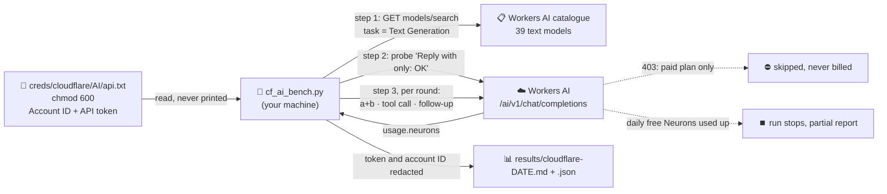

# ☁️ Cloudflare Workers AI: free models

Cloudflare **Workers AI** runs open models on Cloudflare's GPUs. Every account gets a **daily free allocation of 10,000 Neurons**, Cloudflare's usage unit; the price list gives each model's cost per million tokens, and 1,000 Neurons cost $0.011. This folder tests which Workers AI text models work **for free** on our account and how well they handle what an agent like Hermes needs: correct answers, OpenAI-style **tool calls**, and low latency.

> 🧪 **Test only.** Hermes isn't connected to Cloudflare: its providers are still NVIDIA (default) and the [OpenCode bridge](../opencode/README.md). Connecting Hermes would need a new OpenShell provider and network rule, so it's a separate decision.

| | |
|---|---|
| 🔌 Endpoint | `https://api.cloudflare.com/client/v4/accounts/<account>/ai/v1/chat/completions` (OpenAI-compatible) |
| 📋 Catalogue | `GET …/accounts/<account>/ai/models/search?task=Text Generation` |
| 💳 Plan | **Workers Free**: models outside it answer `403 "not available on the Workers Free plan"`, so nothing can be billed. When the day's 10,000 Neurons are used up, requests fail with a "daily free allocation" error until the [daily reset at 00:00 UTC](https://developers.cloudflare.com/workers-ai/platform/pricing/). |
| 🧪 Test | [`cf_ai_bench.py`](cf_ai_bench.py) (stdlib Python, no packages) |
| 📊 Results | [`results/`](results/) |

---

## 🗺️ How the test works



Each round, for every chat model:

1. ➕ **Correctness:** a random `a + b`; the exact sum must be in the reply.
2. 🛠️ **Tool call** (only models that advertise function calling): an OpenAI `tools` request for `list_dir`; it must call `list_dir` with valid JSON arguments.
3. 🔁 **Follow-up:** the tool's result is sent back; the model must give a final text answer.

A failed round stops that model. **Passed** = every round run, 100% correct, tools 100% where supported, no errors. Non-chat models are skipped by name or by their error: LoRA bases, Llama Guard and Cloudflare's own task models (`clairic`, `clef*`).

---

## 📊 Results (2026-10-31)

Full tables: [screening, 1 round](results/cloudflare-2026-10-31.md) · [confirmation, 5 rounds](results/cloudflare-2026-10-31-confirm.md) · [reasoning-model recheck, 1,500 tokens](results/cloudflare-2026-10-31-reasoning-recheck.md). All runs together used about **2,100 of the 10,000** free daily Neurons. The first two reports count model rounds only; probes (`Reply with only: OK`, a few tokens each) are counted from the recheck on.

### ✅ Recommended: passed 5 rounds out of 5, including tool calls

| Model | Latency p50 / max | Neurons per 5 rounds | Notes |
|---|---|---|---|
| `@cf/openai/gpt-oss-120b` | 1.4 s / 3.0 s | 153 | 👑 best all-round pick: strong reasoning and reliable tools |
| `@cf/meta/llama-3.3-70b-instruct-fp8-fast` | 0.8 s / 1.4 s | 127 | fast, reliable |
| `@cf/meta/llama-4-scout-17b-16e-instruct` | 0.7 s / 1.6 s | 178 | fast, 131k context |
| `@cf/openai/gpt-oss-20b` | 0.9 s / 4.5 s | 66 | cheapest of the strong ones |
| `@cf/nvidia/nemotron-3-120b-a12b` | 1.6 s / 2.7 s | 351 | the free Cloudflare version of the NVIDIA model family Hermes uses |
| `@cf/qwen/qwen3.8-27b` | 1.8 s / 23 s | 487 | good, but slow outliers and the most Neurons |
| `@cf/daily-co/phonellm-mini-alpha-2` | 0.6 s / 1.5 s | 24 | tiny and cheap; an **alpha** model, not for real work |

### ⚠️ Passed the 1-round screening, then missed a round

| Model | What happened |
|---|---|
| `@cf/google/gemma-4-26b-a4b-it`, `@cf/zai-org/glm-4.7-flash` | Reasoning models: sometimes spend the whole 200-token budget thinking and return an **empty** answer. With `--max-tokens 1500` both **passed 3 rounds out of 3**, tools included ([recheck](results/cloudflare-2026-10-31-reasoning-recheck.md)). |
| `@cf/mistralai/mistral-small-3.1-24b-instruct` | One wrong sum in round 2 (`18009` for `17999`). |
| `@cf/qwen/qwen3-30b-a3b-fp8` | Empty answer at 200 tokens (same reasoning issue); with 1,500 tokens it **passed 3 rounds out of 3**, tools included ([recheck](results/cloudflare-2026-10-31-reasoning-recheck.md)). |

### 💬 Chat only (no function calling advertised), passed 1 round

`@cf/meta/llama-3.1-8b-instruct-fp8`, `@cf/meta/llama-3.2-3b-instruct`, `@cf/aisingapore/gemma-sea-lion-v4-27b-it`, `@cf/qwen/qwen2.5-coder-32b-instruct`, `@cf/qwen/qwq-32b` (6 s), `@cf/deepseek-ai/deepseek-r1-distill-qwen-32b` (6 s, the most Neurons per answer).

### ❌ Failed or not available

| Model(s) | Why |
|---|---|
| `@cf/ibm-granite/granite-4.0-h-micro` | Tool arguments come back **double-encoded** (a JSON string inside a string), so a client can't read them |
| `@cf/meta/llama-3.2-1b-instruct` | Wrong sum (too small for reliable answers) |
| DeepSeek v4 / v4.1, Kimi K2.6 / K2.7, GLM 5.2 / 5.3 / 5.3-flash (8 models) | **Workers Paid plan only** (`403`) |
| `@cf/meta/llama-3.2-11b-vision-instruct` | Needs a one-time **licence agreement** (send the prompt `agree`); we didn't accept it on your behalf |
| `@cf/swiss-ai/apertus-v1.5-8b` | `403`: this account isn't allowed to use it |
| `@cf/utter-project/eurollm-9b-it` | `400`: "AI model does not have config" (Cloudflare-side) |
| LoRA bases (4), `llama-guard-3-8b`, `clairic`, `clef`, `clef-flash`, `clef-omni` | Not chat models |

### 🪤 Things we learned

- 🧾 **`content: null` is rejected.** On the assistant message that carries `tool_calls`, standard OpenAI clients send `"content": null`. Workers AI refuses that with `400 Bad input … 'string' not in 'null'`; it needs `"content": ""`. Any client (including Hermes) needs to send a string there.
- 🧠 **Reasoning models need room.** Gemma 4, GLM 4.7 Flash and Qwen3 30B can return an empty answer at a small `max_tokens`. Give them 1,000+ tokens.
- 🧮 **Budget for agents.** One test call costs from under 1 Neuron (small Llamas) to about 90 (the DeepSeek R1 distill's long reasoning), because its prompts are tiny. An agent like Hermes sends its system prompt and tool list with every turn; assuming about 10,000 tokens per turn (a rough estimate, not measured here): at `gpt-oss-120b` prices that's roughly 300 to 500 Neurons per turn, so **10,000 free Neurons/day ≈ 20 to 30 agent turns**. That's enough for demos, not for daily use.
- 📈 **Each response reports its cost.** In our tests every Workers AI response carried `usage.neurons`, so the reports show exact Neuron use per model.

---

## ▶️ Run it

Credentials: `~/Desktop/sandbox/creds/cloudflare/AI/api.txt`, folder `700`, file **`600`** (the script refuses anything looser), with the lines:

```text
Account ID: <32-hex account id>
API: <Workers AI API token>
```

Or set `CLOUDFLARE_ACCOUNT_ID` and `CLOUDFLARE_AI_TOKEN`, or point `CLOUDFLARE_AI_CREDS_FILE` at another file. Create the token from Cloudflare's **Workers AI** API token template (Workers AI read and edit, on this account only). The script never prints the token or the account ID, and checks that neither appears in the reports it writes.

```bash
python3 sandbox/cloudflare-ai/cf_ai_bench.py --list          # catalogue only (no Neurons)
python3 sandbox/cloudflare-ai/cf_ai_bench.py                 # screening: 1 round, ~400 Neurons
python3 sandbox/cloudflare-ai/cf_ai_bench.py --rounds 5 --stamp "$(date -u +%F)-confirm" \
  --models @cf/openai/gpt-oss-120b,@cf/meta/llama-3.3-70b-instruct-fp8-fast   # confirm picks
```

| Option | Default | Meaning |
|---|---|---|
| `--models a,b` | all text models | test only these |
| `--rounds N` | `1` | rounds per model |
| `--max-tokens N` | `256` | answer budget (we used `200`; raise it for reasoning models) |
| `--rpm N` | `30` | requests per minute (we used `20`) |
| `--out-dir DIR` / `--stamp S` | `results/`, today's UTC date | report location and file name |

Exit codes: `0` done, `2` daily free Neurons used up (partial report written), `1` no credentials, catalogue unreachable, unknown `--models` id or an unexpected error (a report is still written once testing has started), `130` interrupted (Ctrl-C).

---

## 📚 Links

- Workers AI: [pricing and free allocation](https://developers.cloudflare.com/workers-ai/platform/pricing/) · [OpenAI-compatible endpoints](https://developers.cloudflare.com/workers-ai/configuration/open-ai-compatibility/) · [function calling](https://developers.cloudflare.com/workers-ai/features/function-calling/) · [models](https://developers.cloudflare.com/workers-ai/models/)
- The same kind of test for NVIDIA: [`../scripts/nvidia_bench.py`](../scripts/nvidia_bench.py), results in [`../benchmarks/`](../benchmarks/)
