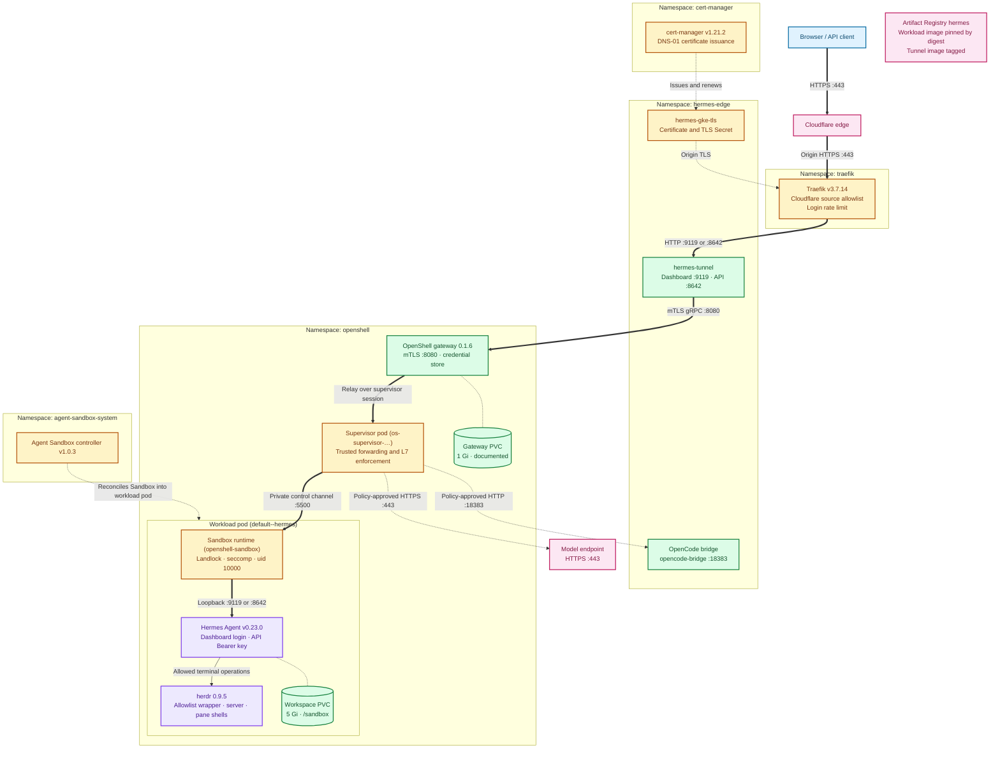
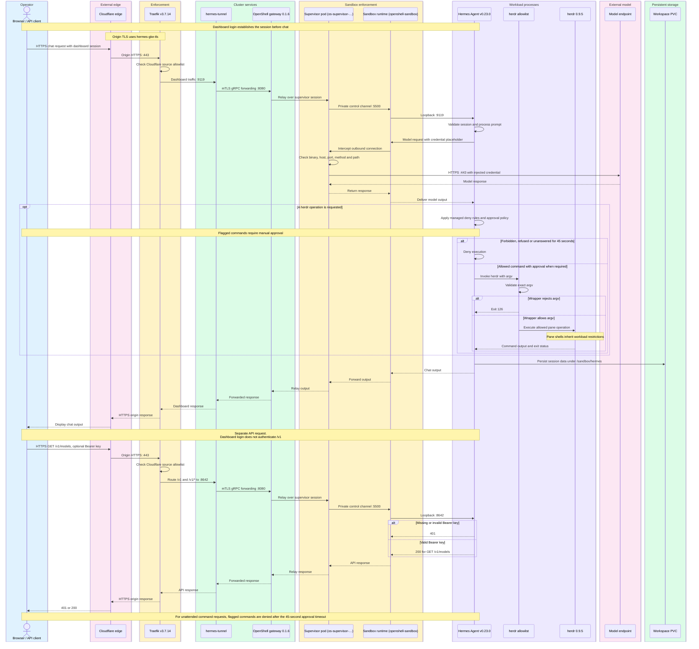
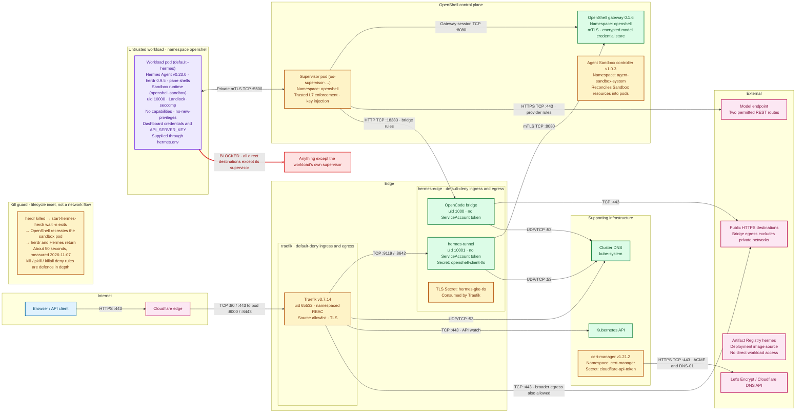

# 🏗️ Hermes on GKE: architecture

This is the architecture of the live GKE deployment described in [Part 1 of the k8s README](README.md#️-part-1-hermes-in-nvidia-openshell-on-gke-verified-2026-11-07): Hermes Agent runs inside an NVIDIA OpenShell sandbox on a GKE Standard cluster, with herdr (terminal workspace manager) in the same sandbox, and is served at `https://hermes-gke.saqlainmushtaq.com` through Cloudflare and Traefik. It exists so that an engineer can see in one place what runs where, which path every request takes, which control stops which threat, and how the stack is upgraded, backed up and recovered. The manifests and scripts are in [`gke/`](gke/) unless a path says otherwise; the README stays the build guide.

> 🧪 **Status:** verified 2026-11-07 on a fresh build: Hermes Agent **v0.23.0**, NVIDIA OpenShell **0.1.6**, herdr **0.9.5** (with the kill guard), GKE **1.36.4-gke.2046003**, Ubuntu 24.04.5 nodes, Traefik **v3.7.14**, cert-manager **v1.21.2**, Agent Sandbox controller **v1.0.3**. Node loss and gateway-state backup were not tested (see [Failure modes](#-failure-modes)).

---

## 🗺️ Diagrams

<!-- DIAGRAM: overview -->

| Component | Legend |
|---|---|
| Browser / API client | Blue; initiates dashboard sessions or authenticated API requests. |
| Cloudflare edge | Pink; proxies public HTTPS to the origin. |
| Traefik v3.7.14 | Amber; applies source restrictions and routes dashboard/API traffic (`gke/traefik-routes.yaml`). |
| hermes-tunnel | Green; forwards both application ports through gateway mTLS (`gke/hermes-tunnel.yaml`). |
| OpenShell gateway 0.1.6 | Green; relays supervisor sessions and holds model credentials (`gke/openshell-values.yaml`, `gke/deploy.sh`). |
| Supervisor pod (`os-supervisor-…`) | Amber; relays inbound traffic and enforces outbound policy (`README.md`, Part 1). |
| Workload pod (`default--hermes`) | Contains the isolated runtime, Hermes and herdr (`gke/deploy.sh`). |
| Sandbox runtime (`openshell-sandbox`) | Amber; applies filesystem/syscall restrictions and forwards application traffic (`README.md`, Part 1). |
| Hermes Agent v0.23.0 | Purple; serves dashboard and API requests under separate authentication (`gke/deploy.sh`). |
| herdr 0.9.5 | Purple; runs allowed terminal operations inside the same workload (`gke/herdr/herdr-allowlist`). |
| OpenCode bridge | Green; accepts policy-approved supervisor requests on port 18383 (`gke/opencode-bridge.yaml`, `../hermes/policy.yaml`). |
| Agent Sandbox controller v1.0.3 | Amber; reconciles Sandbox resources into workload pods in `agent-sandbox-system` (`gke/deploy.sh`, `ARCHITECTURE.md`). |
| Workspace PVC | Green; 5 Gi at `/sandbox`, including `/sandbox/hermes` (`gke/openshell-values.yaml`). |
| Gateway PVC | Green; documented 1 Gi gateway-state volume (`ARCHITECTURE.md`, Storage and backup). |
| cert-manager v1.21.2 | Amber; issues and renews the origin certificate using DNS-01 (`gke/cluster-issuer.yaml`). |
| `hermes-gke-tls` | Amber; Certificate and Secret in `hermes-edge`, consumed by Traefik (`gke/certificate.yaml`, `gke/traefik-routes.yaml`). |
| Model endpoint | Pink; permits the provider’s two REST routes with injected credentials (`../providers/hermes-nvidia.yaml`). |
| Artifact Registry `hermes` | Pink; deployment image source, shown without a workload network edge (`gke/deploy.sh`, `gke/hermes-tunnel.yaml`). |

Thick arrows trace inbound requests; dotted arrows show supporting relationships. Storage links represent mounts, not network traffic.

<!-- DIAGRAM: request-flow -->

| Component | Legend |
|---|---|
| Browser / API client | Blue; dashboard sessions and API Bearer keys authenticate separate interfaces (`ARCHITECTURE.md`, Request flow). |
| Cloudflare edge | Pink; carries public requests and responses over HTTPS (`ARCHITECTURE.md`, Request flow). |
| Traefik v3.7.14 | Amber; routes dashboard traffic to 9119 and `/v1` traffic to 8642 (`gke/traefik-routes.yaml`). |
| hermes-tunnel | Green; carries application forwards over gateway mTLS (`gke/hermes-tunnel.yaml`). |
| OpenShell gateway 0.1.6 | Green; relays requests and responses through the supervisor session (`README.md`, Part 1). |
| Supervisor pod (`os-supervisor-…`) | Amber; enforces provider policy and injects credentials (`../providers/hermes-nvidia.yaml`). |
| Sandbox runtime (`openshell-sandbox`) | Amber; delivers inbound loopback traffic and intercepts outbound requests (`README.md`, Part 1). |
| Hermes Agent v0.23.0 | Purple; authenticates requests, applies deny rules and waits up to 45 seconds for approval (`gke/herdr/hermes-managed.yaml`). |
| `herdr` allowlist | Purple; validates argv before execution and rejects forbidden forms with exit 126 (`gke/herdr/herdr-allowlist`). |
| herdr 0.9.5 | Purple; executes permitted pane operations within the workload (`gke/herdr/README.md`). |
| Model endpoint | Pink; receives only approved provider requests with injected credentials (`../providers/hermes-nvidia.yaml`). |
| Workspace PVC | Green; persists Hermes session data under `/sandbox/hermes` (`ARCHITECTURE.md`, Storage and backup). |

<!-- DIAGRAM: trust-zones -->

| Component | Legend |
|---|---|
| Browser / API client | Blue; accesses the public HTTPS endpoint through Cloudflare (`ARCHITECTURE.md`, Request flow). |
| Cloudflare edge | Pink; accepted origin caller, enforced by Traefik’s source allowlist rather than NetworkPolicy source filtering (`gke/traefik-routes.yaml`, `gke/networkpolicies.yaml`). |
| Traefik v3.7.14 | Amber; permits backend and DNS traffic plus broadly allowed TCP 443 egress, including API access (`gke/networkpolicies.yaml`). |
| hermes-tunnel | Green; tokenless ServiceAccount, gateway mTLS identity and only gateway/DNS egress (`gke/hermes-tunnel.yaml`, `gke/networkpolicies.yaml`). |
| OpenCode bridge | Green; tokenless ServiceAccount, supervisor-only ingress and public HTTPS/DNS egress (`gke/opencode-bridge.yaml`, `gke/networkpolicies.yaml`). |
| `hermes-gke-tls` | Amber; TLS Secret in `hermes-edge`, referenced by Traefik routes (`gke/certificate.yaml`, `gke/traefik-routes.yaml`). |
| OpenShell gateway 0.1.6 | Green; stores the model credential imported by the provider deployment step (`gke/deploy.sh`). |
| Supervisor pod (`os-supervisor-…`) | Amber; mediates workload traffic and injects the model credential only on approved routes (`README.md`, Part 1; provider profile). |
| Agent Sandbox controller v1.0.3 | Amber; reconciles workload resources; token mounting is not established by the local deployment script (`gke/deploy.sh`). |
| Workload pod (`default--hermes`) | Purple; contains Hermes, herdr, pane shells and the sandbox runtime under the documented restrictions (`../hermes/policy.yaml`, `gke/herdr/README.md`). |
| Cluster DNS | Green; selected DNS pods receive edge DNS traffic on UDP/TCP 53 (`gke/networkpolicies.yaml`). |
| Kubernetes API | Green; Traefik watches configuration using namespaced RBAC (`gke/traefik-values.yaml`, `gke/networkpolicies.yaml`). |
| cert-manager v1.21.2 | Amber; uses `cloudflare-api-token` from `cert-manager` for DNS-01 (`gke/cluster-issuer.yaml`, `gke/deploy.sh`). |
| Model endpoint | Pink; only `GET /v1/models` and `POST /v1/chat/completions` are allowed by the provider profile (`../providers/hermes-nvidia.yaml`). |
| Public HTTPS destinations | Pink; shows actual broader infrastructure permissions rather than implying hostname restrictions (`gke/networkpolicies.yaml`). |
| Artifact Registry `hermes` | Pink; supplies deployment images; no workload-to-registry permission is implied (`gke/deploy.sh`). |
| Let’s Encrypt / Cloudflare DNS API | Pink; certificate issuance and DNS-01 services configured by the ClusterIssuers (`gke/cluster-issuer.yaml`). |
| Blocked destinations | Red crossed edge; direct workload access beyond its own supervisor is blocked (`README.md`, Part 1, Guardrails). |
| Kill guard | Amber; `wait -n` plus on-failure restart restores both processes; approximately 50 seconds is a recorded measurement (`gke/herdr/start-hermes-herdr.sh`, `gke/deploy.sh`, `gke/herdr/README.md`). |

The TCP 5500 relationship comes from the documented driver-managed policies in `README.md`; those generated manifests are not supplied in `gke/networkpolicies.yaml`. Certificate-service connections are configured infrastructure flows, outside the two default-deny edge namespaces. Dashboard credentials and `API_SERVER_KEY` arrive through `hermes.env`, which is not a Kubernetes Secret.

## 🧩 Components

| Component | What it does | Namespace | Defined in | Security role |
|---|---|---|---|---|
| Cloudflare edge | Proxied DNS record `hermes-gke`, browser-trusted HTTPS, `http` → `https` 301 | n/a (external) | [`deploy.sh`](gke/deploy.sh) step `dns` (`scripts/update_dns.sh`) | Hides the origin; only its IP ranges may reach Traefik |
| GCP passthrough load balancer | External LB created by the Traefik Service (`type: LoadBalancer`, `externalTrafficPolicy: Local`) | `traefik` | [`traefik-values.yaml`](gke/traefik-values.yaml) | Keeps the real Cloudflare source IP for the allow-list |
| GKE cluster `hermes-gke` | Zonal Standard cluster, `e2-standard-2` Ubuntu nodes, Dataplane V2, autoscaling off | n/a | [`gcp/gcp-infra.sh`](../../gcp/gcp-infra.sh), [`node-system-config.yaml`](gke/node-system-config.yaml) | Landlock-capable kernel, kubelet `podPidsLimit: 2048`, Workload Identity metadata server |
| Dataplane V2 (Cilium) | Enforces every NetworkPolicy, ingress and egress | n/a | `gcp-infra.sh --dataplane-v2` | Makes the workload network fence real |
| Traefik v3.7.14 | The only public entry: TLS, routes `/v1` and `/v1/*` to the API, everything else to the dashboard | `traefik` | [`traefik-values.yaml`](gke/traefik-values.yaml), [`traefik-routes.yaml`](gke/traefik-routes.yaml) | Cloudflare-only allow-list, security headers, login rate limit, namespaced RBAC |
| cert-manager v1.21.2 | Issues and renews the origin certificate `hermes-gke-tls` from Let's Encrypt with Cloudflare DNS-01 | `cert-manager` | [`cert-manager-values.yaml`](gke/cert-manager-values.yaml), [`cluster-issuer.yaml`](gke/cluster-issuer.yaml), [`certificate.yaml`](gke/certificate.yaml) | Publicly trusted origin TLS; holds the Cloudflare DNS token |
| hermes-tunnel | OpenShell CLI 0.1.6 keeping `openshell forward` open for :9119 (dashboard) and :8642 (API) through the gateway | `hermes-edge` | [`hermes-tunnel.yaml`](gke/hermes-tunnel.yaml) | Only path from Traefik into the sandbox; mTLS client certificate; no ServiceAccount token |
| OpenCode bridge | `sourcecheck-bridge:1.1.0`, OpenAI-compatible bridge on ClusterIP :18383, reached by the sandbox as `host.openshell.internal:18383` | `hermes-edge` | [`opencode-bridge.yaml`](gke/opencode-bridge.yaml) | Has no auth, so a NetworkPolicy admits only supervisor pods |
| Agent Sandbox controller v1.0.3 | Installs the `sandboxes.agents.x-k8s.io` CRD and turns each Sandbox resource into the workload pod | `agent-sandbox-system` | [`deploy.sh`](gke/deploy.sh) step `base` (upstream `sandbox.yaml`) | Reconciles gateway-created Sandbox resources into pods; no public exposure |
| OpenShell gateway 0.1.6 | Helm release `openshell` (StatefulSet, pod `openshell-0`): control plane, credential store, Kubernetes compute driver | `openshell` | [`openshell-values.yaml`](gke/openshell-values.yaml) | ClusterIP only, mTLS required, `allowUnauthenticatedUsers: false`, holds the encrypted NVIDIA key |
| Supervisor pod (`os-supervisor-…`) | Trusted side, one per sandbox: dials the gateway, relays forwards, enforces the OPA/L7 policy, injects the key, writes OCSF logs | `openshell` | Created by the OpenShell driver; resources from [`limitrange.yaml`](gke/limitrange.yaml) | Egress policy enforcement and credential injection |
| Workload pod (`default--hermes`) | Untrusted Hermes container `hermes-openshell:v0.23.0-herdr0.9.5`, deployed by digest, 900m CPU / 3 GiB | `openshell` | [`deploy.sh`](gke/deploy.sh) step `sandbox`, [`../hermes/policy.yaml`](../hermes/policy.yaml) | uid 10000, no capabilities, no-new-privileges, seccomp, Landlock, network fenced to its supervisor |
| Sandbox runtime (`openshell-sandbox`) | PID 1 in the workload: applies Landlock and seccomp, hands every DNS lookup and TCP connection to the supervisor | `openshell` | OpenShell (in the workload pod) | Filesystem and syscall boundary |
| Hermes Agent v0.23.0 | Dashboard and chat on :9119, OpenAI-compatible API on :8642 | `openshell` (workload) | [`../hermes/`](../hermes/) image, [`herdr/hermes-managed.yaml`](gke/herdr/hermes-managed.yaml) | Dashboard login (scrypt hash), separate `/v1` Bearer key, manual approvals, deny rules |
| herdr 0.9.5 | Headless `herdr server` started by `start-hermes-herdr`, sockets mode 600 under `/sandbox/hermes` | `openshell` (workload) | [`herdr/Dockerfile`](gke/herdr/Dockerfile), [`herdr/start-hermes-herdr.sh`](gke/herdr/start-hermes-herdr.sh) | Same uid, Landlock, seccomp and network fence as Hermes |
| `herdr` allowlist | Root-owned `/usr/local/bin/herdr`: exact-argv check, then runs the real binary only for allowed pane operations | `openshell` (workload) | [`herdr/herdr-allowlist`](gke/herdr/herdr-allowlist) | Defence in depth: forbidden forms exit 126 |
| `herdr-operator` skill | Read-only skill telling Hermes how to use herdr | `openshell` (workload) | [`herdr/skills/herdr-operator/SKILL.md`](gke/herdr/skills/herdr-operator/SKILL.md) | Root-owned; skill create/edit stays off |
| Kill guard | `approvals.deny` globs for `kill`, `pkill`, `killall`, `herdr server stop`; `wait -n` supervision of herdr and Hermes | `openshell` (workload) | [`herdr/hermes-managed.yaml`](gke/herdr/hermes-managed.yaml), [`herdr/start-hermes-herdr.sh`](gke/herdr/start-hermes-herdr.sh) | Blocks naive kill forms; guarantees recovery if herdr dies |
| Workspace PVC | `workspace-default--hermes`, 5 Gi `standard-rwo`, mounted at `/sandbox` | `openshell` | [`openshell-values.yaml`](gke/openshell-values.yaml) (`workspaceDefaultStorageSize`) | Holds Hermes data; deleted with the sandbox |
| NetworkPolicies | Default-deny and allow rules for `hermes-edge` and `traefik`; OpenShell manages its own in `openshell` | `hermes-edge`, `traefik`, `openshell` | [`networkpolicies.yaml`](gke/networkpolicies.yaml) | Least-privilege east-west and egress traffic |
| LimitRange `container-defaults` | Default requests/limits for containers that set none | `openshell` | [`limitrange.yaml`](gke/limitrange.yaml) | Keeps the supervisor out of BestEffort |
| Pod Security labels | `restricted` (enforce, warn, audit) on all four app namespaces | `traefik`, `cert-manager`, `openshell`, `hermes-edge` | [`namespaces.yaml`](gke/namespaces.yaml) | Rejects privileged or root pods at admission |
| Artifact Registry `hermes` | `us-central1` Docker repository holding the custom Hermes and tunnel images | n/a | README [Build it, step 2](README.md#-build-it-step-by-step) | Source of the digest-pinned workload image |
| NVIDIA API Catalog | Default model endpoint `integrate.api.nvidia.com:443` | n/a (external) | [`../providers/hermes-nvidia.yaml`](../providers/hermes-nvidia.yaml) | Reachable only on two REST routes, with the key the supervisor injects |

---

## 🧱 Namespaces and trust zones

| Zone | Namespaces / hosts | Members | Trust | Boundary into the next zone |
|---|---|---|---|---|
| Internet and Cloudflare | Public internet, Cloudflare edge | Browsers, API clients, Cloudflare proxy and DNS | Untrusted clients; Cloudflare trusted as the only origin caller | Cloudflare IP allow-list on Traefik; origin TLS with `hermes-gke-tls` |
| Edge | `traefik`, `hermes-edge`, `cert-manager` | Traefik, hermes-tunnel, OpenCode bridge, cert-manager, edge Secrets | Trusted infrastructure, least privilege | Default-deny NetworkPolicies; tunnel reaches only the gateway on TCP 8080 with an mTLS client certificate |
| OpenShell control plane | `openshell` (gateway, supervisors), `agent-sandbox-system` | OpenShell gateway, supervisor pods, Agent Sandbox controller | Trusted; holds the credential store and the policy | Per-pair `os-control-<id>` policy; supervisor is the workload's only peer |
| Untrusted workload | `openshell` (pods labelled `openshell.ai/boundary-role=workload`) | Sandbox runtime, Hermes, herdr and its pane shells | Untrusted: runs model-chosen commands | Landlock, seccomp, uid 10000, no capabilities, NetworkPolicy fence, supervisor L7 policy |
| Model provider | External HTTPS | NVIDIA API Catalog (via the supervisor); OpenCode Zen (via the bridge) | External; sees prompt content | Supervisor allows only `POST /v1/chat/completions` and `GET /v1/models` to `integrate.api.nvidia.com:443` and injects the key |

---

## 🔀 Request flow

**Browser login, then `/api`:**

1. The browser opens `https://hermes-gke.saqlainmushtaq.com/login`; Cloudflare terminates the visitor's TLS and connects to the Traefik LB on :443 with origin TLS (`hermes-gke-tls`).
2. Traefik (`hermes-websecure`) applies `cloudflare-only` and `security-headers` and sends the request to `hermes-tunnel:9119` (priority 100 route).
3. The tunnel carries it as a gRPC `ForwardTcp` over mTLS to the gateway (:8080); the gateway relays it over the supervisor session; the supervisor passes it on the private control channel to the sandbox runtime, which delivers it to Hermes over loopback.
4. `POST /auth/password-login` matches the priority 300 route, which adds `login-ratelimit` (10 per minute per `CF-Connecting-IP`); Hermes checks the scrypt hash and sets `__Host-` session cookies (`Secure; HttpOnly; SameSite=lax`).
5. Later `/api/*` calls (for example `/api/auth/me`) take the same path; without a session Hermes answers `401`.

**WebSocket chat:**

1. The Chat page opens `/api/pty`, `/api/ws` and `/api/events` on the same host; Traefik proxies the `Upgrade` natively (none of the middlewares touch it).
2. Each socket follows the dashboard path above (tunnel :9119 → gateway → supervisor → runtime → Hermes).
3. The tunnel's entrypoint restarts hung forwards itself; its Kubernetes probes are TCP-only so a probe never drops every chat. Verified: all three sockets stayed open for 240 s idle, before and after a reload.

**`/v1` API with a key:**

1. The client calls `https://hermes-gke.saqlainmushtaq.com/v1/...` with `Authorization: Bearer <API_SERVER_KEY>`.
2. Traefik's priority 200 route (`Path(/v1) || PathPrefix(/v1/)`) applies `cloudflare-only` and `security-headers` (no rate limit, no dashboard login) and sends it to `hermes-tunnel:8642`.
3. The request takes the same tunnel → gateway → supervisor → runtime path to the Hermes API on :8642, which checks the Bearer key (`/v1/models` without or with a wrong key → `401`).
4. Flagged commands requested over `/v1` are denied after the 45 s approval timeout (unattended mode is `deny`).

**Model call through the OpenShell L7 provider:**

1. Hermes's bundled Python sends a request to `integrate.api.nvidia.com` with the placeholder key it holds.
2. The sandbox runtime intercepts the DNS lookup and TCP connection and hands it to the supervisor (the workload has no network of its own).
3. The supervisor matches the `_provider_nvidia` rules (binary = Hermes's Python, host `integrate.api.nvidia.com:443`, `POST /v1/chat/completions` or `GET /v1/models`) and logs `ALLOWED … [policy:_provider_nvidia engine:l7]` in OCSF.
4. The supervisor injects the real key from the gateway's credential store and sends the HTTPS request; anything else is logged `DENIED` and never leaves.
5. The response returns supervisor → runtime → Hermes; calls to the OpenCode bridge follow the same path under the `opencode_bridge` rules to `host.openshell.internal:18383`.

---

## 🚧 Network policies

The repo's policies are in [`networkpolicies.yaml`](gke/networkpolicies.yaml). DNS below means UDP/TCP 53 to `kube-system` pods `k8s-app=kube-dns` or `k8s-app=node-local-dns` (GKE NodeLocal DNSCache).

| Policy (namespace) | Selector | Allowed ingress | Allowed egress | Purpose |
|---|---|---|---|---|
| `default-deny` (`hermes-edge`) | all pods | none | none | Deny everything not allowed below |
| `hermes-tunnel-ingress-from-traefik` (`hermes-edge`) | `app.kubernetes.io/name=hermes-tunnel` | TCP 9119, 8642 from Traefik pods in `traefik` | n/a | Only Traefik can reach the tunnel |
| `hermes-tunnel-egress` (`hermes-edge`) | `app.kubernetes.io/name=hermes-tunnel` | n/a | TCP 8080 to the OpenShell gateway (`app.kubernetes.io/name=openshell` in `openshell`); DNS | Tunnel talks only to the gateway |
| `opencode-bridge-ingress-from-supervisors` (`hermes-edge`) | `app.kubernetes.io/name=opencode-bridge` | TCP 18383 from `openshell` pods labelled `openshell.ai/component=supervisor` or `app.kubernetes.io/name=openshell-supervisor` | n/a | The unauthenticated bridge is reachable only by supervisors |
| `opencode-bridge-egress` (`hermes-edge`) | `app.kubernetes.io/name=opencode-bridge` | n/a | TCP 443 to public addresses only (private, link-local incl. cloud metadata, and CGNAT ranges excluded); DNS | Bridge reaches OpenCode Zen, nothing in the VPC |
| `default-deny` (`traefik`) | all pods | none | none | Deny everything not allowed below |
| `traefik-ingress` (`traefik`) | `app.kubernetes.io/name=traefik` | TCP 8000, 8443 from any source | n/a | LB traffic; the Cloudflare allow-list filters per request in Traefik |
| `traefik-egress` (`traefik`) | `app.kubernetes.io/name=traefik` | n/a | TCP 9119, 8642 to `hermes-tunnel` in `hermes-edge`; DNS; TCP 443 to any address (Kubernetes API) | Backends and the API server (narrowing to the control-plane IP is a documented TODO) |
| `openshell-sandbox-ssh` (`openshell`) | `openshell.ai/managed-by=openshell` | Gateway → sandbox only (chart value `networkPolicy.enabled: true`) | not in this repo | Chart-managed sandbox SSH ingress |
| `openshell-sandbox-workloads` (`openshell`) | `openshell.ai/boundary-role=workload` | TCP 5500 from any supervisor pod in `openshell` | none | Workload has no network except its supervisor |
| `os-control-<id>` (`openshell`) | `openshell.ai/boundary-pair=<id>` | Per pair: the workload reaches only its own supervisor on TCP 5500 | Per pair, as for ingress | Driver-managed fence for one sandbox |
| `openshell-sandbox-supervisors` (`openshell`) | `openshell.ai/boundary-role=supervisor` | not in this repo | not in this repo | Driver-managed supervisor policy |

The `openshell` policies are created by the OpenShell chart and Kubernetes driver, not by this repo; their names and selectors are from the live cluster, their rules from the [Guardrails](README.md#️-guardrails-gke-vs-vm-with-the-live-proof) table. Proof of the fence: a throwaway pod with `openshell.ai/boundary-role=workload` reaches no internet, Kubernetes API, gateway or DNS; the same pod without the label reaches all four.

---

## 🪪 Identities and RBAC

**ServiceAccounts and roles:**

| Identity | Namespace | Token mounted | Permissions | Defined in |
|---|---|---|---|---|
| `hermes-tunnel` | `hermes-edge` | No (`automountServiceAccountToken: false`) | None | [`hermes-tunnel.yaml`](gke/hermes-tunnel.yaml) |
| `opencode-bridge` | `hermes-edge` | No (`automountServiceAccountToken: false`) | None | [`opencode-bridge.yaml`](gke/opencode-bridge.yaml) |
| `traefik` | `traefik` | Chart default | Roles only in `hermes-edge` and `traefik` (`rbac.namespaced: true`); `can-i get secrets -n openshell` → `no` | [`traefik-values.yaml`](gke/traefik-values.yaml) |
| OpenShell gateway | `openshell` | Chart-managed | Kubernetes API access to create Sandbox resources and supervisor pods (chart RBAC, not in this repo) | [`openshell-values.yaml`](gke/openshell-values.yaml) (chart 0.1.6) |
| Agent Sandbox controller | `agent-sandbox-system` | Upstream manifest | Reconciles Sandbox resources into pods (upstream RBAC) | `deploy.sh` step `base` |
| cert-manager | `cert-manager` | Chart default | Chart RBAC; reads `cloudflare-api-token` | [`cert-manager-values.yaml`](gke/cert-manager-values.yaml) |
| Gateway clients (tunnel, CLI) | n/a | n/a | Authenticated to the gateway by the mTLS client certificate in `openshell-client-tls`, not by Kubernetes RBAC | [`openshell-cli.sh`](gke/openshell-cli.sh), [`hermes-tunnel.yaml`](gke/hermes-tunnel.yaml) |

**Users inside the pods** (no container of the stack runs as root):

| Pod | uid | Restrictions |
|---|---|---|
| Hermes workload (`openshell-sandbox`, `start-hermes`, `hermes`, herdr) | 10000 | `CapEff 0`, `NoNewPrivs 1`, `Seccomp 2`, Landlock |
| Supervisor | 10000 | All capabilities dropped, `runAsNonRoot`, read-only root filesystem |
| OpenShell gateway | 1000 | All capabilities dropped, `runAsNonRoot`, `RuntimeDefault` seccomp |
| hermes-tunnel (and init `install-mtls`) | 10001 | `CapEff 0`, `NoNewPrivs 1`, `Seccomp 2`, read-only root filesystem |
| Traefik | 65532 | `CapEff 0`, `NoNewPrivs 1`, `Seccomp 2`, read-only root filesystem |
| OpenCode bridge | 1000 | `CapEff 0`, `NoNewPrivs 1`, `Seccomp 2`, read-only root filesystem |

**Workload Identity:** enabled on the cluster (`--workload-pool=<project>.svc.id.goog`, `--workload-metadata=GKE_METADATA`), so pods get the GKE metadata server instead of the node's credentials. No Kubernetes ServiceAccount in [`gke/`](gke/) is bound to a Google service account.

**Where Secrets live** (names only):

| Secret | Namespace | Used by |
|---|---|---|
| `nvidia-api-key` | `openshell` | Read once by the `provider` step; the gateway keeps its own encrypted copy |
| `openshell-client-tls` | `openshell`, copied to `hermes-edge` | Gateway mTLS clients (tunnel, CLI) |
| `openshell-server-tls`, `openshell-jwt-keys`, `openshell-credential-storage-key-encryption-key` | `openshell` | Gateway only (chart PKI hook) |
| `os-sandbox-*`, `os-supervisor-*` | `openshell` | OpenShell sandbox and supervisor (driver-managed) |
| `cloudflare-api-token` | `cert-manager` | cert-manager DNS-01 |
| `letsencrypt-prod-account-key`, `letsencrypt-staging-account-key`, `cert-manager-webhook-ca` | `cert-manager` | cert-manager |
| `hermes-gke-tls` | `hermes-edge` | Traefik origin TLS |
| `hermes.env` (not a Kubernetes Secret) | Operator machine, passed with `--env-from` | Hermes dashboard login hash, session secret, `API_SERVER_KEY` |

---

## 💾 Storage and backup

| PVC | Namespace | Size / StorageClass | Mounted at | Contents | Backup |
|---|---|---|---|---|---|
| `workspace-default--hermes` | `openshell` | 5 Gi `standard-rwo` | `/sandbox` in the workload | Hermes data in `/sandbox/hermes` (sessions, settings, memory, logs, `config.yaml`), herdr socket and state, `/sandbox/hermes/workspace` | `recreate-sandbox` step (below) |
| `openshell-data-openshell-0` | `openshell` | 1 Gi `standard-rwo` | OpenShell gateway | Gateway state | None in this repo |
| `opencode-bridge-data` | `hermes-edge` | 1 Gi, default StorageClass `standard-rwo` (`pd-balanced`, `WaitForFirstConsumer`) | `~/.local/share/opencode`, `~/.config/opencode` in the bridge | OpenCode's anonymous client identity and state | None in this repo |

OpenShell deletes the workspace PVC with the sandbox, so `sandbox delete` + `create` alone loses `/sandbox`. `sandbox stop`/`start` keeps it.

| Task | Command | What it does |
|---|---|---|
| Back up, re-create, restore | `STEPS="recreate-sandbox sandbox restore-data tunnel-restart" sandbox/k8s/gke/deploy.sh` | Tars `/sandbox/hermes` to `~/.config/hermes-sandbox/gke/hermes-data-backup-<UTC>.tgz` (mode 600); fails closed unless the archive is readable and contains `hermes/config.yaml`; then deletes, re-creates, restores and restarts |
| Restore only | `STEPS=restore-data sandbox/k8s/gke/deploy.sh` (optional `HERMES_BACKUP=<file>`) | Sends the newest (or named) archive in 3 MiB chunks, checks SHA-256, extracts everything except `hermes/config.yaml`, then `sandbox stop`/`start` |
| Test the fail-closed backup | `sandbox/k8s/gke/test-recreate-backup.sh` | Offline, stub `docker`/`kubectl`/`gcloud`: the sandbox is never deleted unless the backup is good (6/6) |
| Delete without backup | `STEPS="delete-sandbox" sandbox/k8s/gke/deploy.sh` | Deletes the sandbox and its workspace PVC (save data first) |

Measured roll (2026-11-07): 2044 entries, 16 MB archive, 22 sessions before and 22 after.

---

## 📦 Images and digests

| Image | Tag | How it is pinned | Where built |
|---|---|---|---|
| `hermes-openshell` (workload) | `v0.23.0-herdr0.9.5` | **By digest**: `deploy.sh` resolves the tag to its digest in Artifact Registry and creates the sandbox from `hermes-openshell@<digest>` (nodes cache by tag); herdr binary SHA-256 checked in the build. The README records the tested builds `9f19d7ae…` (allowlist) and `fc2fc015…` (kill guard) | Locally with `docker buildx` from [`herdr/Dockerfile`](gke/herdr/Dockerfile) on top of `hermes-openshell:v0.23.0`; pushed to Artifact Registry `hermes` |
| `hermes-openshell` (base, rollback target) | `v0.23.0` | Tag | Locally from `sandbox/hermes` (base `nousresearch/hermes-agent:v0.23.0`); Artifact Registry |
| `hermes-tunnel` (tunnel and CLI) | `0.1.6` | Tag (`IfNotPresent`) | Locally from `sandbox/tunnel` (OpenShell CLI 0.1.6); Artifact Registry |
| OpenShell gateway | `0.1.6` | Chart version 0.1.6 | Upstream (`ghcr.io/nvidia/openshell`) |
| Supervisor and sandbox runtime | not recorded in the repo | Selected by the OpenShell 0.1.6 chart and driver | Upstream (OpenShell) |
| Traefik | `v3.7.14` | Chart 42.0.0 | Upstream |
| cert-manager (controller, webhook, cainjector) | `v1.21.2` | Chart v1.21.2 | Upstream (Jetstack) |
| Agent Sandbox controller | `v1.0.3` | Release manifest URL | Upstream (`kubernetes-sigs/agent-sandbox`) |
| OpenCode bridge | `sourcecheck-bridge:1.1.0` | Tag | Docker Hub |

---

## ⬆️ Upgrade and rollback

| Task | Documented procedure |
|---|---|
| Upgrade Hermes or herdr | Build and push the new image (README step 2), set `HERMES_TAG`, then `STEPS="recreate-sandbox sandbox restore-data tunnel-restart" sandbox/k8s/gke/deploy.sh` (backup first, fails closed) |
| Roll back Hermes | The same roll with the previous tag, for example `HERMES_TAG=v0.23.0 HERMES_CMD=start-hermes` (no herdr); old images stay in Artifact Registry |
| Upgrade a chart or controller (from `deploy.sh`) | Change the pinned variable (`OPENSHELL_CHART_VERSION`, `TRAEFIK_CHART_VERSION`, `CERT_MANAGER_VERSION`, `AGENT_SANDBOX_VERSION`) and re-run that step; each is `helm upgrade --install` or `kubectl apply` |
| GKE and nodes | Managed by the `regular` release channel; a surge upgrade briefly adds one `e2-standard-2` node and re-creates the Hermes pod (the workspace PVC stays) |
| Rotate the dashboard password | New `dashboard.pw`, regenerate the hash in `hermes.env`, then `STEPS="delete-sandbox sandbox tunnel" sandbox/k8s/gke/deploy.sh` (deletes `/sandbox`; save data first) |
| Rotate the NVIDIA key | Replace Secret `nvidia-api-key`, then `openshell provider update nvidia --from-existing` with the new key in the environment |
| Rotate the gateway client certificate | Re-run the chart's PKI hook (`helm upgrade`), `kubectl -n hermes-edge delete secret openshell-client-tls`, `STEPS=tunnel sandbox/k8s/gke/deploy.sh` (copies it again only when absent), `kubectl -n hermes-edge rollout restart deploy/hermes-tunnel` |

---

## 📏 Capacity vs quota and org-policy limits

| Item | Value | Source |
|---|---|---|
| Node type | `e2-standard-2` (2 vCPU, 8 GB) | [`gcp/README.md`](../../gcp/README.md) |
| Node count | 2 steady-state for this stack, autoscaling off; the live cluster has a third node for the herdr + Hermes POC | README [Sizing](README.md#-sizing) |
| Maximum | 3 × `e2-standard-2` (6 vCPU): 2 nodes plus one surge node during an upgrade | README [Sizing](README.md#-sizing), `gcp/README.md` quota row |
| Free CPU per node | About 950m after the GKE system pods; a 1 CPU request does not fit | README [Troubleshooting](README.md#-troubleshooting) |
| Hermes workload | requests = limits = 900m CPU / 3 GiB (`HERMES_CPU`, `HERMES_MEMORY`); its node is at about 97 % CPU and 80 % memory requests | [`deploy.sh`](gke/deploy.sh) |
| Supervisor | 100m / 128Mi requests, 1 CPU / 512Mi limits (LimitRange defaults) | [`limitrange.yaml`](gke/limitrange.yaml) |
| Traefik | 100m / 128Mi requests, 1 CPU / 256Mi limits | [`traefik-values.yaml`](gke/traefik-values.yaml) |
| hermes-tunnel | 50m / 64Mi requests, 500m / 128Mi limits (init: 10m / 16Mi, 100m / 32Mi) | [`hermes-tunnel.yaml`](gke/hermes-tunnel.yaml) |
| OpenCode bridge | 100m / 256Mi requests, 1 CPU / 1Gi limits | [`opencode-bridge.yaml`](gke/opencode-bridge.yaml) |
| cert-manager | controller 10m / 64Mi (limit 256Mi), webhook 10m / 32Mi (128Mi), cainjector 10m / 64Mi (256Mi) | [`cert-manager-values.yaml`](gke/cert-manager-values.yaml) |
| PIDs | 2048 per pod (kubelet `podPidsLimit`) | [`node-system-config.yaml`](gke/node-system-config.yaml) |
| Disks | 2 × 30 GB `pd-balanced` boot disks; PVCs 5 Gi + 1 Gi + 1 Gi | README [Cost and quota](README.md#-cost-and-quota) |
| Idle memory | About 1.4 GB for the whole stack (Hermes 715 MiB) | README [Sizing](README.md#-sizing) |

---

## 🧯 Failure modes

| Symptom | Cause | Detection | Recovery |
|---|---|---|---|
| Hermes briefly unavailable, new `default--hermes` pod | herdr, Hermes or `start-hermes-herdr` killed: `wait -n` exits the workload | `openshell-cli.sh sandbox get hermes`; [`test-kill-guard.sh`](gke/herdr/test-kill-guard.sh) with `RECOVERY=1` | Automatic: OpenShell's on-failure restart re-creates the pod with herdr and Hermes back within about 50 s (measured 2026-11-07; `/login` `200`, `/v1/models` `200` with the key) |
| Sandbox `Phase: Error` / `SandboxSuspended` | `kubectl delete pod default--hermes` (treated as a failed main process) | `openshell-cli.sh sandbox get hermes` | `openshell-cli.sh sandbox stop hermes`, then `sandbox start hermes`; `kubectl -n hermes-edge rollout restart deploy/hermes-tunnel` |
| Tunnel health failures after start-up | Tunnel forwards point at a sandbox that was re-created or restarted | `kubectl -n hermes-edge logs deploy/hermes-tunnel` shows `health: … did not answer` | `kubectl -n hermes-edge rollout restart deploy/hermes-tunnel` |
| Tunnel logs `connect error: transport error`; DNS times out in `hermes-edge` | NodeLocal DNSCache answers the kube-dns IP and a policy allows only `k8s-app=kube-dns` | Tunnel logs | Allow `k8s-app=node-local-dns` too (already in [`networkpolicies.yaml`](gke/networkpolicies.yaml)) |
| Origin TLS errors at Cloudflare | `hermes-gke-tls` not issued or not renewed (DNS-01 token, ClusterIssuer) | `kubectl -n hermes-edge get certificate` not `READY True` | Fix `cloudflare-api-token` or the issuer; delete Secret `hermes-gke-tls` to force a fresh issuance |
| Public `403` from the origin | Request not from a Cloudflare IP (or `externalTrafficPolicy` not `Local`) | Traefik access log | By design for direct LB access; keep the record proxied |
| `ERR_NAME_NOT_RESOLVED` on a new hostname | Resolver caches NXDOMAIN up to 30 min | `dig +short hermes-gke.saqlainmushtaq.com` against a public resolver (should list Cloudflare addresses) | Wait or flush the resolver cache |
| `429` on `/auth/password-login` | More than 10 login attempts a minute from one visitor | Traefik logs, `401`/`429` bursts | Wait a minute |
| Sandbox `Pending`, `Insufficient cpu` | Request above the ~950m free per node, or the Hermes node has no room | `kubectl -n openshell describe pod default--hermes` | `HERMES_CPU=900m` (default) |
| Node lost or drained | Node failure, surge upgrade | `kubectl get nodes` | Pod re-created on another node with the PVC (documented for surge upgrades); node failure itself not tested |
| `/sandbox` data gone | `sandbox delete` + `create` deletes the workspace PVC | Sessions missing in the dashboard | `STEPS=restore-data` from the newest `hermes-data-backup-*.tgz`; use the `recreate-sandbox` roll in future |
| Backup step stops with `backup failed … nothing deleted` | `sandbox exec`/`tar` failed, or archive empty or without `hermes/config.yaml` | `deploy.sh` output | Fix the sandbox, re-run; nothing was deleted |
| Rebuilt image not used | Same tag cached on the node (`IfNotPresent`) | `kubectl -n openshell get pod default--hermes -o jsonpath='{.status.containerStatuses[0].imageID}'` | `deploy.sh` creates the sandbox by digest; re-create the sandbox |
| Sandbox never starts, runtime logs `Landlock ABI probe` | COS node image (no Landlock) | Runtime logs | Use Ubuntu nodes (`UBUNTU_CONTAINERD`) |

---

## 🎯 Threat model

| Threat | Control | Enforced by | Proof (test) |
|---|---|---|---|
| Internet reaches the dashboard without a login | Cloudflare-only allow-list; Hermes login (scrypt); `/v1` Bearer key; login rate limit | Traefik `cloudflare-only`, `login-ratelimit`; Hermes | Direct LB IP `403`; `/api/auth/me` `401`; wrong password `401`, more than 10 a minute `429`; `/v1/models` `401` without key |
| Header spoofing (`X-Forwarded-*`) | Forwarded headers trusted from Cloudflare ranges only; alias headers deleted | [`traefik-values.yaml`](gke/traefik-values.yaml) | Configuration; no dedicated test recorded |
| Agent writes outside its workspace or reads secrets on disk | Landlock (system paths read-only, write only `/sandbox`, `/tmp`), uid 10000, no capabilities | OpenShell runtime, [`../hermes/policy.yaml`](../hermes/policy.yaml) | `/opt/hermes`, `/etc` writes and `/etc/shadow`, `/.openshell`, `/proc/1/environ` reads → `Permission denied` |
| Agent exfiltrates data or reaches cloud metadata | No network of its own; every connection goes through the supervisor policy | Workload NetworkPolicies; OpenShell OPA/L7 | Fence pod reaches nothing; metadata and `attacker.example` → curl exit 7, OCSF `DENIED` |
| NVIDIA key leaks to the agent | Key held by the gateway, injected by the supervisor on the allowed routes only | OpenShell provider and credential store | B3: key variable holds only a placeholder; no `nvapi-` in any output |
| Agent loosens its own guardrails | Managed config, skill and `herdr` wrapper root-owned on read-only paths | Landlock, file ownership, Hermes managed scope | Writes to `/etc/hermes/config.yaml`, the skill and `/usr/local/bin/herdr` → `Permission denied` |
| Agent misuses herdr (stop server, remote, prompt other agents) | Exact-argv allowlist; `approvals.deny` globs; manual approvals | `/usr/local/bin/herdr`; Hermes approvals | Bypass forms → exit `126`; `herdr server stop` → `BLOCKED … deny rule` in the chat |
| Agent kills herdr | `kill`/`pkill`/`killall` deny globs; supervision restarts both on exit | [`herdr/hermes-managed.yaml`](gke/herdr/hermes-managed.yaml), [`herdr/start-hermes-herdr.sh`](gke/herdr/start-hermes-herdr.sh) | `test-kill-guard.sh`: 9/9 kill forms exit `3`, 3/3 harmless `0`, chat `--yolo` leaves the same herdr; operator kill → back in ~50 s; 13/13 PASS |
| Container escape or privilege escalation | Non-root everywhere, `RuntimeDefault` seccomp, no-new-privileges, Pod Security `restricted`, no Docker socket | Pod specs, [`namespaces.yaml`](gke/namespaces.yaml) | Per-pod uid/`CapEff`/`NoNewPrivs`/`Seccomp` values; B1 (no Docker), B4 (`sudo` not found) |
| Fork bomb in one pod starves the node | 2048 PIDs per pod | [`node-system-config.yaml`](gke/node-system-config.yaml) | `configz` → `podPidsLimit = 2048` |
| Unauthorised gateway use from the cluster | ClusterIP only, mTLS client certificates, no unauthenticated users | [`openshell-values.yaml`](gke/openshell-values.yaml), tunnel NetworkPolicy | CLI and tunnel work only with `openshell-client-tls` |
| Edge component reads other Secrets | Traefik RBAC namespaced to `hermes-edge` and `traefik`; tunnel and bridge have no token | [`traefik-values.yaml`](gke/traefik-values.yaml), ServiceAccounts | `kubectl auth can-i get secrets -n openshell --as=system:serviceaccount:traefik:traefik` → `no` |
| Something other than a supervisor uses the unauthenticated bridge | Ingress only from supervisor pods | `opencode-bridge-ingress-from-supervisors` | Policy present; no dedicated test recorded |

**Not protected:** a compromised Cloudflare account or DNS token; a Hermes vulnerability reachable after a valid login; the model provider seeing prompt content; anything a logged-in user asks Hermes to do in its own workspace. The herdr allowlist and deny globs are defence in depth, not a boundary (same uid as Hermes); the OpenShell sandbox is the boundary.

---

## 🔗 Links

| Topic | Where |
|---|---|
| Part 1 overview | [README: Part 1](README.md#️-part-1-hermes-in-nvidia-openshell-on-gke-verified-2026-11-07) |
| Components and diagrams | [README: Components](README.md#-components-one-line-each), [Architecture (as running)](README.md#️-architecture-as-running), [Architecture on GKE](README.md#architecture-on-gke) |
| Login | [README: How to log in](README.md#-how-to-log-in) |
| herdr | [README: herdr in the dashboard](README.md#-herdr-in-the-dashboard), [`gke/herdr/`](gke/herdr/) |
| Landlock and node image | [README: Landlock and why the nodes are Ubuntu](README.md#-landlock-and-why-the-nodes-are-ubuntu-not-cos), [COS-APPARMOR.md](COS-APPARMOR.md) |
| Guardrails and threats | [README: Guardrails](README.md#️-guardrails-gke-vs-vm-with-the-live-proof), [Threat model](README.md#-threat-model) |
| Build and Secrets | [README: Build it, step by step](README.md#-build-it-step-by-step), [Kubernetes Secrets](README.md#-kubernetes-secrets) |
| Tests | [README: Verify](README.md#-verify) |
| Run it | [README: Operations](README.md#-operations), [Troubleshooting](README.md#-troubleshooting), [Cost and quota](README.md#-cost-and-quota) |
| Versions and files | [README: Pinned versions](README.md#-pinned-versions), [Files in gke/](README.md#-files-in-gke) |
| Cluster creation | [`gcp/README.md`](../../gcp/README.md), [`gcp/gcp-infra.sh`](../../gcp/gcp-infra.sh) |
| Manifests and scripts | [`deploy.sh`](gke/deploy.sh), [`openshell-cli.sh`](gke/openshell-cli.sh), [`networkpolicies.yaml`](gke/networkpolicies.yaml), [`traefik-routes.yaml`](gke/traefik-routes.yaml), [`openshell-values.yaml`](gke/openshell-values.yaml), [`test-recreate-backup.sh`](gke/test-recreate-backup.sh) |
