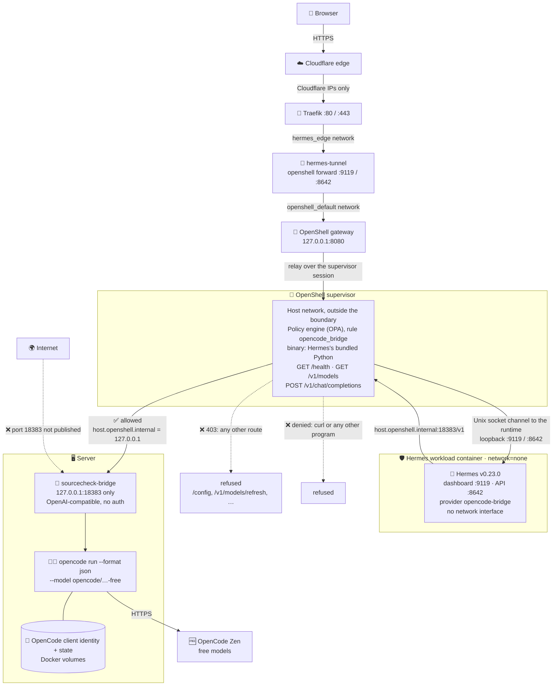
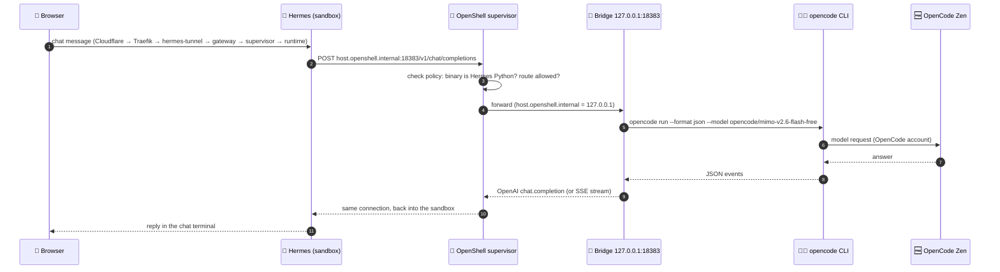

# 🌉 OpenCode bridge for the Hermes sandbox

The **OpenCode bridge** gives Hermes, which runs inside the NVIDIA OpenShell sandbox, access to **OpenCode's free models** (MiMo, DeepSeek, Big Pickle and others) at **$0**. It exposes an **OpenAI-compatible** endpoint on the server and runs each request through the [OpenCode](https://opencode.ai) CLI (`opencode run`).

In this deployment the bridge is the **optional alternative** provider. The default is the NVIDIA API Catalog (see [`../README.md`](../README.md#-nvidia-models)). The bridge is configured in Hermes as provider **`opencode-bridge`**; picking it in a chat doesn't change Hermes's default model.

| | |
|---|---|
| 📦 Container | `sourcecheck-bridge` (image `sourcecheck-bridge:1.1.0`, full name in [`docker-compose.example.yml`](docker-compose.example.yml); bridge `1.0.0`, OpenCode CLI `v2.1.4`), run from that example or as service `bridge` of your own Compose stack. Runs as the non-root user `bridge`. |
| ⚙️ Settings | free models only (the bridge's default, `--free-only`; the compose file's `OPENCODE_BRIDGE_FREE_ONLY=1` isn't read by bridge `1.0.0`), `OPENCODE_BRIDGE_MAX_CONCURRENCY=1` (one request at a time; another waits up to 30 s, then gets `429 bridge busy`), `OPENCODE_BRIDGE_TIMEOUT=180` s, default model `opencode/mimo-v2.6-flash-free` |
| 💾 Volumes | `sourcecheck-ai_bridge-config` → `~/.config/opencode` and `sourcecheck-ai_bridge-state` → `~/.local/share/opencode` (OpenCode's anonymous client identity `service.json` and its session database, kept across restarts; there is no OpenCode login or API key) |
| 🔌 Published on | **`127.0.0.1:18383` only** (inside its container it listens on `0.0.0.0:18383`). It has **no authentication**, so it must never be published on another address. |
| 🛣️ Routes | `GET /health`, `GET /v1/models`, `POST /v1/chat/completions` (the only three the sandbox may call) |
| 🧠 Hermes provider | `opencode-bridge` in [`../hermes/config.yaml`](../hermes/config.yaml), default model `opencode/mimo-v2.6-flash-free` |
| 🧱 Sandbox rule | `opencode_bridge` in [`../hermes/policy.yaml`](../hermes/policy.yaml) |
| ✅ Test | [`test_bridge.sh`](test_bridge.sh) (this folder) |

---

## 🗺️ Architecture

This diagram zooms in on the bridge path. The full, verified architecture (every hop, port and trust boundary) is [sandbox/README.md → Architecture at a glance](../README.md#architecture-at-a-glance).



### 🔁 One chat message through the bridge



### 🧩 How the pieces fit

- 🛡️ **The sandbox has no network interface.** Every connection Hermes makes goes to the OpenShell **supervisor**, which checks it against the policy. The supervisor runs on the host network and resolves **`host.openshell.internal` to `127.0.0.1`**, so Hermes reaches a bridge that listens on loopback only.
- 🎯 **The rule is narrow.** The `opencode_bridge` rule allows one host and port, and only these three routes. It's also **scoped to Hermes's bundled Python** (`/opt/hermes/tools/python-3.14.9+20261021-linux-x64/bin/python3.14`), so `curl` or any other program run on its own is refused. Programs that Hermes's Python starts inherit its access, because OpenShell checks the calling program **or one of its ancestors** (risk R5 in [`../SECURITY.md`](../SECURITY.md)); the route rules still apply to them.
- 🔑 **No key to protect.** The bridge has no authentication. Hermes requires a key variable for every provider, so `up.sh` passes `OPENCODE_BRIDGE_API_KEY=not-needed`. The bridge stays safe because it is reachable **only from the server itself**: published on `127.0.0.1`, closed from the internet, and from the sandbox only through the rule above.
- 🆓 **The bridge's own identity.** The free models need no OpenCode login or API key. They run under an anonymous client identity that OpenCode keeps in the bridge's `bridge-config` volume (`service.json`), and the free quota is tied to it. Hermes never sees it. The bridge settings used here: [`../ENVIRONMENT.md`](../ENVIRONMENT.md#74-opencode-bridge), with [`bridge.env.example`](bridge.env.example) and [`docker-compose.example.yml`](docker-compose.example.yml) to run the bridge on its own.
- 🐢 **One request at a time.** The bridge runs `MAX_CONCURRENCY=1`: a second chat waits up to 30 s (`OPENCODE_BRIDGE_QUEUE_WAIT`), then gets `429 bridge busy`, and Hermes quietly answers from its NVIDIA **fallback** models instead. Free models can take 10–60 s to answer.

---

## 💬 Use it in Hermes

The bridge is already configured. **Don't change the default model** just to try it. Pick it per chat instead:

- 🖥️ **Dashboard:** in a chat, type `/model` and choose the provider **`opencode-bridge`**, then `opencode/mimo-v2.6-flash-free` (or any model it lists). A **New chat** goes back to the NVIDIA default.
- ⌨️ **One-shot, from the server** (doesn't touch the saved default):

  ```bash
  openshell sandbox exec -n hermes --no-tty -- sh -c 'cd /tmp && HOME=/sandbox/hermes HERMES_HOME=/sandbox/hermes \
    /opt/hermes/bin/hermes chat -Q --provider opencode-bridge -m opencode/mimo-v2.6-flash-free -q "Say hello"'
  ```

  It leaves one session in the dashboard's **Sessions** list; delete it there or with `hermes sessions delete`.

> ⚠️ The side panel's **Switch model** saves its pick as the **default**. `start-hermes` restores the NVIDIA default on the next start, but until then every new chat uses the bridge.

---

## ✅ Test it

Run on the server, from the repo checkout:

```bash
sandbox/opencode/test_bridge.sh                 # no model calls
LLM_CHECKS=1 sandbox/opencode/test_bridge.sh    # + 2 real prompts (OpenCode free quota)
```

| # | What it checks | Expected |
|---|---|---|
| 1 | `sourcecheck-bridge` container | healthy, published on `127.0.0.1:18383` **only** |
| 2 | Bridge on the host | `/health` ok, `/v1/models` lists the free models, including Hermes's `opencode/mimo-v2.6-flash-free` |
| 3 | OpenShell policy | `opencode_bridge` in the **effective** policy; Hermes Python gets `200` on `/health` and `/v1/models`; `/config` and `POST /v1/admin/shutdown` → `403`; `curl` on its own is refused |
| 4 | Hermes config | provider `opencode-bridge` → `http://host.openshell.internal:18383/v1`; `OPENCODE_BRIDGE_API_KEY` set |
| 5 | Model answers (`LLM_CHECKS=1`) | the bridge answers directly, and Hermes in the sandbox answers through `--provider opencode-bridge`; the test then deletes the chat session it created |

Result on 2026-10-31 (server `44.201.241.164`): **`15 passed, 0 failed`** with `LLM_CHECKS=1`, and the default model was still NVIDIA afterwards.

Other checks that cover the bridge: [`../scripts/verify.sh`](../scripts/verify.sh) (sections 4 and 8), the demo's [UC 03 egress](../demo/use-cases/03-network-egress.md) ([`verify-03.sh`](../demo/scripts/verify-03.sh)) and [`../security/probes.py`](../security/probes.py).

Quick manual checks:

```bash
curl -s http://127.0.0.1:18383/health
curl -s http://127.0.0.1:18383/v1/models | python3 -m json.tool | grep '"id"'
docker port sourcecheck-bridge          # 👉 18383/tcp -> 127.0.0.1:18383, nothing else
openshell policy get hermes --full | grep -A18 opencode_bridge
```

---

## 🧯 Troubleshooting

| Symptom | Cause | Fix |
|---|---|---|
| Chat replies *"[bridge error: Free usage limit reached … (retry in 16h)]"* | The OpenCode **free quota** is used up. It's **account-wide**, so switching to another free model doesn't help. | Wait for the reset time shown, or switch back to the NVIDIA default (**New chat**). Keep model checks opt-in (`LLM_CHECKS=1`). |
| Hermes says *"connection error"* on the bridge model | The bridge container is down, or no longer listening on `127.0.0.1:18383` | `docker ps --filter name=sourcecheck-bridge`; `curl http://127.0.0.1:18383/health`; restart it from the folder of its Compose file: `docker compose up -d bridge`. |
| `openshell logs hermes` shows `DENIED … host.openshell.internal:18383` | A program other than Hermes's Python called the bridge, or a route outside the three allowed ones | Expected for `curl` and other routes. If Hermes's own call is denied, check the Python path in `../hermes/policy.yaml` still matches the image (it changes when the Hermes image changes). |
| `test_bridge.sh` fails *"published on: 0.0.0.0:18383"* | Someone published the bridge on all addresses again. It has **no password**. | In the bridge's Compose file (reference: [`docker-compose.example.yml`](docker-compose.example.yml)) set the port to `127.0.0.1:18383:18383`, then `docker compose up -d`. |
| A bridge chat suddenly answers from `openai/gpt-oss-20b` (log: `Fallback activated`) | The bridge failed, timed out (180 s) or was busy (`429 bridge busy`, one request at a time), so Hermes used its NVIDIA fallback | Wait for the other chat to finish and ask again. `docker logs --tail 20 sourcecheck-bridge` shows `429` or errors. |
| Model missing from `/model` | The bridge refreshes its model list from OpenCode every hour (`OPENCODE_BRIDGE_MODEL_REFRESH_INTERVAL`, default 3600 s); a model was renamed or retired | `curl -s http://127.0.0.1:18383/v1/models` and pick one it lists. Update `default_model` in `../hermes/config.yaml` if the default is gone. |

---

## 📚 Related

- 🛡️ Sandbox setup, policy and security: [`../README.md`](../README.md), [`../SECURITY.md`](../SECURITY.md) (risks R3, R5, R13 and R20)
- 🖥️ The bridge's source and laptop/Kubernetes versions: [`../../opencode/`](../../opencode/)
